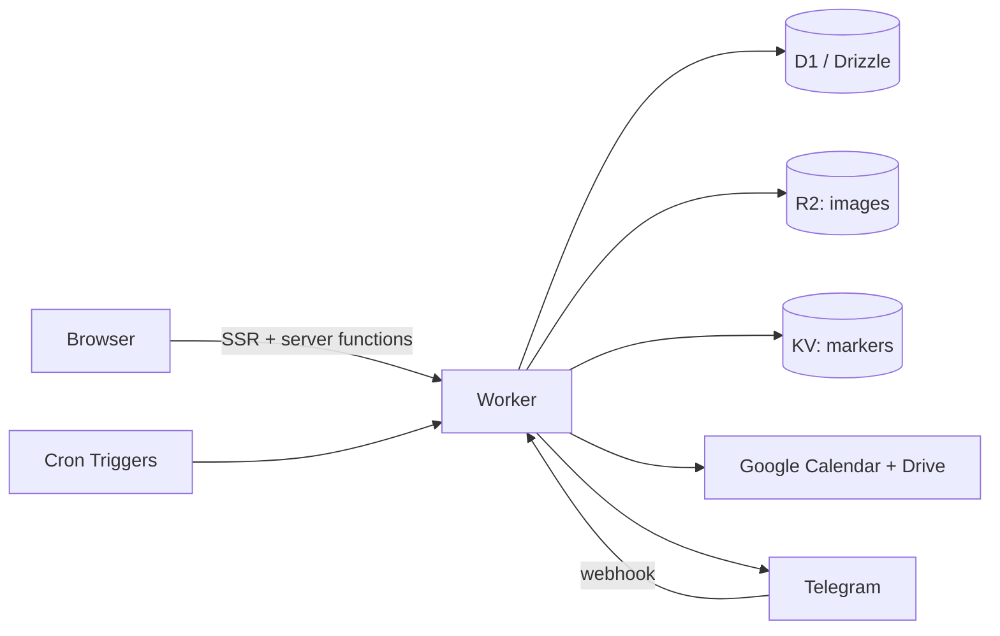

<div align="center">
  

# MerikSirat

**Equipment booking and photo albums for NU Image, the photography club at Nazarbayev University.**

[Features](#features) · [Architecture](#architecture) · [Flamekeepers](#flamekeepers) · [Getting started](#getting-started) · [Deployment](#deployment) · [Documentation](#documentation)


</div>

MerikSirat lets club members book cameras, lenses and other gear, pick it up and return it through a Telegram bot, and share event photo albums. Admins manage equipment, members and storage. The whole app runs on Cloudflare Workers, with server-side rendering done inside the Worker.

## Features

**Members**

- Browse the equipment catalog with live availability, backed by Google Calendar free/busy data.
- Book several items in one booking, each with its own time slot. Extend by 30 minutes when there is no conflict.
- Confirm pickup within a 15-minute window and return items, fully or partially, through the Telegram bot.
- Get Telegram reminders for upcoming pickups and returns.
- Upload, browse and favorite photo albums stored in Google Drive.
- Optionally become a [flamekeeper](#flamekeepers) by pledging spare Google Drive space to the club (`@nu.edu.kz` accounts only).

**Admins**

- Dashboard with bookings, equipment usage and system statistics.
- Equipment management with categories, bulk edit and clearance levels for high-end gear.
- Member management: roles, status (Active, Inactive, Alumni), clearance, birthdays, violations and bans.
- Booking oversight: overdue items, no-shows and conflicts.
- Album and storage management, including flamekeepers (members who pledge spare Google Drive space) and scheduled deletion.
- Settings for operating hours, booking limits and notifications.

> [!NOTE]
> Sign-up is limited to `@nu.edu.kz` and `@alumni.nu.edu.kz` Google accounts. Terms like _flamekeeper_, _buffer_ and _volume_ are defined in the [glossary](GLOSSARY.md).

## Architecture



| Layer          | Technology                                                    |
| -------------- | ------------------------------------------------------------- |
| Frontend       | React 19, TanStack Start, Router and Query                    |
| UI             | Tailwind CSS v4, shadcn/ui, Radix UI                          |
| Runtime        | Cloudflare Workers (`server.ts`), Smart Placement             |
| Data           | D1 (SQLite) with Drizzle ORM, R2 for images, KV for markers   |
| Auth           | Better Auth with Google OAuth                                 |
| Integrations   | Google Calendar and Drive APIs, Telegram Bot API              |
| Rate limiting  | Workers native rate limit bindings                            |
| Scheduled work | Three Cron Triggers: every 5 minutes, hourly, daily 03:00 UTC |

Photos live in Google Drive rather than R2. New uploads go to a club-run **buffer** account; see [Flamekeepers](#flamekeepers) for the reserve storage and [ADR-0015](docs/adr/0015-buffer-is-stable-photo-storage.md) for the design.

## Flamekeepers

A flamekeeper is an `@nu.edu.kz` user who pledges optional reserve storage from their own Google Drive to the club. Pledges are at least 512 MB and cap what the app may use; no space is set aside in Google. Flamekeeping is separate from club membership ([ADR-0011](docs/adr/0011-membership-and-flamekeeping-are-separate.md)).

- **Nothing is held at sign-up.** Uploads always go to the buffer and never to a flamekeeper. A flamekeeper holds photos only after an admin runs **Move to Flamekeepers**, which relays them through the admin's browser into the flamekeeper's Drive.
- **The pool.** Free pledged space across active flamekeepers. The hourly `maintainPool` step marks each flamekeeper Active or Full and alerts admins when usage reaches the "% used" setting (default 90).
- **Leaving is safe.** When a flamekeeper stops, graduates, changes email domain or is banned, they end at once if they hold nothing. Otherwise they are **Draining** while the hourly `drainFlamekeepers` step copies their photos back to the buffer. The same step rescues the photos of a **Lost** flamekeeper (one whose Drive access can no longer be refreshed).
- **Statuses** shown to admins: Active, Full, Draining, Lost, Stopped, Banned. They are system-managed and read-only.

> [!NOTE]
> A flamekeeper's access is a `drive.file`-only token stored apart from their login ([ADR-0013](docs/adr/0013-drive-grant-stored-apart-from-login.md)). There is no backup copy of a photo while it sits with a flamekeeper, and a full buffer pauses a drain rather than deleting anything.

Scenarios: [admin](docs/scenarios/admin/flamekeepers/list.md), [flamekeeper](docs/scenarios/flamekeeper/onboarding/become-flamekeeper.md) and [offload and storage](docs/scenarios/admin/albums/storage.md).

## Getting started

### Prerequisites

- Node.js 18+ and npm
- A Cloudflare account (for `wrangler`)
- A Google Cloud project with the Calendar and Drive APIs enabled and an OAuth client
- A Telegram bot token (optional locally, see below)

### Run locally

```bash
npm install
cp .env.example .env   # fill in the values
npm run dev
```

`npm run dev` applies local D1 migrations, builds, and starts `wrangler dev` on <http://localhost:3000>.

> [!TIP]
> Set `DEV=true` in `.env` to skip the Telegram onboarding step locally.

To try admin features, sign in once, then promote your user:

```bash
npx wrangler d1 execute meriksirat_d1 --local \
  --command "update user set role='admin' where email='you@example.com';"
```

### Environment

[`.env.example`](.env.example) is the canonical list of keys. Production reads bindings from [`wrangler.jsonc`](wrangler.jsonc); secrets are set with `wrangler secret put`.

### Connecting the buffer account

Album uploads fail with "Photo storage is not available right now" until an admin connects the buffer, a Google account used as stable photo storage. The app stores its refresh token encrypted in D1 (`buffer_grant`) and never sends it to the browser ([ADR-0021](docs/adr/0021-buffer-account-is-a-stored-grant.md)).

1. In Google Cloud Console, make sure the OAuth consent screen allows the buffer account (add it as a test user in Testing mode) and that `<your origin>/api/buffer/callback` is an authorized redirect URI, for example `http://localhost:3000/api/buffer/callback`.
2. Set `BUFFER_ENCRYPTION_KEY` (`openssl rand -base64 32`) in `.env`, and in production with `wrangler secret put BUFFER_ENCRYPTION_KEY`.
3. Sign in as an admin, open **Settings > Storage**, press **Connect**, pick the buffer account and allow full Drive access.

To change the buffer later, connect a different account. Albums are copied over in the background, uploads keep using the old account until every album is copied, and the old originals are removed 7 days after the switch. Cancelling discards the copies and changes nothing.

> [!WARNING]
> Never revoke the app on the master Google account at myaccount.google.com/permissions. It shares the OAuth client with production. Minting a new master token does not revoke the old grant. Losing `BUFFER_ENCRYPTION_KEY` means reconnecting the buffer account.

## Development

| Command                                          | What it does                                            |
| ------------------------------------------------ | ------------------------------------------------------- |
| `npm run dev`                                    | Migrate locally, build, run `wrangler dev` on :3000     |
| `npm run dev:vite`                               | Vite UI shell only, without the Worker                  |
| `npm run test`                                   | Unit tests (Vitest, no database)                        |
| `npx tsc --noEmit`                               | Type check                                              |
| `npm run format`                                 | Prettier                                                |
| `npm run db:generate`                            | Generate a Drizzle migration into `migrations/`         |
| `npm run db:migrate-local` / `db:migrate-remote` | Apply migrations to the local or production D1 database |

Test the cron jobs locally with `wrangler dev --test-scheduled`, then call each schedule:

```bash
curl "http://localhost:3000/cdn-cgi/handler/scheduled?cron=0+*+*+*+*"
```

> [!IMPORTANT]
> Code reachable from the browser must not statically import worker-only modules (`cloudflare:workers`, `@/db`, `drizzle-orm`, `@/lib/auth/auth`). Import them inside server function handlers with `await import(...)`. After a build, `rg -c "cloudflare:workers" dist/client/assets/` should report nothing. See [ADR-0003](docs/adr/0003-lazy-import-worker-only-modules.md) and [AGENTS.md](AGENTS.md).

## Deployment

```bash
npm run db:migrate-remote
npm run deploy
```

## Documentation

- [Glossary](GLOSSARY.md): the domain vocabulary used across code and docs
- [ADRs](docs/adr/): architectural decisions
- [Scenarios](docs/scenarios/README.md): behavior by role (anonymous, member, flamekeeper, admin), cron jobs, KV usage and the database ERD
- [FAQ](docs/faq.md), [Terms of Service](docs/terms-of-service.md) and [Privacy Policy](docs/privacy-policy.md)
- [AGENTS.md](AGENTS.md): conventions for contributors and coding agents
