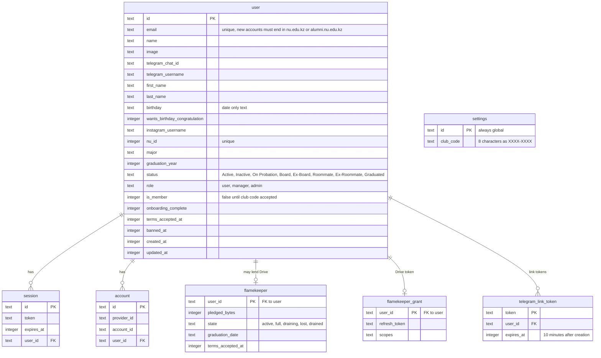
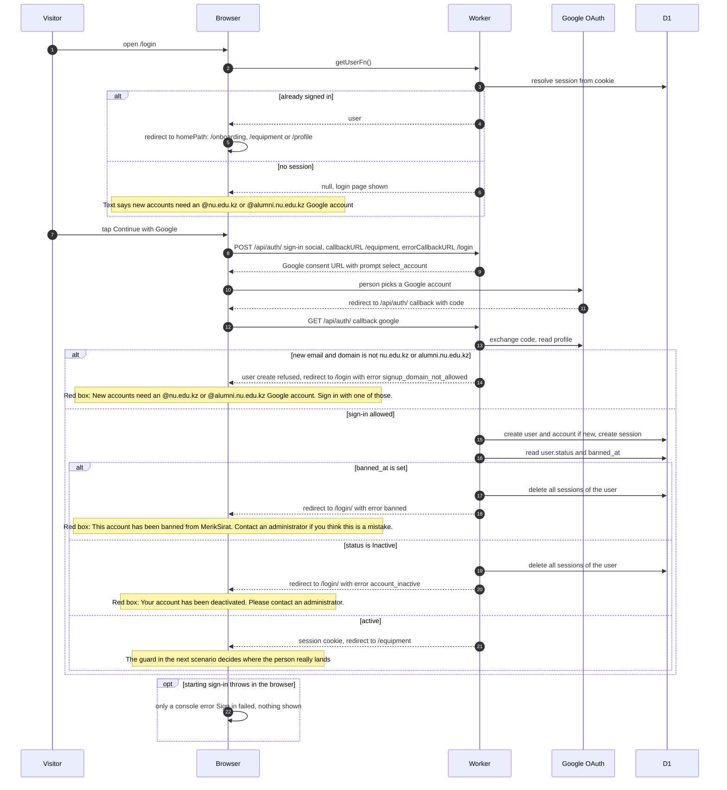
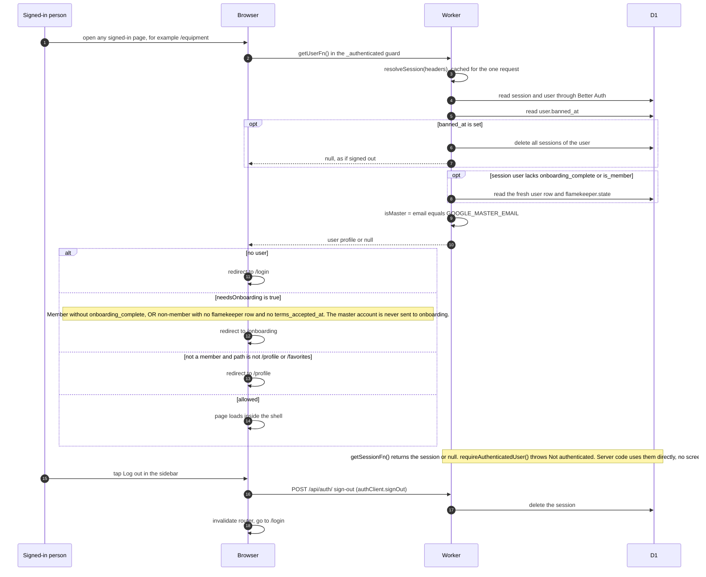
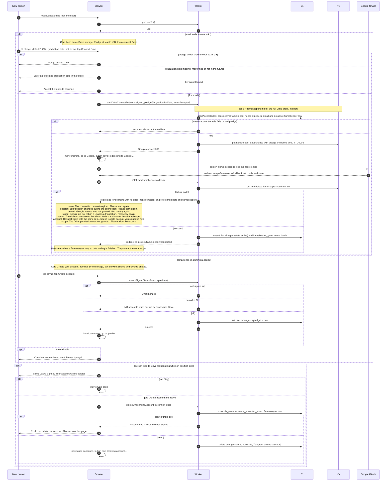
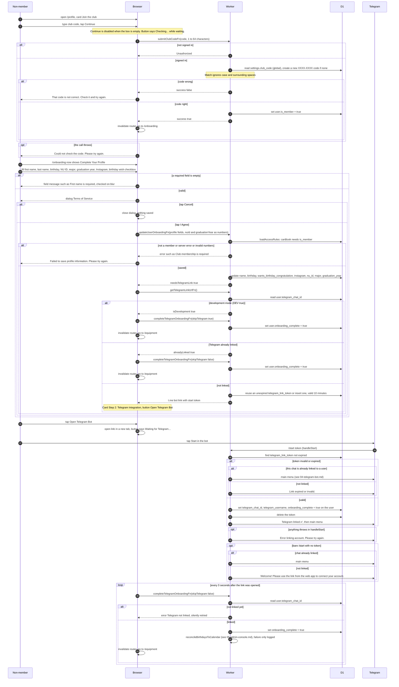
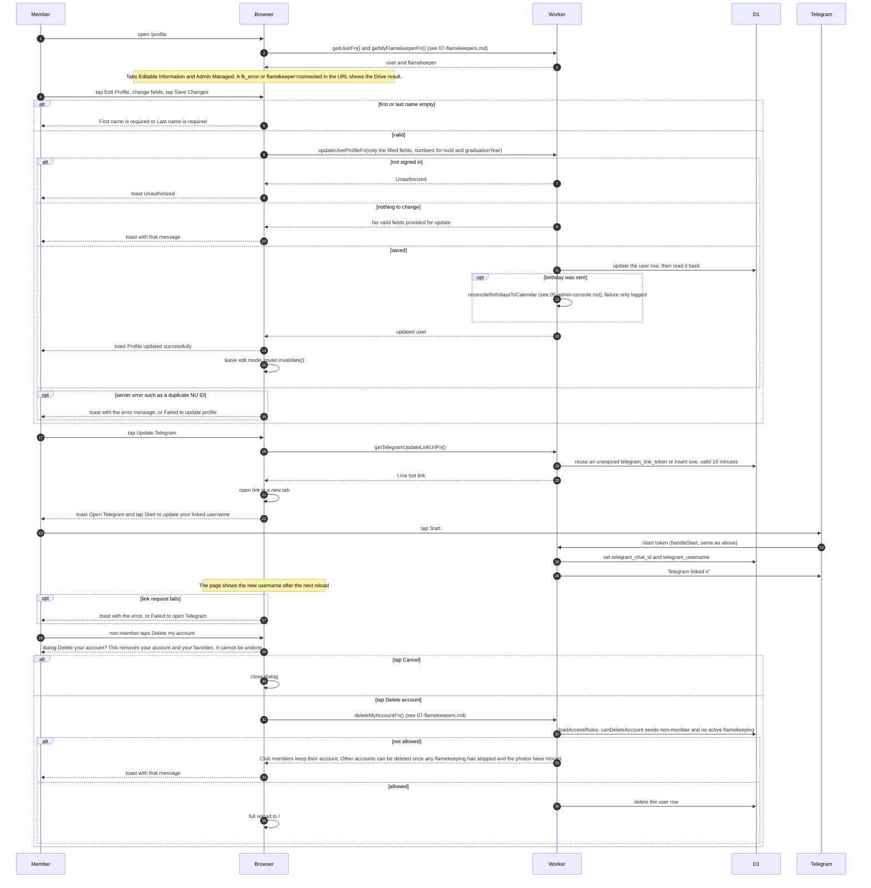
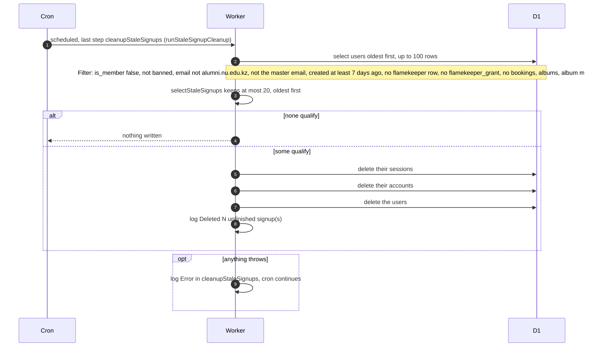

# Sign-in, Onboarding and Profile

How a person signs in with Google, finishes signing up (NU accounts by lending Drive space, alumni by accepting terms, club members by entering the club code and filling in their details), links Telegram, and edits their own profile. Triggered by the person in the browser, plus the 5-minute cron that removes abandoned signups.

## Data

KV holds `flamekeeper-oauth:{nonce}` for 600 seconds (the pending Drive pledge, written when the person starts connecting Drive). Telegram link tokens live in D1, not KV.

## Signing in with Google

A visitor opens the login page and taps Continue with Google. Better Auth allows 100 requests per 60 seconds on the auth routes. Brand new accounts must use an NU or alumni address. Existing accounts of any address can still sign in.

## Entering the app: guard, session and sign-out

Every page under the signed-in area runs the same check before it loads. This diagram also covers the helpers that read the session.

## Creating an account (NU Drive pledge, alumni terms, leaving)

A new person lands on /onboarding. The route sends a signed-out visitor to /login and an already finished person to their home path. A member sees the profile step instead (see the next scenario). While on this first step, leaving the page means the new account is deleted.

## Joining the club and finishing the member profile

A non-member (Drive lender or alumni) opens their profile, enters the club code, then completes name, NU ID and other details, accepts the terms dialog and links Telegram. The club code is one row in `settings` and is created on first use if missing.

## Editing your own profile

Members edit their details and re-link Telegram from /profile. Non-members can delete their account from the same page. The profile page loads the user with getUserFn and the flamekeeper record with getMyFlamekeeperFn. None of these actions invalidate a query key, they call router.invalidate().

## Cleaning up abandoned signups

Every 5 minutes the cron removes accounts that signed in but never finished signing up.

