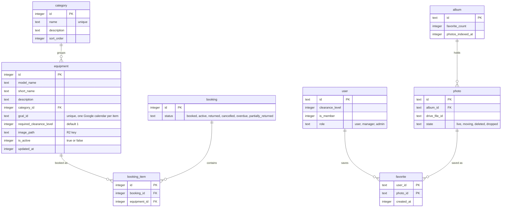
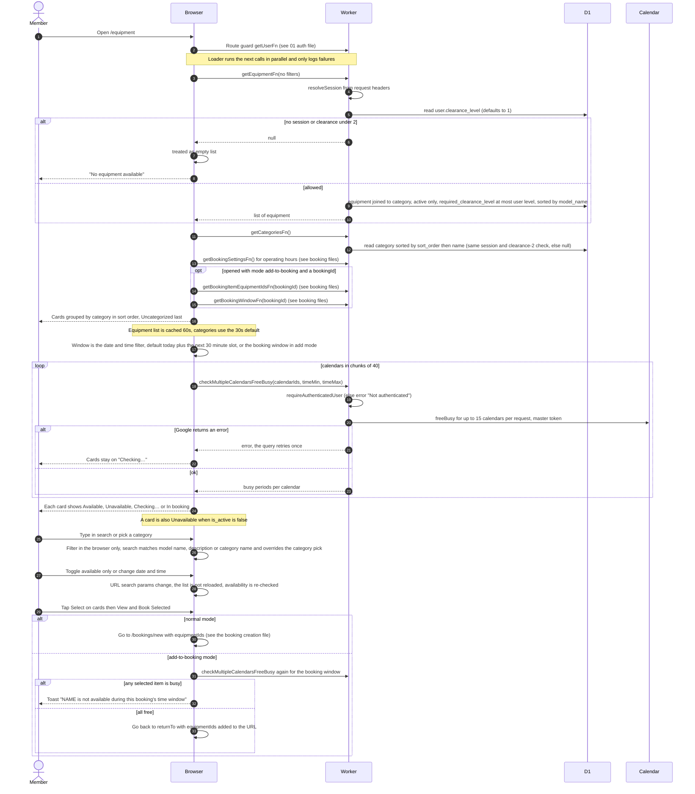
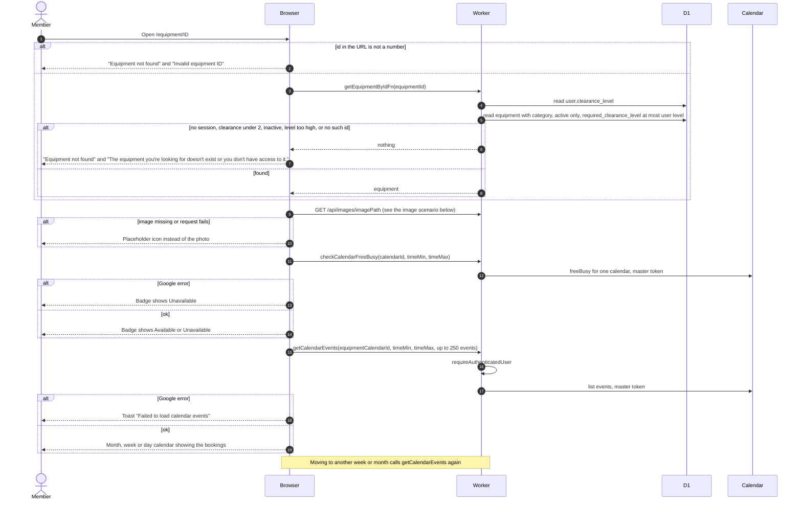
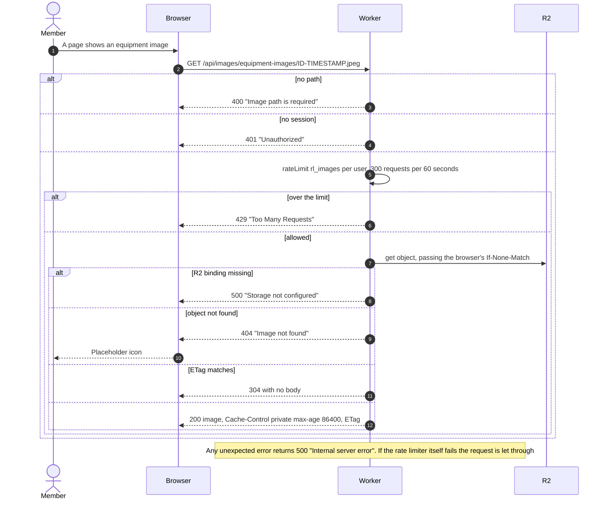
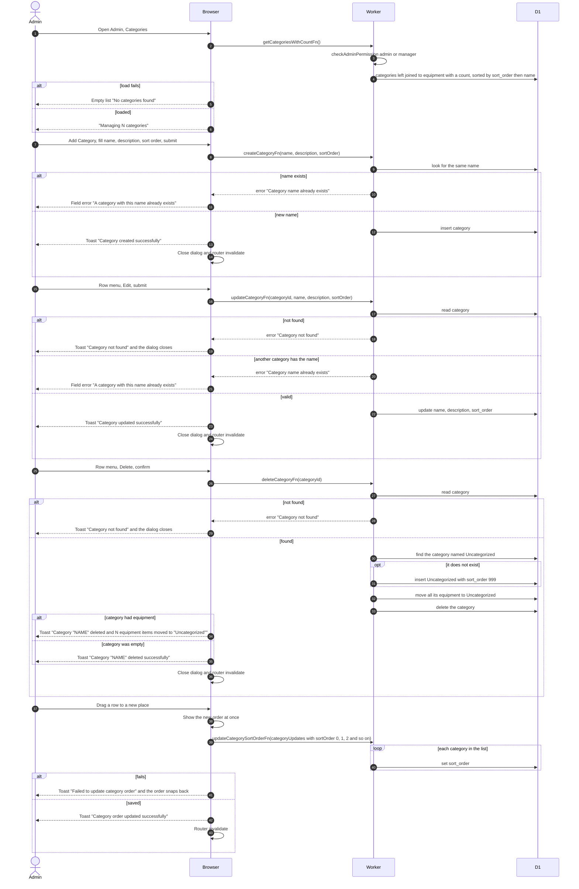
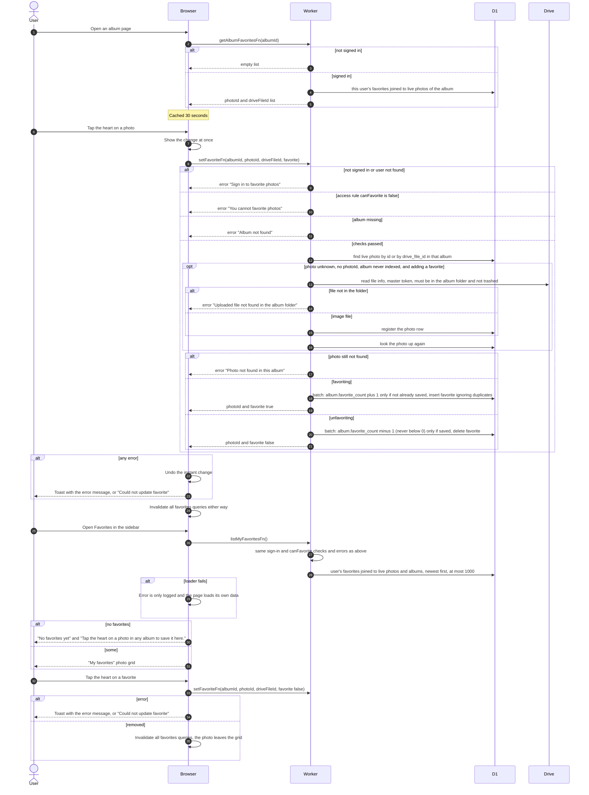

# Equipment catalog, admin equipment and favorites

This covers how members browse and inspect equipment, how admins and managers manage equipment and categories (including images), how equipment images are served, and how any signed-in user saves favorite photos. The landing page `/` loads nothing and only redirects to `/albums`.

## Data

R2 holds equipment images under the key `equipment-images/{equipmentId}-{timestamp ms}.{jpeg, png or webp}`. Nothing ever deletes or expires these objects.

## Browsing the catalog and checking availability

A member opens Equipment in the sidebar. Only users with clearance level 2 or higher see anything. Free/busy results come from each equipment's own Google Calendar, read with the master Google token (cached in the Worker for about 50 minutes).

## Opening one piece of equipment

The member taps Details on a card. The page shows the photo, details, an availability badge and the equipment's calendar.

## Serving equipment images

Every image on the catalog, detail page and admin table is requested by the browser as `/api/images/{imagePath}`. Images are private and the browser reuses them for one day.

## Admin: managing equipment

Admins and managers open Admin, Equipment. Every admin function first runs `checkAdminPermission` for the roles admin and manager. Any other role cannot open the admin pages (error "Page not found"), and a direct call fails with "Unauthorized: No session" or "Insufficient permissions". Creating equipment does not create a Google calendar: the admin pastes the ID of a calendar that already exists.

```mermaid
sequenceDiagram
    autonumber
    actor Admin
    participant Browser
    participant Worker
    participant D1
    participant R2

    Admin->>Browser: Open Admin, Equipment
    Browser->>Worker: getAdminEquipmentFn(filters, page, limit)
    Worker->>D1: count and list all equipment (any level, any active state), default 50 per page, at most 100
    Browser->>Worker: getCategoriesFn()
    Browser-->>Admin: Table with filters in the URL and "Managing N equipment items"

    Admin->>Browser: Tick rows then Edit Clearance
    Browser->>Browser: Dialog "Bulk Edit Clearance Level" with levels 1 to 10
    Admin->>Browser: Update All
    Browser->>Worker: bulkUpdateEquipmentClearanceFn(equipmentIds, requiredClearanceLevel)
    alt no ids
        Worker-->>Browser: error "No equipment IDs provided"
        Browser-->>Admin: Toast "Failed to update equipment"
    else ok
        Worker->>D1: set required_clearance_level on all chosen rows
        Browser-->>Admin: Toast "Updated clearance level for N equipment item(s)"
        Browser->>Browser: Clear selection and invalidate equipment admin-list queries
    end

    Admin->>Browser: Add Equipment
    Browser->>Worker: getCategoriesFn()
    Admin->>Browser: Choose an image and fill the form
    alt file is not JPEG, PNG or WebP
        Browser-->>Admin: "Invalid file type. Only JPEG, PNG, and WebP images are allowed."
    else file over 5 MB
        Browser-->>Admin: "File size too large. Maximum size is 5MB."
    end
    Admin->>Browser: Create Equipment
    alt form invalid
        Browser-->>Admin: "Model name is required", "Category is required", "Google Calendar ID is required" or clearance outside 1 to 10
    else form valid
        Browser->>Worker: createEquipmentAdminFn(modelName, shortName, description, categoryId, googleCalendarId, requiredClearanceLevel)
        Worker->>D1: look for equipment with the same gcal_id
        alt calendar already used
            Worker-->>Browser: error "Google Calendar ID already exists. Each equipment must have a unique calendar."
            Browser-->>Admin: Red alert with that message
        else calendar is new
            Worker->>D1: check the category exists
            alt category missing
                Worker-->>Browser: error "Selected category does not exist"
                Browser-->>Admin: Red alert with that message
            else category found
                Worker->>D1: insert equipment with is_active true, return id
                Worker-->>Browser: equipmentId
                opt an image was chosen
                    Browser->>Browser: Read the file as a base64 data URL
                    Browser->>Worker: uploadEquipmentImageFn(equipmentId, imageData, contentType, fileName)
                    Note over Worker: Same steps as the upload in the edit part below
                    alt upload fails
                        Browser-->>Admin: "Equipment created successfully, but image upload failed. You can add an image later by editing the equipment."
                    end
                end
                Browser-->>Admin: Green alert "Equipment "NAME" created successfully!" plus " Image uploaded." if it worked
                Browser->>Browser: After 1.5 seconds go to /admin/equipment
            end
        end
    end

    Admin->>Browser: Click a table row
    Browser->>Worker: getAdminEquipmentByIdFn(equipmentId)
    Worker->>D1: read equipment with category, any level or state
    Browser->>Worker: getCategoriesFn()
    alt equipment not found or load fails
        Browser-->>Admin: Error "Failed to load equipment data"
    end
    Admin->>Browser: Change fields, active switch, optional new image, then Save Changes
    Browser->>Worker: updateEquipmentAdminFn(equipmentId and changed fields including isActive)
    Worker->>D1: read equipment
    alt not found
        Worker-->>Browser: error "Equipment not found"
    else new gcal_id used by another item
        Worker-->>Browser: error "Google Calendar ID already exists. Each equipment must have a unique calendar."
    else category missing
        Worker-->>Browser: error "Selected category does not exist"
    else valid
        Worker->>D1: update only the provided fields
        Worker-->>Browser: success
    end
    opt save succeeded and a new image was chosen
        Browser->>Worker: uploadEquipmentImageFn(equipmentId, imageData, contentType, fileName)
        alt content type not image/jpeg, image/jpg, image/png or image/webp
            Worker-->>Browser: error "Invalid file type. Only JPEG, PNG, and WebP images are allowed."
        else decoded size over 5 MB
            Worker-->>Browser: error "File size too large. Maximum size is 5MB."
        else equipment missing
            Worker-->>Browser: error "Equipment not found"
        else valid
            Worker->>R2: put equipment-images/ID-TIMESTAMP.ext with its content type
            alt R2 fails
                Worker-->>Browser: error "Failed to upload image: REASON"
            else stored
                Worker->>D1: set equipment.image_path to the new key and updated_at
                Worker-->>Browser: imagePath and "Image uploaded successfully"
            end
        end
    end
    alt save failed
        Browser-->>Admin: Red alert with the error message
    else saved and image uploaded
        Browser-->>Admin: Green alert "Equipment "NAME" updated successfully with new image!"
    else saved but image failed
        Browser-->>Admin: Green alert "Equipment "NAME" updated successfully, but image upload failed. You can try uploading the image again."
    else saved with no image chosen
        Browser-->>Admin: Green alert "Equipment "NAME" updated successfully!"
    end
    Browser->>Browser: After 1.5 seconds go to /admin/equipment

    Admin->>Browser: Delete Equipment
    Browser->>Browser: Confirm dialog "Are you sure you want to delete NAME?"
    Admin->>Browser: Confirm
    Browser->>Worker: deleteEquipmentAdminFn(equipmentId)
    Worker->>D1: read equipment
    alt not found
        Worker-->>Browser: error "Equipment not found"
        Browser-->>Admin: Red alert with that message
    else found
        Worker->>D1: count booking_item rows whose booking is booked, active, overdue or partially_returned
        alt one or more
            Worker->>D1: set is_active false and updated_at
            Worker-->>Browser: action deactivated
            Browser-->>Admin: "Equipment "NAME" has been marked as inactive due to active bookings. It will no longer be available for new bookings."
            Browser->>Browser: After 2 seconds go to /admin/equipment
        else none
            Worker->>D1: delete the equipment row
            Worker-->>Browser: action deleted
            Browser-->>Admin: "Equipment "NAME" has been permanently deleted."
            Browser->>Browser: After 1.5 seconds go to /admin/equipment
        end
    end
    Note over Worker,R2: Deleting or replacing never removes old images from R2 and never touches the Google calendar
```

## Admin: managing categories

Admins and managers open Admin, Categories. Rows can be reordered by drag and drop. After every change the page data is refreshed with a router invalidate.

## Favoriting photos and the favorites page

Any signed-in user, member or not, can heart photos in an album and see them under Favorites. Albums themselves are covered in other files.

