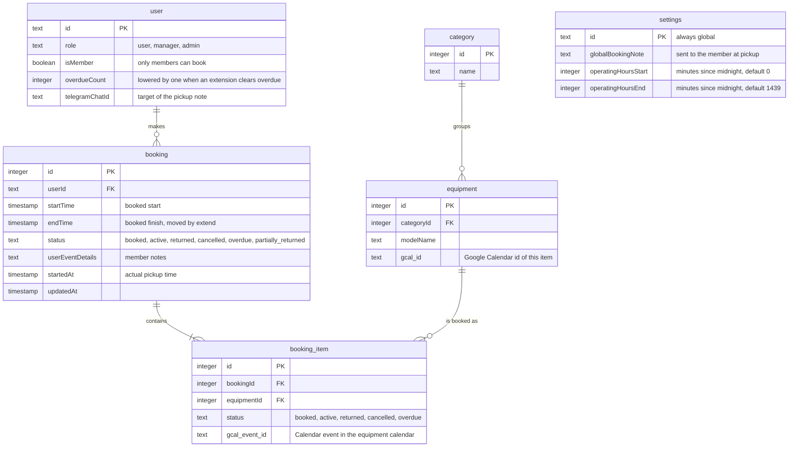
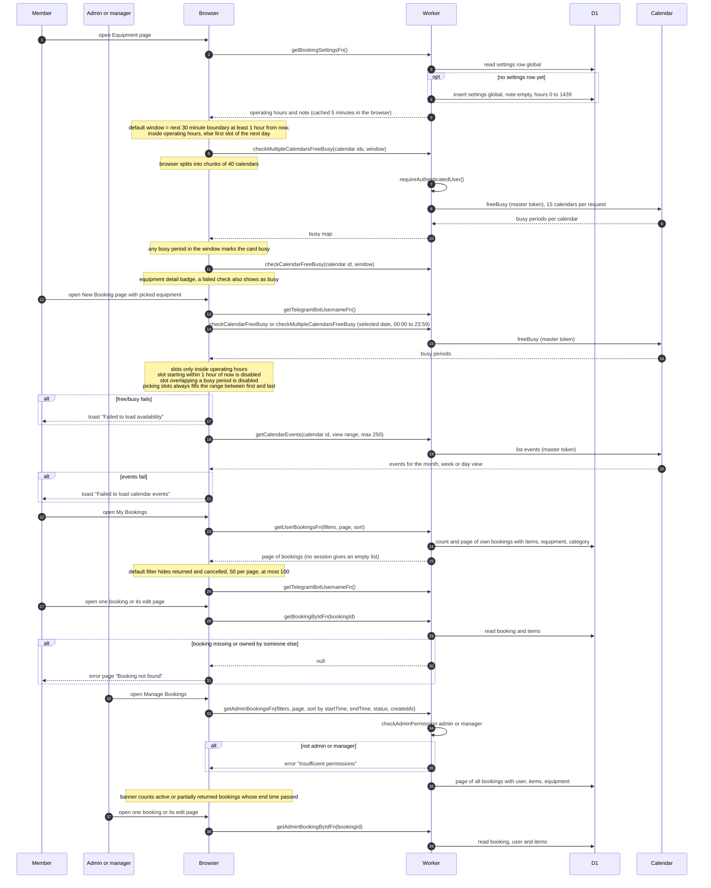
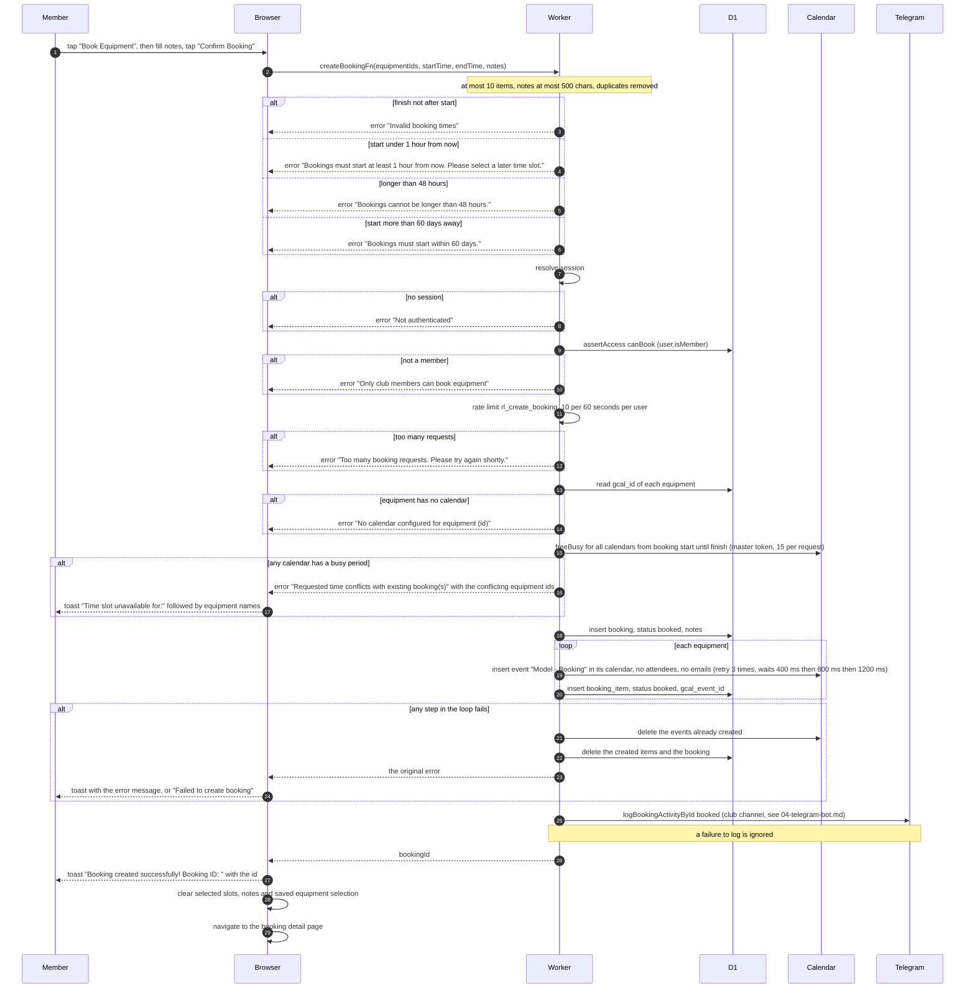
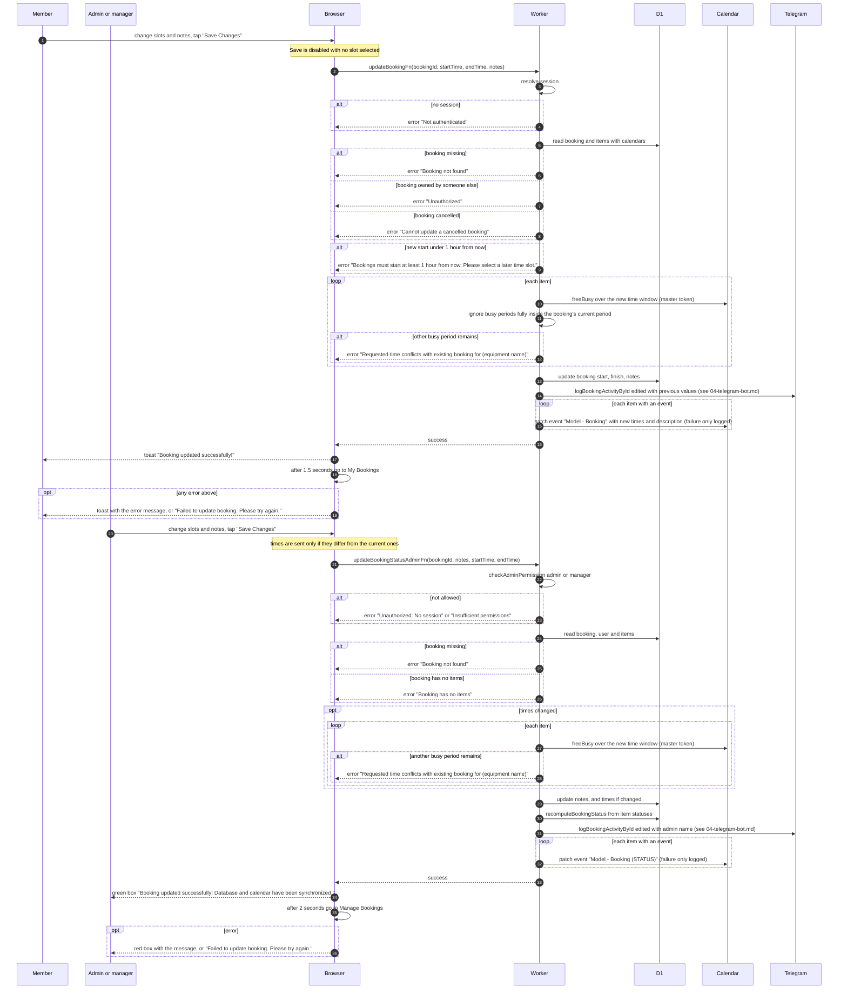
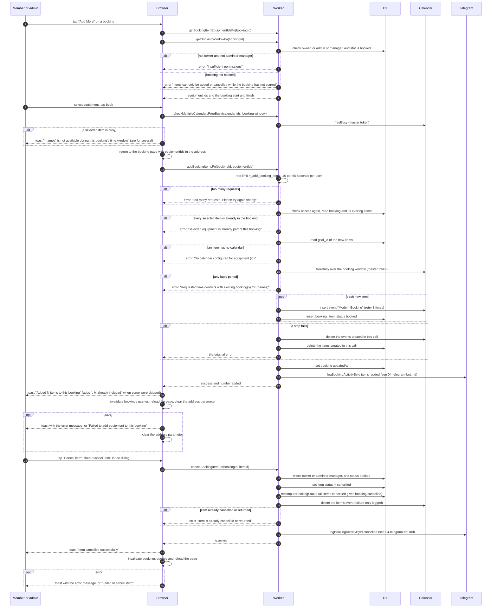
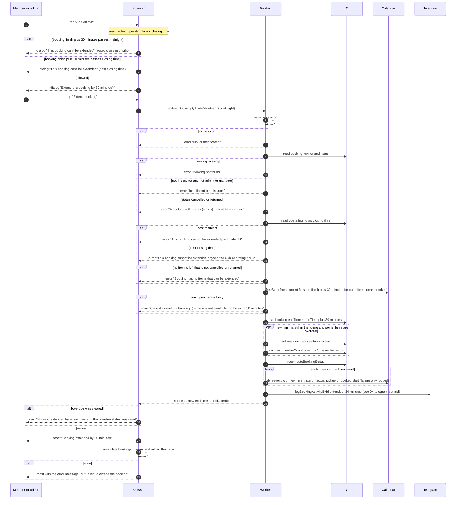
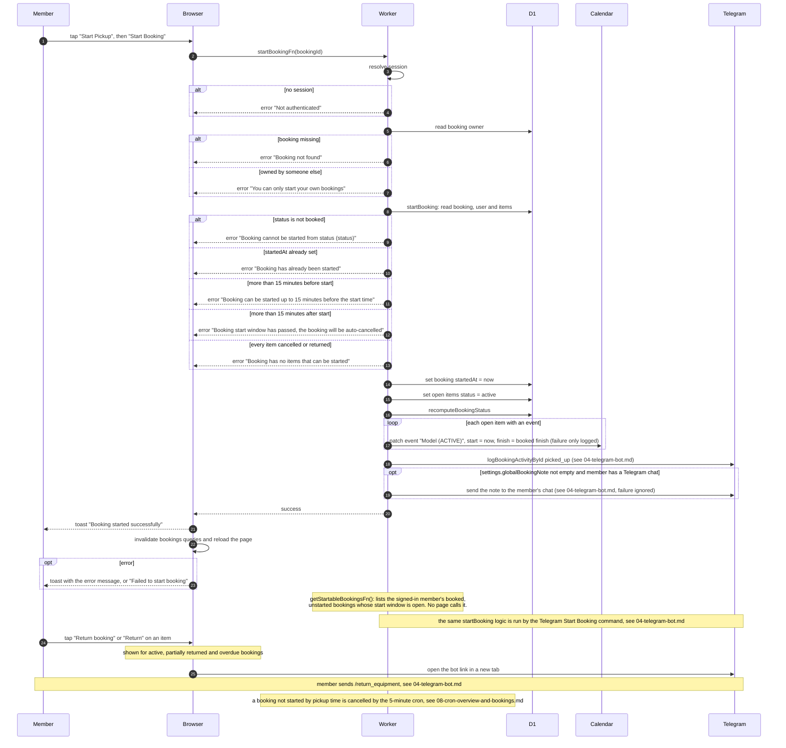
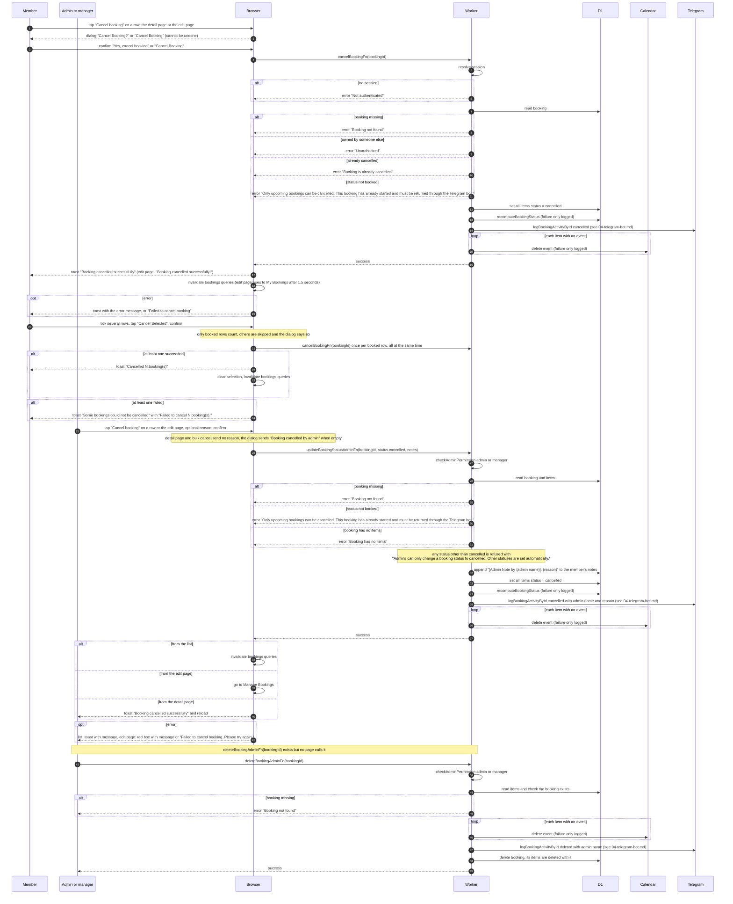
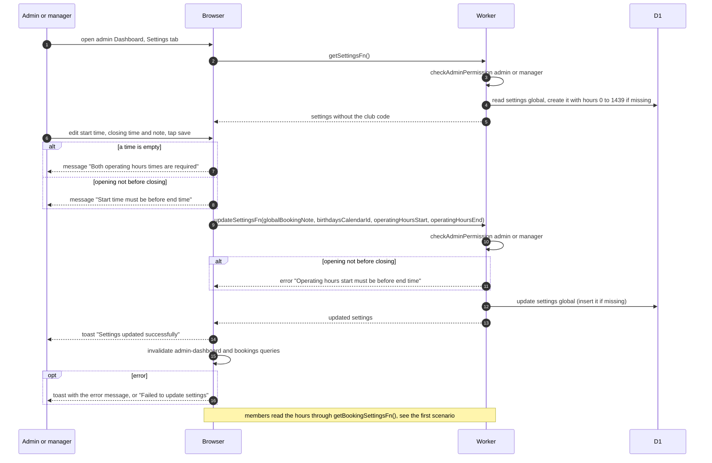

# Bookings

How a booking lives on the website for members and for admins or managers: finding free equipment, creating, editing, extending, starting pickup, cancelling, adding or cancelling single items, the admin booking pages, and the operating-hours settings. Returns happen only in Telegram. Automatic cancel, overdue and reminders are cron jobs.

## Data

Equipment availability is never stored in D1. It is read live from one Google Calendar per equipment (`equipment.gcal_id`). Every Calendar call uses the club master Google token. The token is cached in Worker memory for 50 minutes and is refreshed from Google OAuth when the cache is empty or old. Rate limits use Cloudflare's rate limit binding (not KV and not D1).

## Loading pages and checking availability

Opening the equipment page, the new booking page, the booking lists and the booking detail pages. All times are club time (Asia/Almaty, UTC+5). A booking is one single day, starts at least 1 hour from now, is at most 48 hours long and starts within 60 days.

## Creating a booking

The member picks equipment on the Equipment page, taps Book, then picks a date and slots on New Booking. Event details are required in the confirm dialog (the Confirm Booking button stays disabled while the notes are empty).

## Editing a booking

Only bookings with status booked show the edit screen. Members save from `/bookings/:id/edit`, admins and managers from `/admin/bookings/:id/edit`. The slot picker starts on the booking's current day and slots, and does not treat the booking's own calendar event as busy.

## Adding and cancelling single items

"Add More" on a booked booking opens the Equipment page in add-to-booking mode. Items already in the booking are marked, and availability is checked for the booking's own time window. Cancel item is shown only while the booking is booked. Both work for the owner, and for admins and managers.

## Extending a booking by 30 minutes

"Add 30 min" shows for booked, active, partially returned and overdue bookings, on list rows, detail pages and edit pages, for the owner and for admins and managers.

## Starting pickup and returning

"Start Pickup" is on the booking detail page of the owner only. The button shows only while the booking is booked, not started, and now is within 15 minutes before or after the start time. Admins have no start button. Returns are not on the website. The "Return" links open the Telegram bot.

## Cancelling and deleting bookings

Members can cancel only their own booked bookings. Admins and managers can cancel any booked booking. Once a booking has started it can only be returned through Telegram.

## Booking settings and operating hours

Admins and managers set the club's opening and closing time and the note sent to members at pickup. The hours limit which slots the picker offers, where "Add 30 min" stops, and the default window used for availability.

