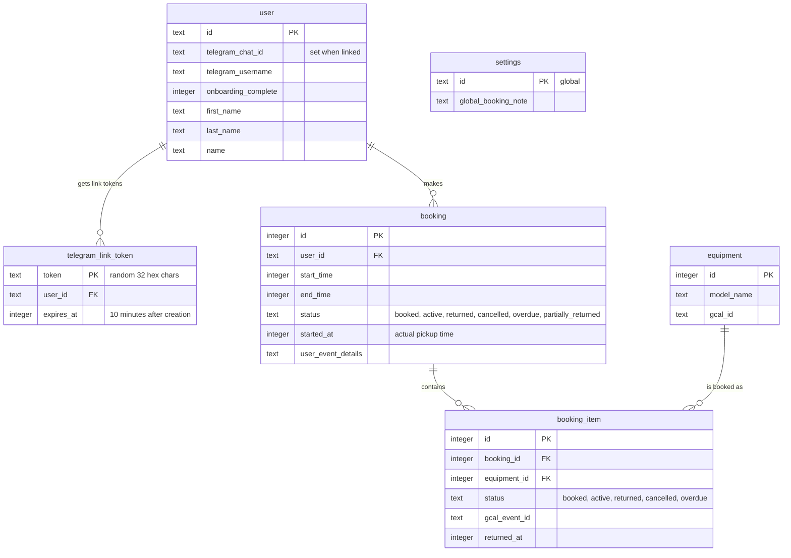
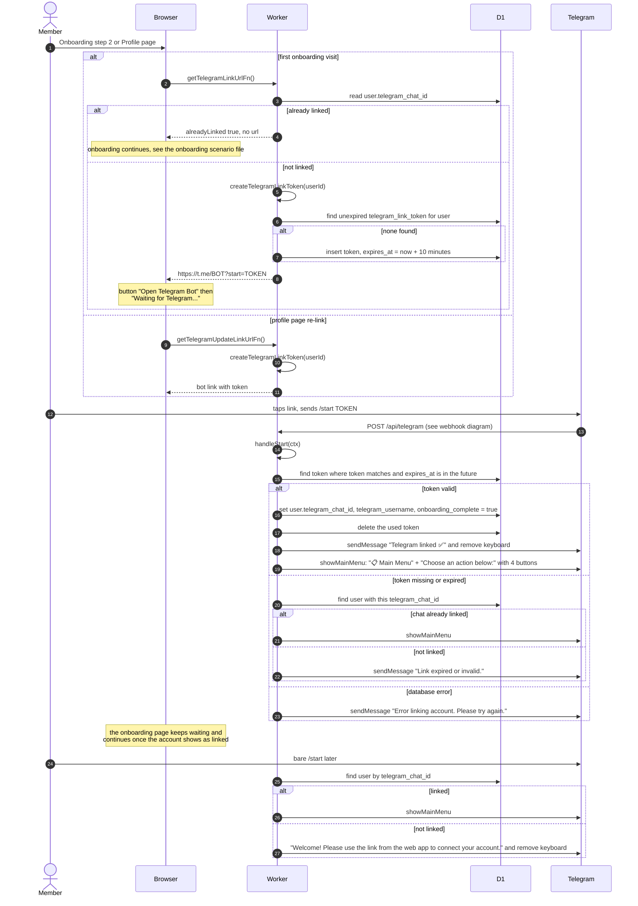
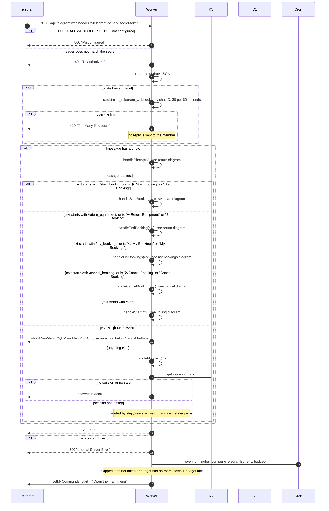
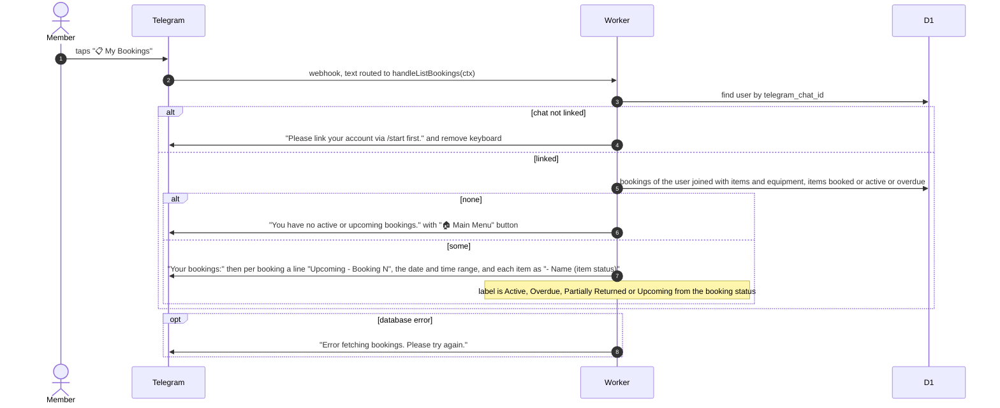
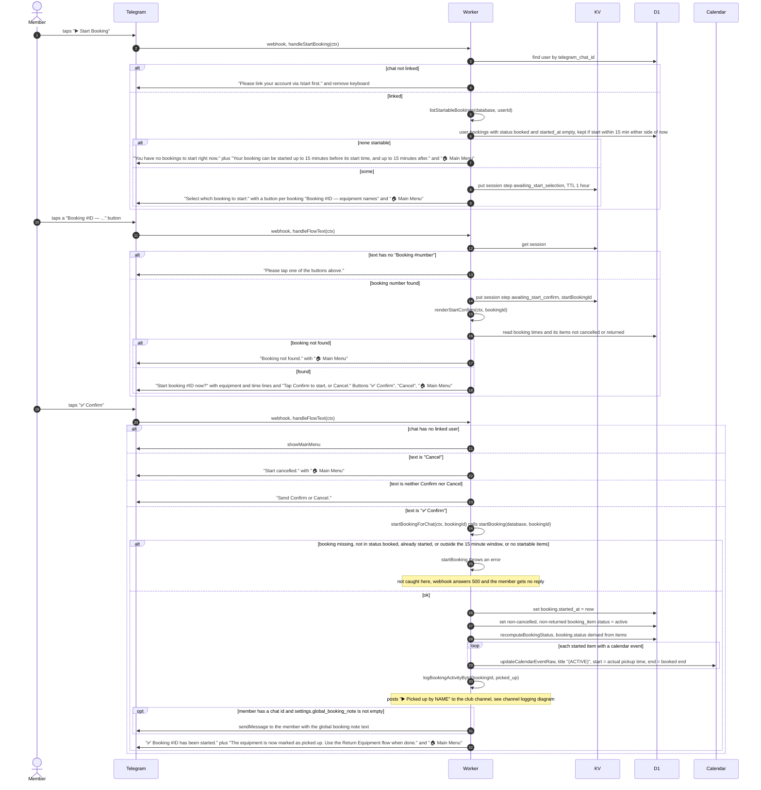
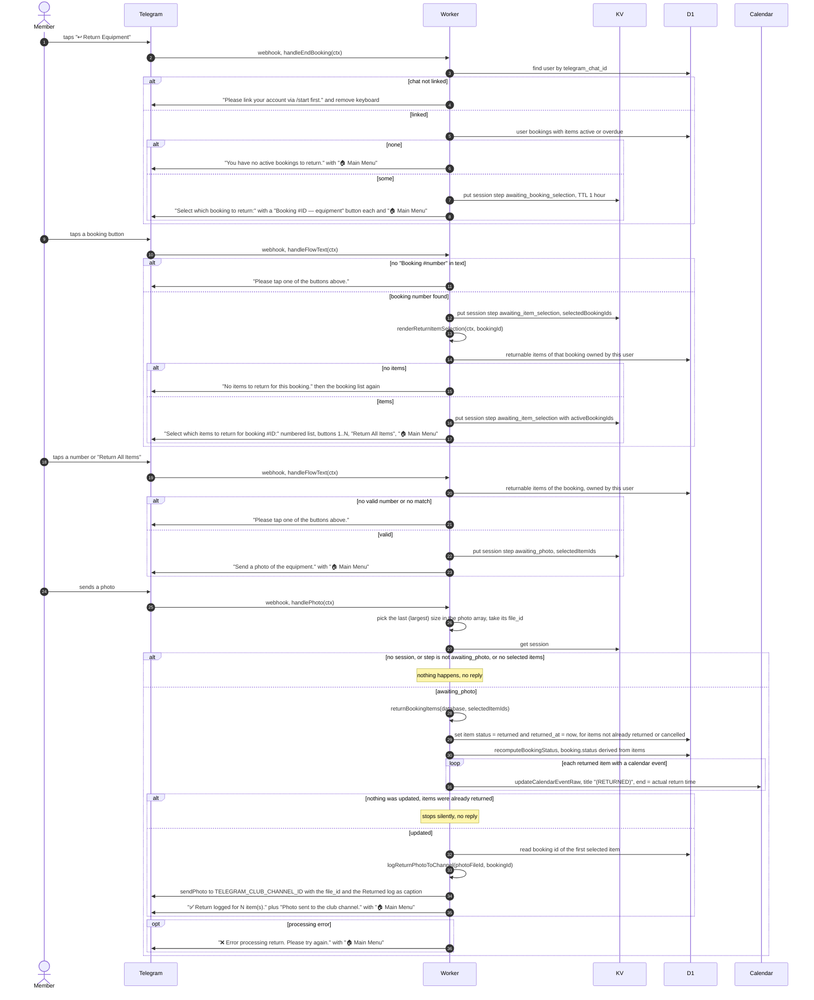
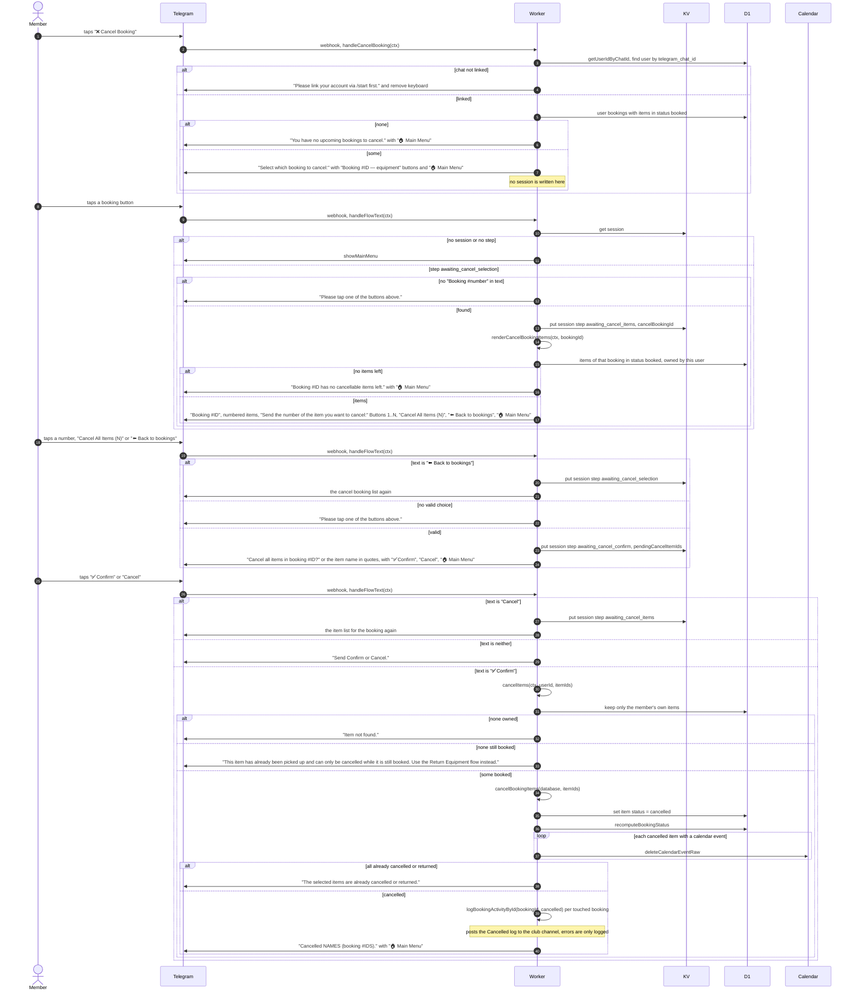
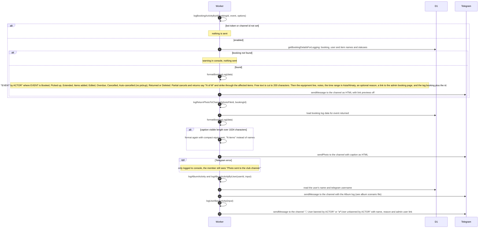

# Telegram Bot

Everything a member does by chatting with the club bot: linking a Telegram account, listing bookings, picking up equipment, returning it with a photo, and cancelling. Telegram calls the webhook on every message. The bot also posts activity logs to the club channel.

## Data

Bot sessions live in KV under the key `session:{telegramChatId}` as JSON, with a 1 hour TTL (`expirationTtl` 3600). Every write refreshes the TTL. Fields: `step`, `userId`, `activeBookingIds`, `selectedBookingIds`, `selectedItemIds`, `startBookingId`, `cancelBookingId`, `pendingCancelItemIds`, `createdAt`. Steps: `awaiting_booking_selection`, `awaiting_item_selection`, `awaiting_photo`, `awaiting_start_selection`, `awaiting_start_confirm`, `awaiting_cancel_selection`, `awaiting_cancel_items`, `awaiting_cancel_confirm`. Return photos are never stored in R2 or D1. Only the Telegram `file_id` is forwarded to the club channel.

## Linking a Telegram account

The member creates the link on the web (onboarding step 2 or the profile page), then taps it in Telegram. The link is valid for 10 minutes. A valid unexpired token for the same user is reused instead of making a new one.

## Webhook, checks and message routing

Telegram sends every update to the webhook. The bot is driven by a persistent reply keyboard, so each tap arrives as a plain text message. There are no inline buttons: an update that is a `callback_query` is rate limited and then ignored. Every 5-minute cron run also re-registers the bot's command list.

The four menu buttons are `📋 My Bookings`, `▶️ Start Booking`, `↩️ Return Equipment` and `❌ Cancel Booking`.

## Viewing my bookings

Triggered by `/my_bookings` or the `📋 My Bookings` button. Shows bookings that have items still `booked`, `active` or `overdue`. Times are shown in Asia/Almaty.

## Starting a booking (picking up equipment)

Only bookings with status `booked`, no `started_at`, and a start time within 15 minutes before or after now are offered. The member picks a booking, then confirms.

## Returning equipment with a photo

Triggered by `/return_equipment` or `↩️ Return Equipment`. Only items with status `active` or `overdue` can be returned, with no time filter. The photo goes to the club channel only.

## Cancelling a booking

Triggered by `/cancel_booking` or `❌ Cancel Booking`. Only items still `booked` (never picked up) can be cancelled. The cancel list step does not write a session. The next tap only continues if the session already holds step `awaiting_cancel_selection`.

## Club channel activity logs

Booking actions done through the bot post to the club channel `TELEGRAM_CLUB_CHANNEL_ID`. Logging never throws and does nothing when the bot token or channel id is missing. The same logging functions are also used by the web app and cron, which are covered in the other scenario files.

