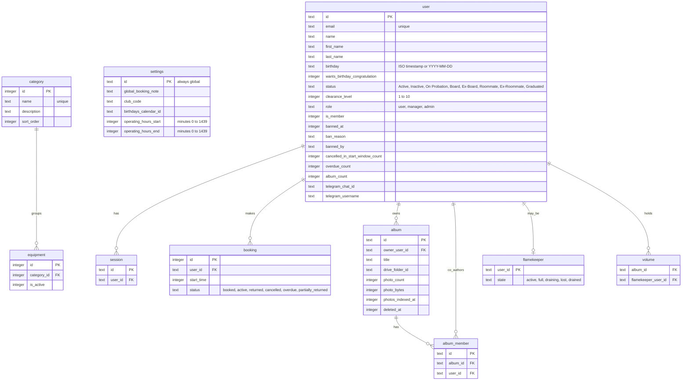
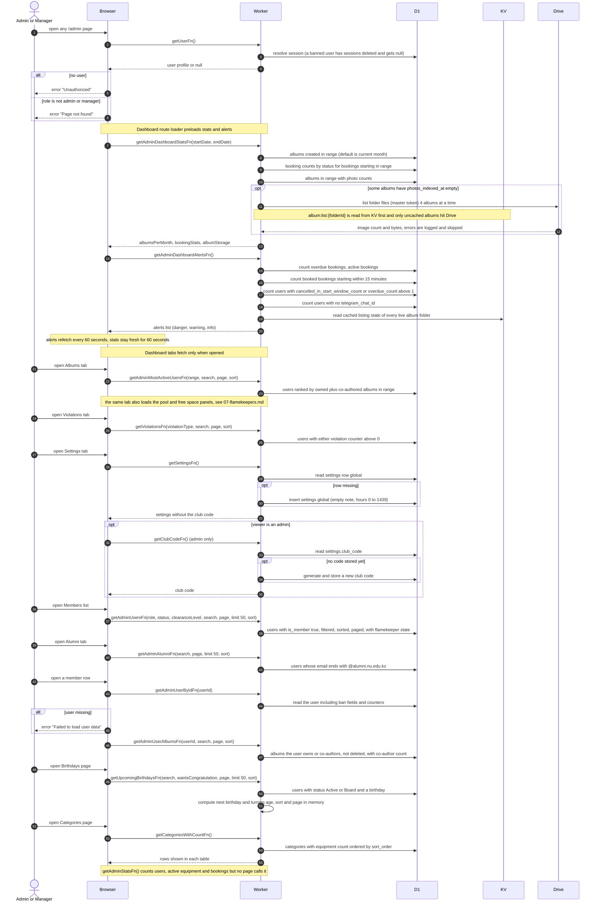
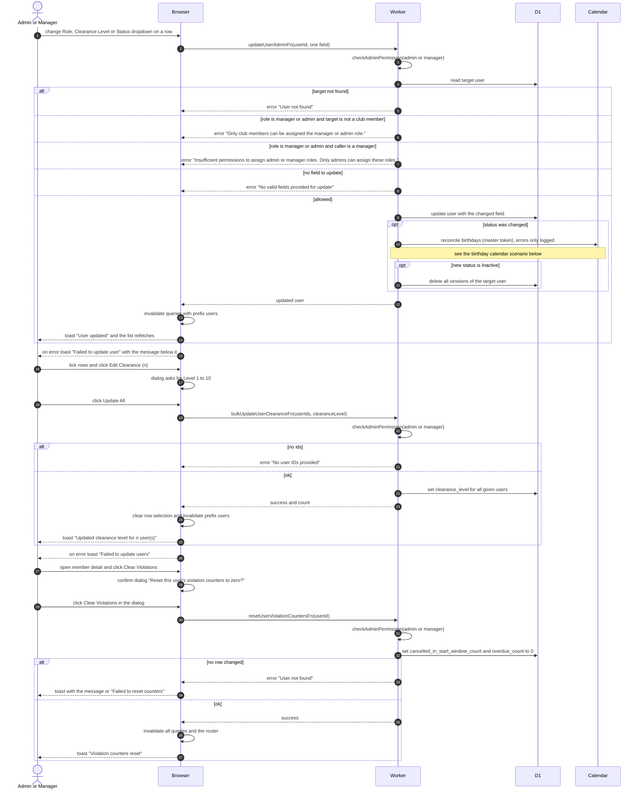
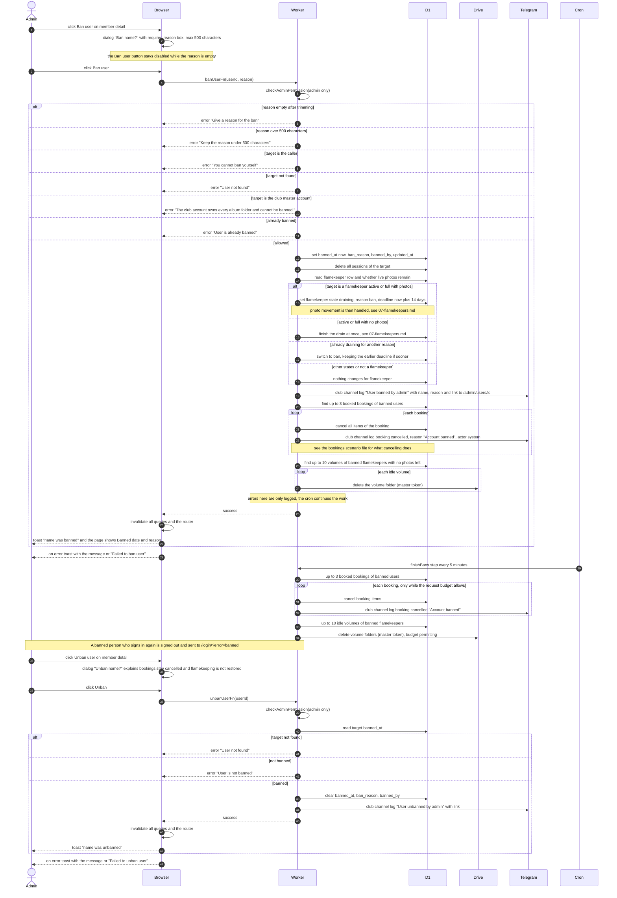
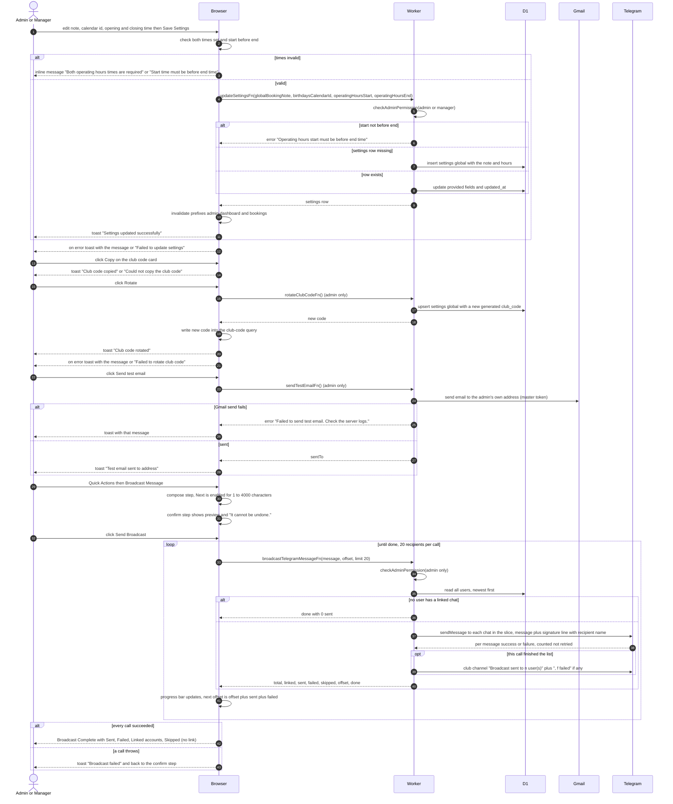
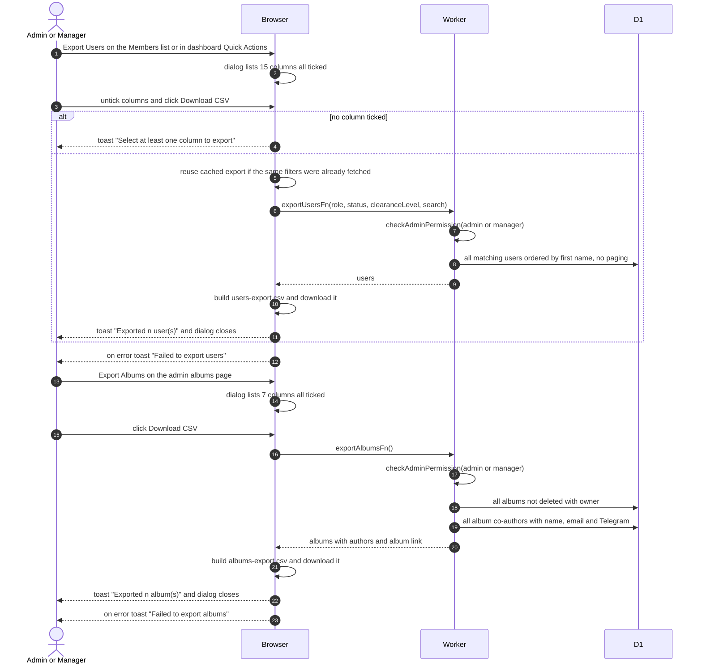
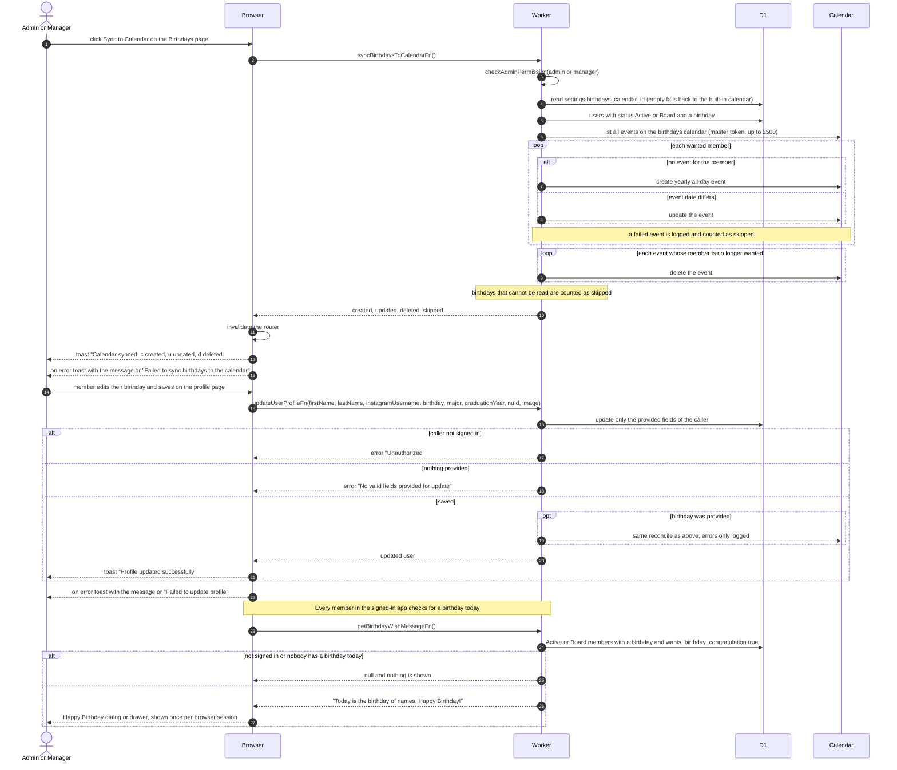
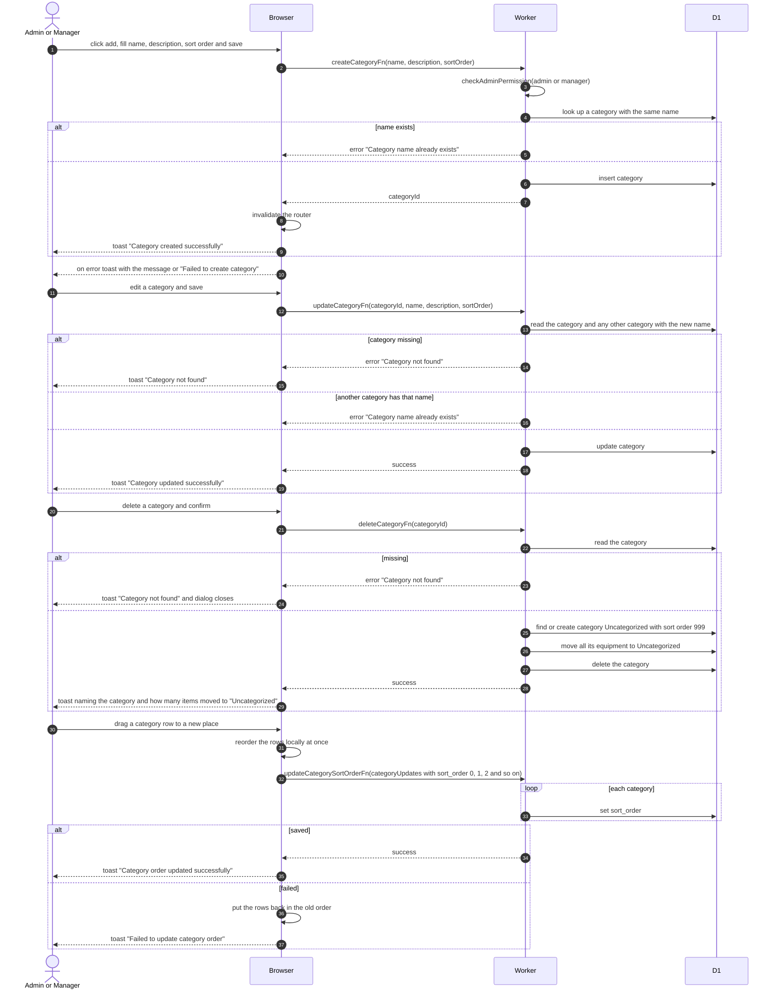

# Admin Console

The admin and manager pages that are not about bookings, equipment or flamekeepers: dashboard, members and alumni lists, member detail, bans, birthdays, settings, club code, test email, broadcast, CSV exports and equipment categories. Triggered by admins and managers in the browser, plus the 5-minute cron finishing a ban.

## Data

KV holds album folder listings under `album:list:{driveFolderId}` with a 300 second TTL. The dashboard reads them and never writes them.

## Opening the admin area and loading its pages

Every page under /admin first passes the admin layout guard. Each loader function below checks the caller again on the server. `checkAdminPermission` is the shared check. It refuses with "Unauthorized: No session", "Unauthorized: User not found" or "Insufficient permissions". Admin only functions are marked.

## Changing a member's role, status or clearance, and clearing violations

Inline dropdowns on the Members list call `updateUserAdminFn` one field at a time. Selecting rows and choosing Edit Clearance calls `bulkUpdateUserClearanceFn`. Only an admin sees the Manager and Admin role options enabled. Clearing violations is on the member detail page.

## Banning and unbanning a member

Only admins see the Ban section on the member detail page, and an admin does not see Ban on their own page. A ban takes effect at once for sign-in, then bookings and Drive access are cleaned up. Whatever does not fit in the request is finished by the 5-minute cron.

## Settings, club code, test email and broadcast

Settings and club code live on the dashboard Settings tab. The test email button and Broadcast Message item are in the dashboard header and are shown to admins only.

## Exporting users and albums to CSV

Exports are built in the browser from the full list the server returns, not just the visible page.

## Birthdays page and birthday calendar

The calendar holds one yearly all-day event per Active or Board member with a readable birthday. The same sync also runs after a status change by an admin, after a member edits their birthday on their profile, and after onboarding (see the sign-up and onboarding scenario file).

## Managing equipment categories

The categories page under Admin lists every category with its equipment count. All category functions allow admins and managers.

