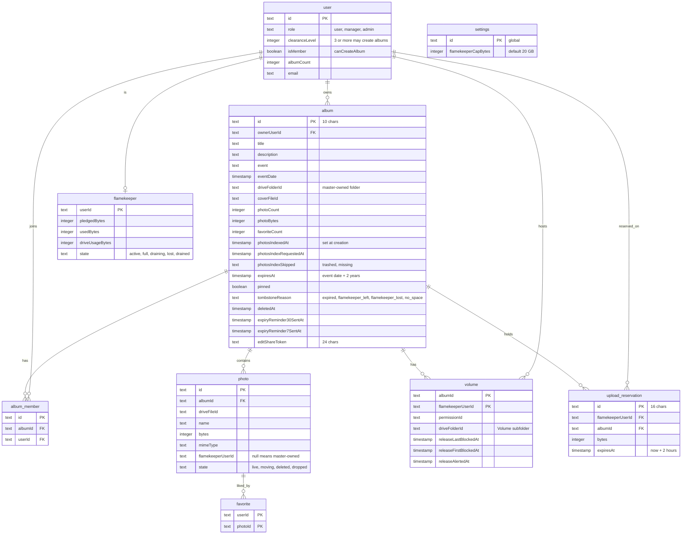
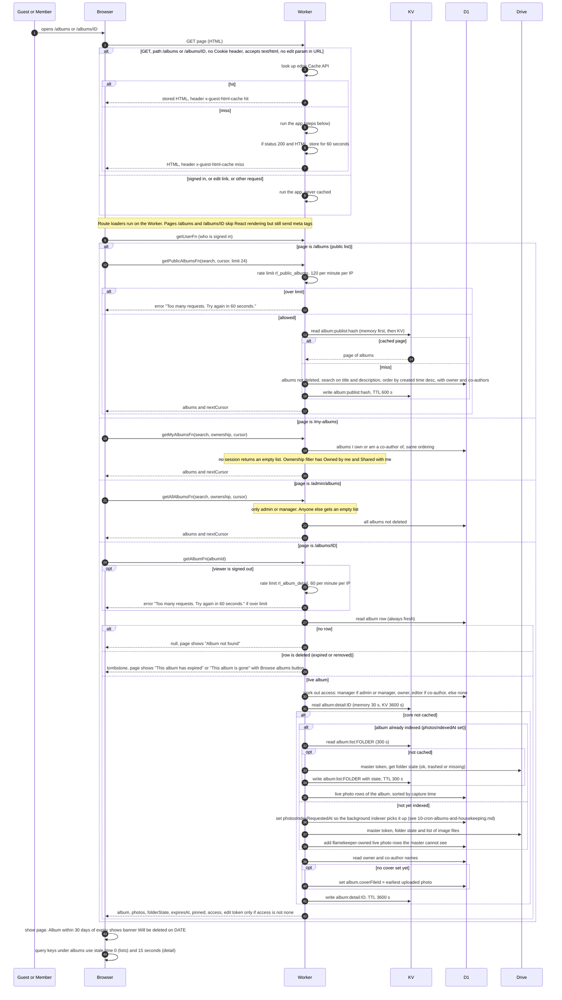
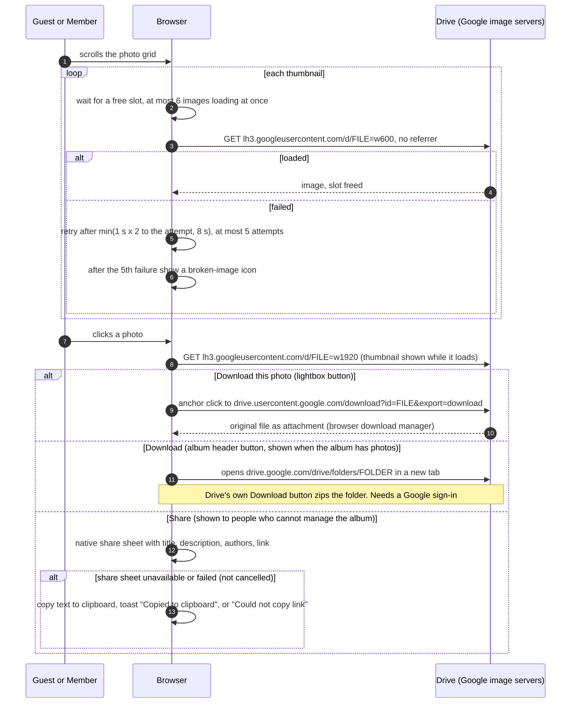
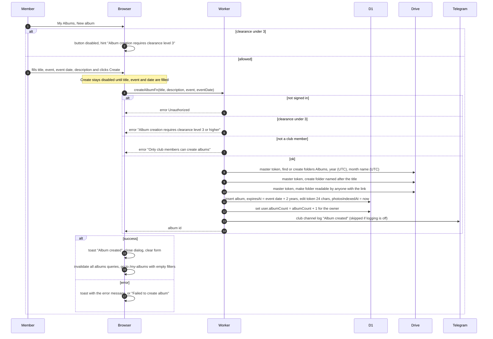
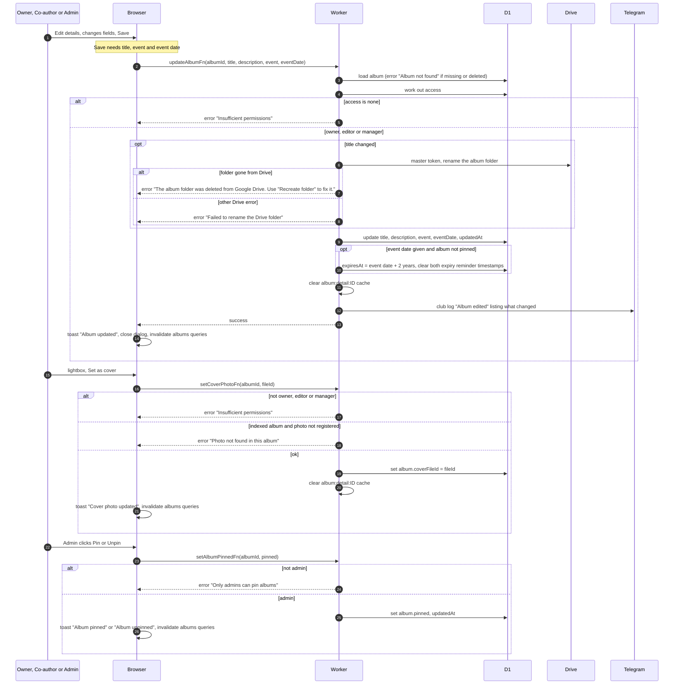
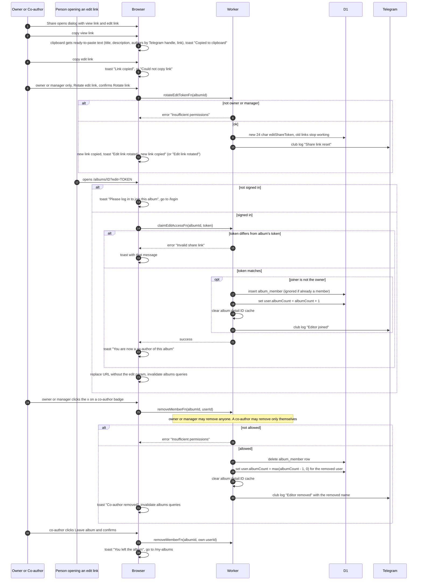
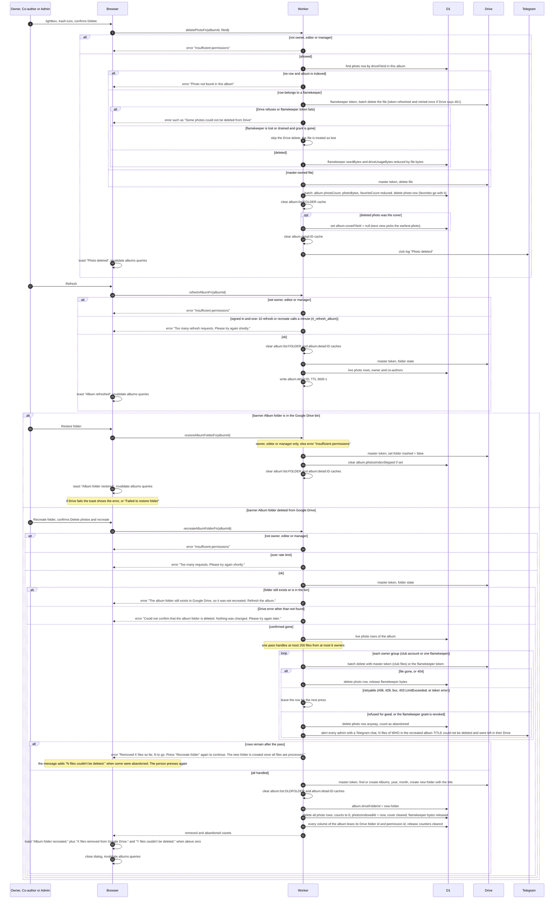
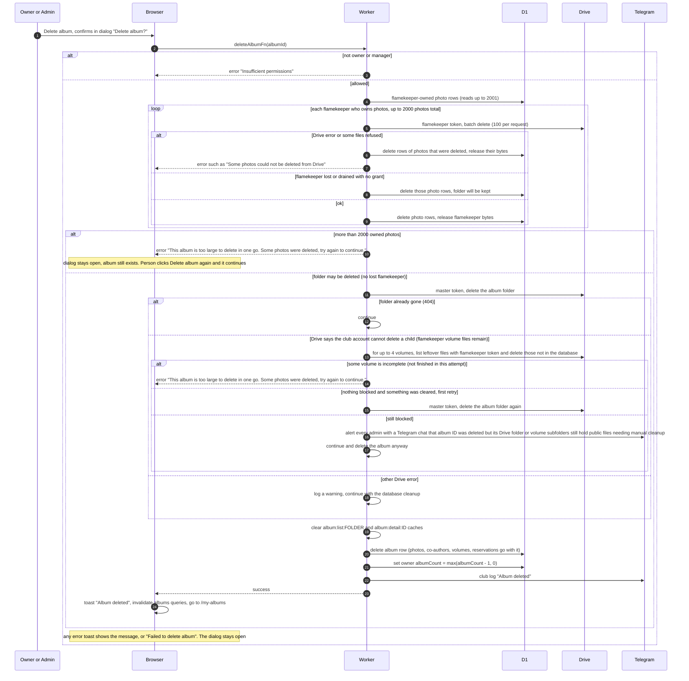
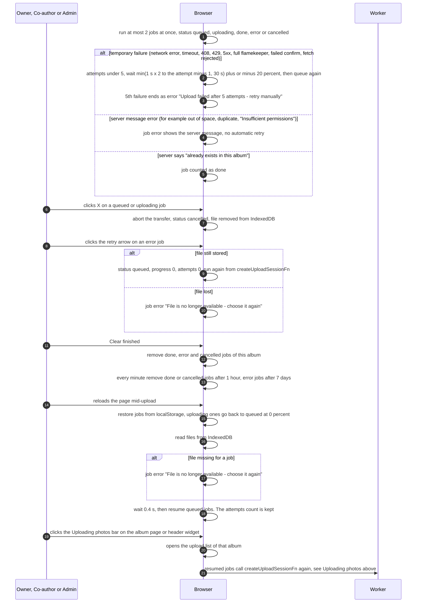

# Albums and photo uploads

Everything about photo albums: browsing them signed out or as a member, viewing and downloading photos, creating and editing albums, co-authors, deleting photos and albums, repairing the Drive folder, and uploading photos. Triggered by guests, members, co-authors, owners and admins in the browser.

Which Google Drive account owns what:
- The club (master) Drive account owns the folder tree `Albums/{year}/{month}/{album title}` and the `Volume xxxxxx` subfolders inside each album folder. It makes each album folder readable by anyone with the link.
- The photo files themselves are created by flamekeepers, in their own Drive accounts, inside their volume subfolder (the master shares that subfolder with the flamekeeper's email as writer). They count against the flamekeeper's Drive space.
- Photos are shown straight from Google's image servers, so viewing never uses the Worker or any Drive token.

KV and edge cache entries used here:
- `album:list:{driveFolderId}` holds a folder-state snapshot for 300 seconds.
- `album:detail:{albumId}` holds the viewer-independent album detail for 3600 seconds.
- `album:publist:{hash}` holds one page of the public album list for 600 seconds.
- Each Worker instance also keeps up to 25 of the detail and list entries in memory for 30 seconds.
- Guest page HTML for `/albums` and `/albums/{id}` is cached in the edge Cache API for 60 seconds (per data centre).

## Data

## Browsing albums and opening one

A guest or a member opens `/albums`, a shared album link, `/my-albums` or (admin) `/admin/albums`. Lists page by 24 albums, newest first, by infinite scroll. Album detail data is always rechecked against a fresh album row, while the heavy part is cached.

## Viewing photos, thumbnails, downloading and sharing

Every album folder is public, so the browser loads images straight from Google's image servers.

## Creating an album

Members with clearance level 3 or higher click New album on My Albums and fill in title, event, event date and optional description.

## Editing details, setting the cover and pinning

Owners, co-authors and admins or managers see the album manager row on the album page. Pinning is an admin-only button. Automatic expiry itself is in 10-cron-albums-and-housekeeping.md.

## Sharing links, co-authors and leaving

The view link is public. The edit link lets any signed-in user become a co-author (editor).

## Deleting a photo, refreshing, and repairing the Drive folder

Any owner, co-author, admin or manager can delete any photo in the album, whoever uploaded it. The Refresh button, the bin banner and the deleted-folder banner are shown to the same people. Banners appear when the cached folder state is trashed or missing.

## Deleting an album

Owner, admin or manager clicks Delete album and confirms. Photos held by flamekeepers are deleted first, then the album folder, then the database row. A very large album can need several tries.

## Uploading photos

Owner, co-authors, admins and managers click Upload photos, then drop or choose images. Each file goes through the same steps: the Worker picks a flamekeeper and reserves space, the browser sends the bytes straight to Google Drive, then the Worker registers the photo. The out-of-space message is: `Out of space, become a flamekeeper / ` followed by hash-savenuimg (the initiative name). Becoming a flamekeeper is in 07-flamekeepers.md.

```mermaid
sequenceDiagram
  autonumber
  participant Person as Owner, Co-author or Admin
  participant Browser
  participant Worker
  participant D1
  participant Drive
  participant Google as Drive upload server

  Person->>Browser: Upload photos, drops files or Choose photos
  alt upload button disabled
    Note over Browser: disabled unless the folder is ok. Hints "Restore the album folder from the Drive bin before uploading" or "Recreate the album folder before uploading"
  end
  Browser->>Browser: keep image files only (empty type allowed)
  alt no image files
    Browser->>Browser: toast "Please choose image files"
  else
    Browser->>Browser: skip names already in the album, queued or uploading for it, or repeated in the batch
    alt all skipped
      Browser->>Browser: toast one photo is already in the album, or N photos skipped - already in the album
    else some skipped
      Browser->>Browser: toast N duplicate(s) skipped - already in the album
    end
    Browser->>Browser: save jobs to localStorage and the files to IndexedDB, up to 2 uploads at once
  end

  loop each queued file
    Browser->>Worker: createUploadSessionFn(albumId, fileName, mimeType, size up to 5 GB)
    Worker->>D1: load album and work out access
    alt not owner, editor or manager
      Worker-->>Browser: error "Insufficient permissions"
    else allowed
      Worker->>Drive: master token, folder state
      alt folder in the bin
        Worker-->>Browser: error "The album folder is in the Google Drive bin. Restore it before uploading."
      else folder permanently deleted
        Worker-->>Browser: error from Drive "Drive file not found"
      else ok
        Worker->>D1: live photo with the same name in this album?
        alt duplicate by name
          Worker-->>Browser: error "Photo "NAME" already exists in this album"
        else album not yet indexed
          Worker->>Drive: master token, search the folder for that name
          opt found
            Worker->>D1: register the existing file as a photo row
            Worker-->>Browser: error "Photo "NAME" already exists in this album"
          end
        end
        loop up to 4 placement tries
          Worker->>D1: active and full flamekeepers with pledged, used, drive usage and unexpired reserved bytes
          Note over Worker: only active flamekeepers, never the master account's own email. Space left = smaller of pledge minus used minus reserved, and cap minus Drive usage minus reserved. Cap is settings.flamekeeperCapBytes, default 20 GB. Needs at least the file size. Most space left wins
          alt nobody has room
            Worker-->>Browser: error out-of-space message
          else flamekeeper picked
            Worker->>D1: insert upload_reservation (16 char id, expires in 2 hours) only if used + file + live reservations is within the pledge
            alt reservation refused (race)
              Worker->>Worker: try the next flamekeeper
            else reserved
              Worker->>Drive: master token, find or create the Volume subfolder for this album and flamekeeper, share it with their email as writer
              Worker->>Drive: flamekeeper token, start a resumable upload in that subfolder (token refreshed and retried once on 401)
              alt Drive reports the flamekeeper's storage full
                Worker->>D1: delete reservation, flamekeeper state = full, try next
              else subfolder missing in Drive
                Worker->>D1: delete reservation, forget the subfolder id and recreate it, unless it still holds photos then skip this flamekeeper
              else grant revoked or Drive auth failed
                Worker->>D1: delete reservation, skip this flamekeeper
              else other error
                Worker-->>Browser: that error
              else ok
                Worker-->>Browser: uploadUrl and reservationId
              end
            end
          end
        end
        Note over Worker: after 4 tries with no success, the person gets the out-of-space message
      end
    end

    Browser->>Google: PUT file bytes to uploadUrl, Content-Type text/plain, progress shown
    alt 2xx
      Google-->>Browser: JSON with file id
      opt reply has a file id
        loop up to 3 tries, wait 0.5 s then 1 s
          Browser->>Worker: confirmPhotoUploadFn(albumId, fileId, reservationId)
          Worker->>D1: load reservation for this album
          alt reservation missing
            alt photo already registered
              Worker-->>Browser: registered false (treated as done)
            else
              Worker-->>Browser: error "Upload session expired, upload again"
            end
          else found
            Worker->>Drive: flamekeeper token, read file info
            alt file not in the flamekeeper's volume subfolder or in the bin
              Worker-->>Browser: error "Uploaded file not found in the album folder"
            else not an image
              Worker->>Drive: flamekeeper token, delete the file
              Worker->>D1: delete reservation
              Worker-->>Browser: registered false
            else image
              Worker->>D1: insert photo row (state live, flamekeeperUserId set), album photoCount and photoBytes up
              Worker->>D1: batch: flamekeeper usedBytes and driveUsageBytes up by file size, delete reservation
              Worker-->>Browser: registered true
            end
          end
        end
        Note over Browser: after 3 failed confirms the job counts as a temporary failure and is queued again
      end
      Browser->>Browser: job done at 100 percent, file removed from IndexedDB
      Browser->>Browser: when every job of the album is finished, invalidate albums queries and refresh the page data
      Note over Browser,Worker: confirming does not clear album:detail:ID. The album page may show the cached photo list until Refresh, another edit, or the cache expires (up to 1 hour)
    else 403 storageQuotaExceeded
      Browser->>Worker: releaseUploadFn(albumId, reservationId, quotaExceeded true)
      Worker->>D1: delete reservation, flamekeeper state = full
      Browser->>Browser: treated as a temporary failure, retried (a different flamekeeper is chosen)
    else 408, 429, 5xx, network error or timeout
      Browser->>Worker: releaseUploadFn(albumId, reservationId, quotaExceeded false)
      Worker->>D1: delete reservation
      Browser->>Browser: temporary failure, retried
    else any other status
      Browser->>Worker: releaseUploadFn(albumId, reservationId, quotaExceeded false)
      Browser->>Browser: job error "Upload failed (STATUS)"
    end
    Note over Worker: releaseUploadFn needs owner, editor or manager access, else "Insufficient permissions". It does nothing if the reservation is not found
  end
```

## Upload queue behaviour in the browser

What the person sees while jobs run, fail, are cancelled or survive a page reload. No server call is made here except the same three upload functions.

