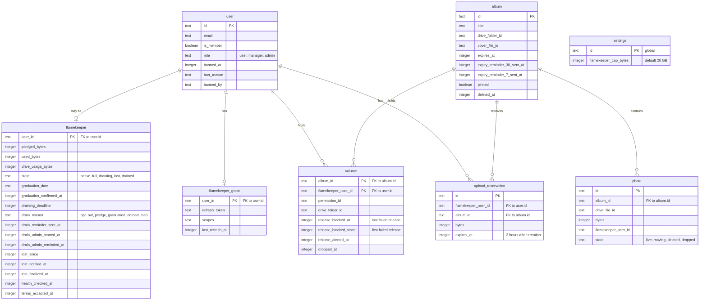
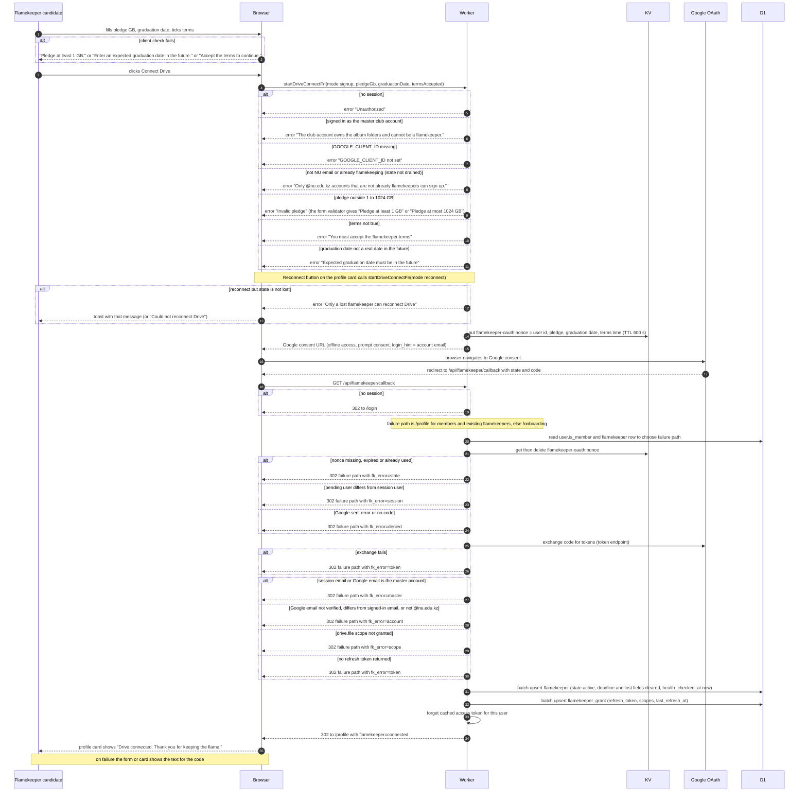
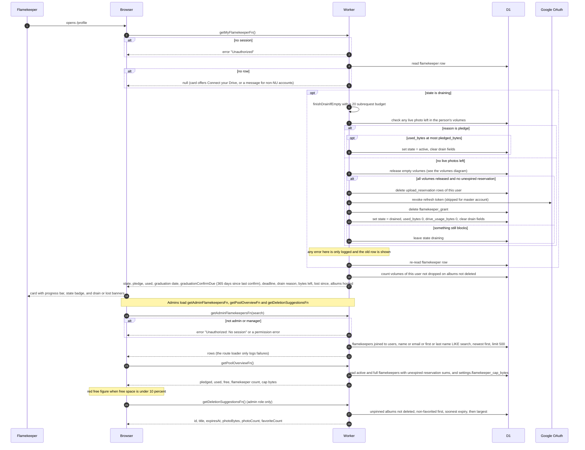
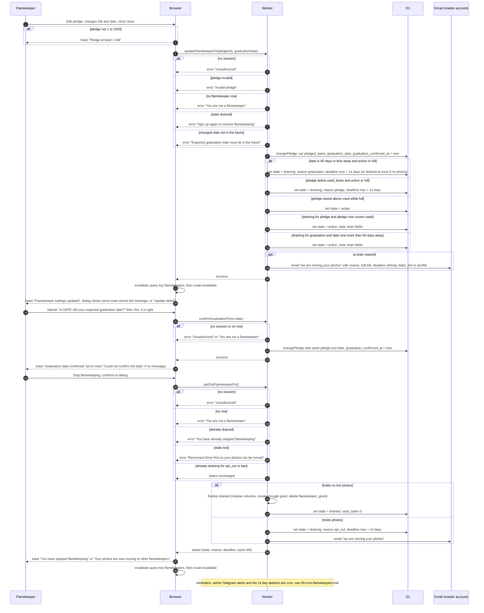
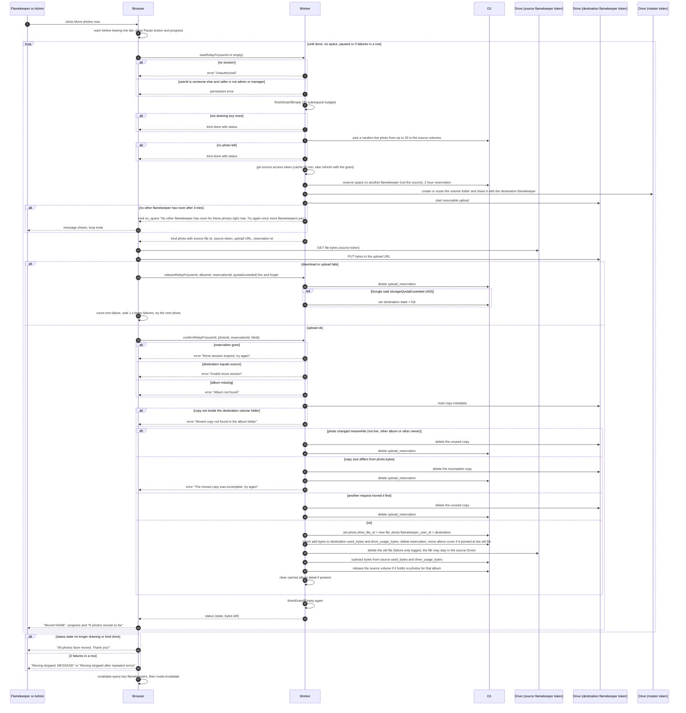
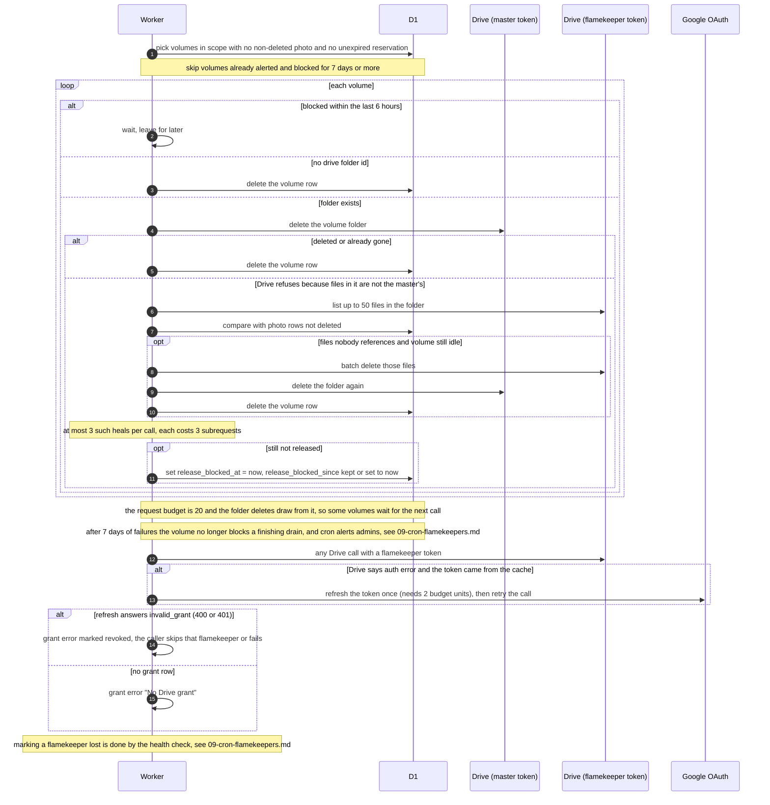
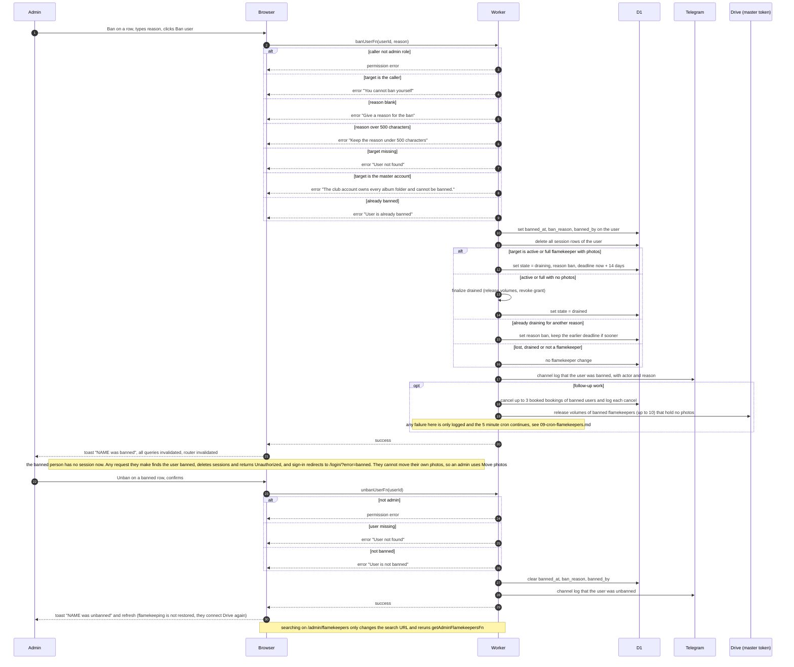
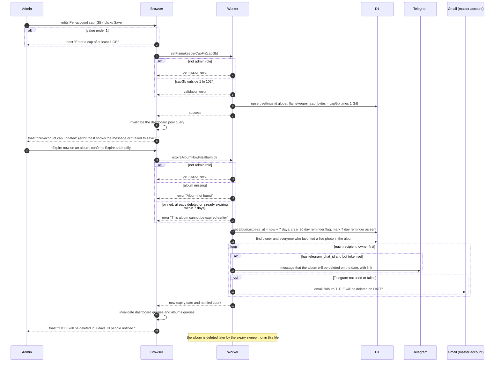
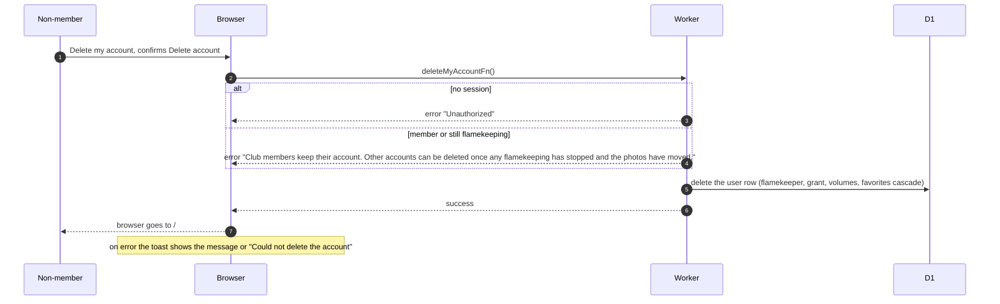

# Flamekeepers

A flamekeeper is someone who lends part of their NU Google Drive to hold club photos. This covers everything a person or admin triggers: signing up and rejoining, reconnecting Drive, editing the pledge, stopping, moving photos out through the browser, deleting an account, and the admin pages for the pool, free space and individual flamekeepers. The scheduled side (drain deadlines, reminders, bans, graduation, health checks, pool alerts) is in 09-cron-flamekeepers.md. Uploads are in 06-albums-and-uploads.md.

## Data

KV holds the sign-up handshake under `flamekeeper-oauth:{nonce}` with a 600 second TTL. The value is the pending user id, pledge, graduation date and terms time. An access token for a flamekeeper's Drive is also cached in Worker memory for 50 minutes per flamekeeper (not in KV).

## Becoming a flamekeeper or reconnecting Drive

Sign-up happens on the onboarding page (NU emails only) or the profile page. Reconnecting is for a flamekeeper in state lost. Everything goes through Google consent and one callback route. The Drive scope asked for is `drive.file`, plus `openid` and `email`.

Messages by code: denied "Google access was not granted. You can try again.", state "The connection request expired. Please start again.", session "Your session changed during the connection. Please start again.", account "Connect Drive with the same @nu.edu.kz Google account you signed in with.", scope "The Drive permission was not granted. Please allow file access.", token "Google did not return a usable authorization. Please try again.", master "The club account owns the album folders and cannot be a flamekeeper."

Rejoining after stopping works the same way: a drained flamekeeper sees "Become a flamekeeper" with a switch, fills the same form, and the callback upserts the old row back to active.

## Loading the profile and admin pages

The profile loader runs `getUserFn` and the flamekeeper query. The admin flamekeepers page, the dashboard pool card and the free-space panel load their lists. Opening the profile of a draining flamekeeper can also finish the drain.

## Editing the pledge, confirming graduation, stopping

Edit pledge and Stop flamekeeping live on the profile card. Edit pledge is hidden when the drain reason is opt_out or domain. Stop is hidden when the state is lost or the reason is opt_out. A graduation date within 60 days of today starts a drain at once.

## Moving photos out through the browser

The Move photos now button appears in the draining banner on the flamekeeper's own profile, and for admins and managers as Move photos in the admin flamekeepers table. Each photo goes Drive to browser to Drive, one at a time. Admins pass the target `userId`, so the Worker uses the flamekeeper's token as the source.

## Volumes, grants and the 7 day rule during a request

Releasing a volume deletes the flamekeeper's subfolder in the album with the master token. It runs from the relay (one album at a time), from finishing a drain, and when an admin bans someone. Each call looks at up to 20 volumes.

## Admin actions on a flamekeeper

An admin can move a draining flamekeeper's photos (see the moving photos diagram) and ban or unban them. Ban and Unban buttons show only for the admin role and never on the admin's own row. The ban dialog needs a reason.

## Admin pool cap and freeing space

Both live on the admin dashboard Albums tab. Managers see the pool card read only, and admins can change the cap and expire albums.

## Deleting an account

The Delete my account card shows only to non-members who are not flamekeeping (no flamekeeper row, or state drained).

