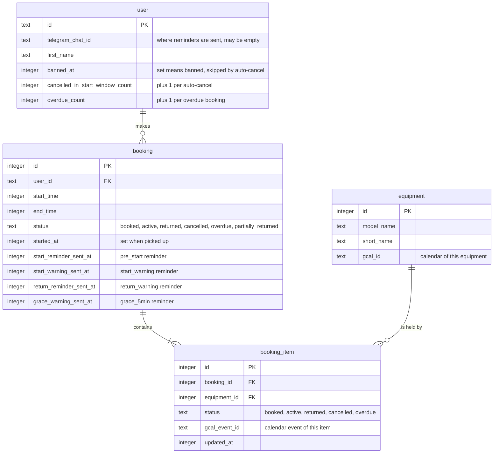
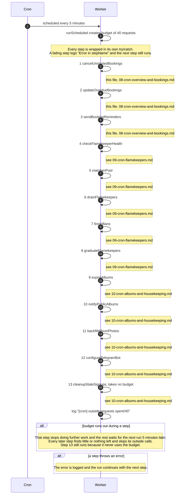
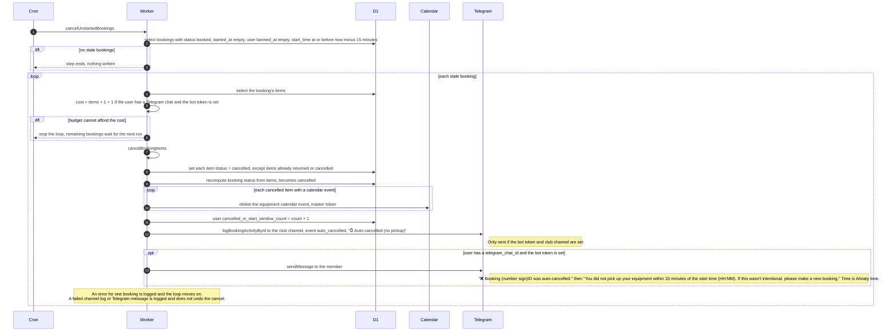
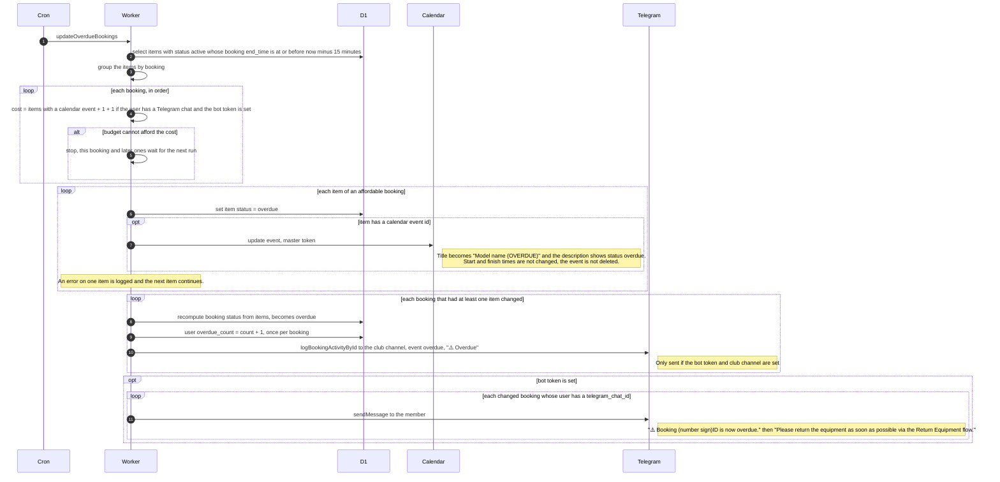
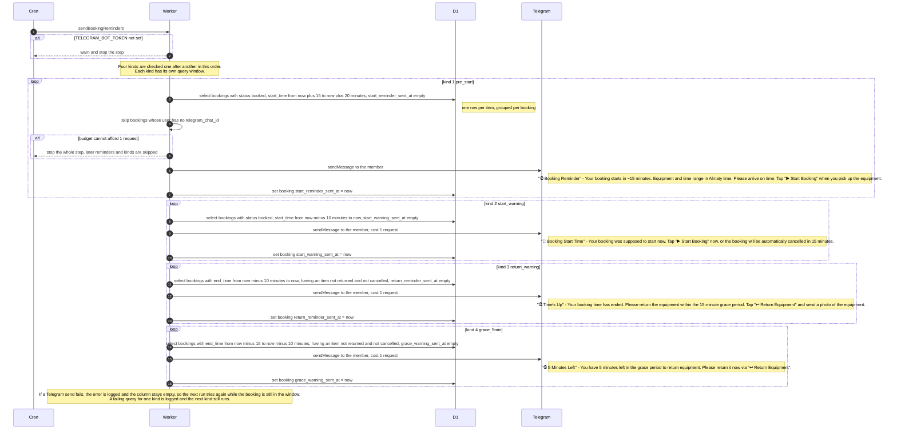
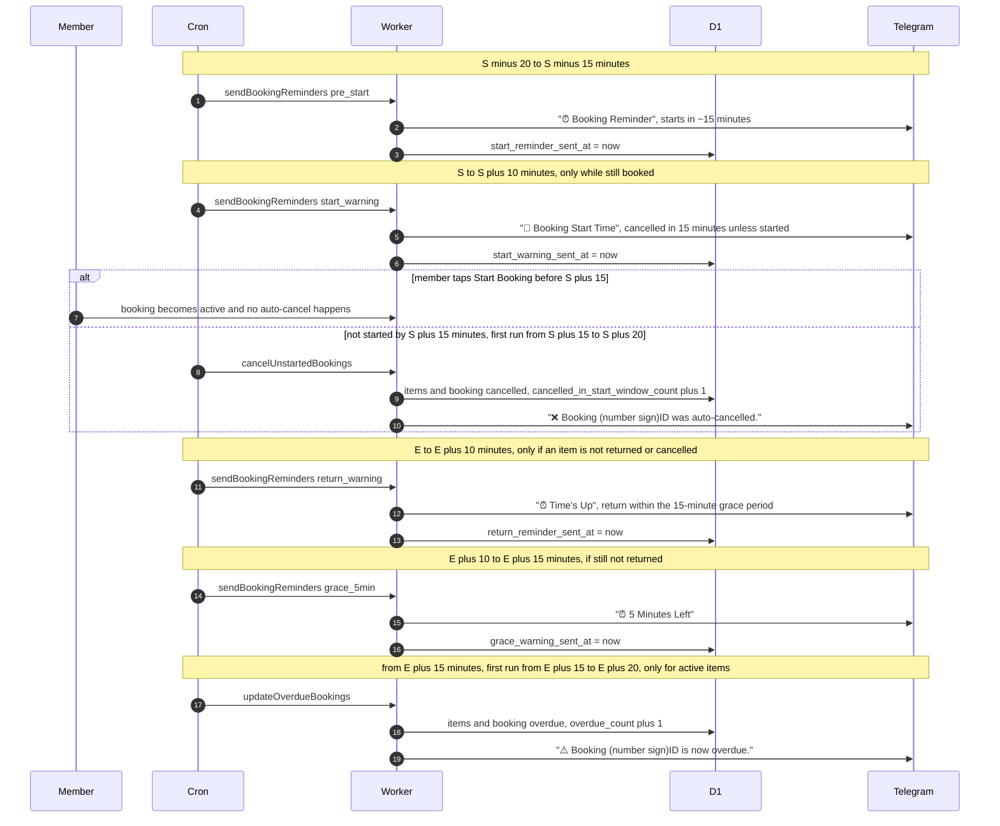

# Scheduled Jobs and Booking Timers

Every 5 minutes Cloudflare's clock wakes the Worker and runs 13 background steps in a fixed order. This file shows the whole run, then the three steps that look after bookings: auto-cancel, overdue and the four Telegram reminders.

## Data
Nothing here is stored in KV or R2. The tracking columns on `booking` are what make each reminder fire only once.

## The 5-minute run, all 13 steps
The cron trigger is `*/5 * * * *`. The Worker's `scheduled` handler starts `runScheduled` in the background. One shared budget of 40 outside requests (Telegram, Google, Drive calls) is created per run. Cloudflare allows 50 per run, so 10 are kept spare. Each step spends from the same budget in the order below. Only the last step does not use the budget.

## Auto-cancel of bookings nobody picked up (step 1)
A booking is cancelled once 15 minutes have passed since its start time and it was never started. Bookings of banned users are left alone.

## Overdue bookings (step 2)
An item becomes overdue 15 minutes after the booking's end time if it is still active, meaning picked up but not returned. Items that were never picked up are not touched here.

## The four booking reminders (step 3)
All times are measured from the moment of the run. Each reminder is sent to the member's Telegram chat, once per booking, and the matching column on `booking` is set after it is sent. Members without a `telegram_chat_id` get nothing and no column is set. If the bot token is missing the whole step logs "TELEGRAM_BOT_TOKEN not configured, skipping reminders" and does nothing.

## One booking over time
Start time is S and end time is E. The cron runs every 5 minutes, so each event happens at the first run inside its window. The 5-minute-wide window of kind 1 is hit by exactly one run. The 10-minute windows are hit by two runs, and the tracking column stops the second one.

