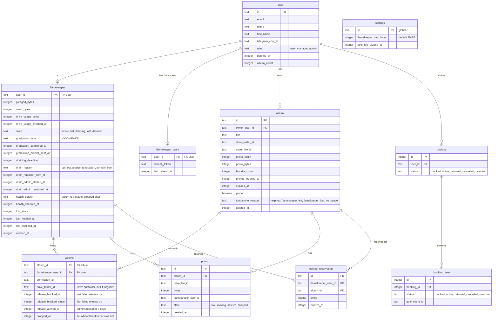
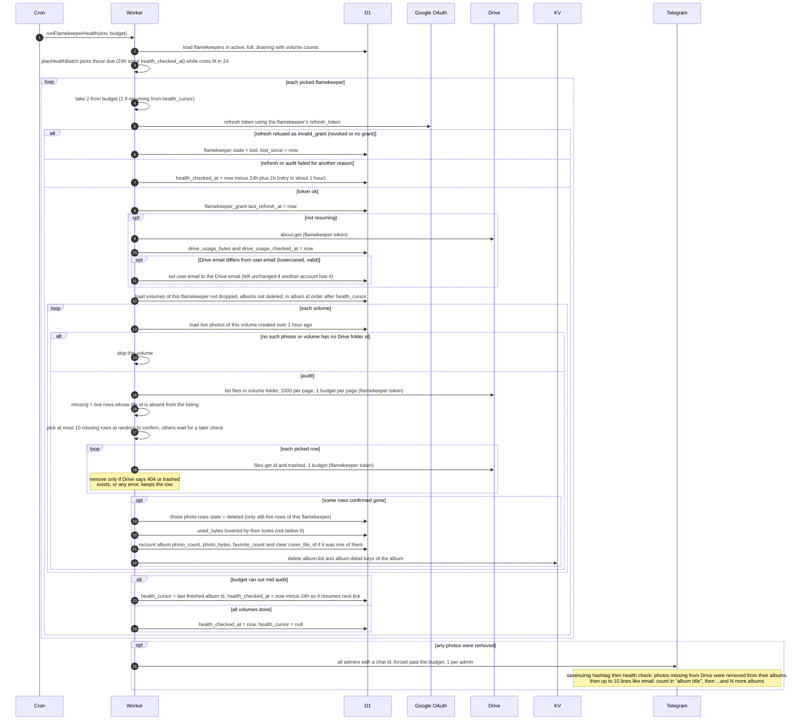
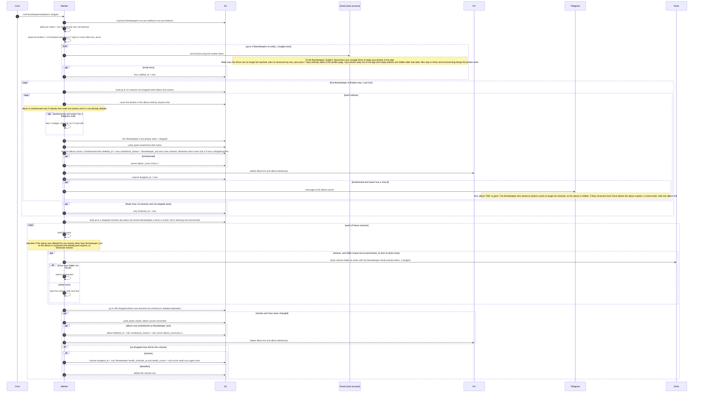
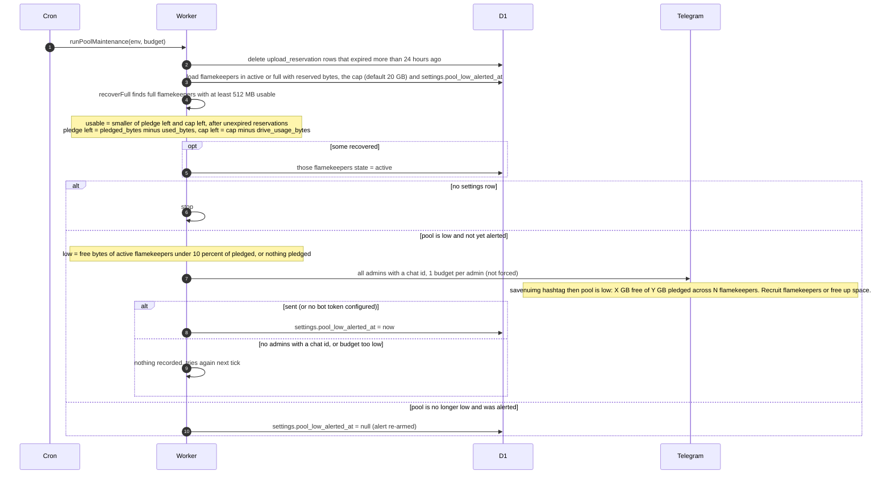
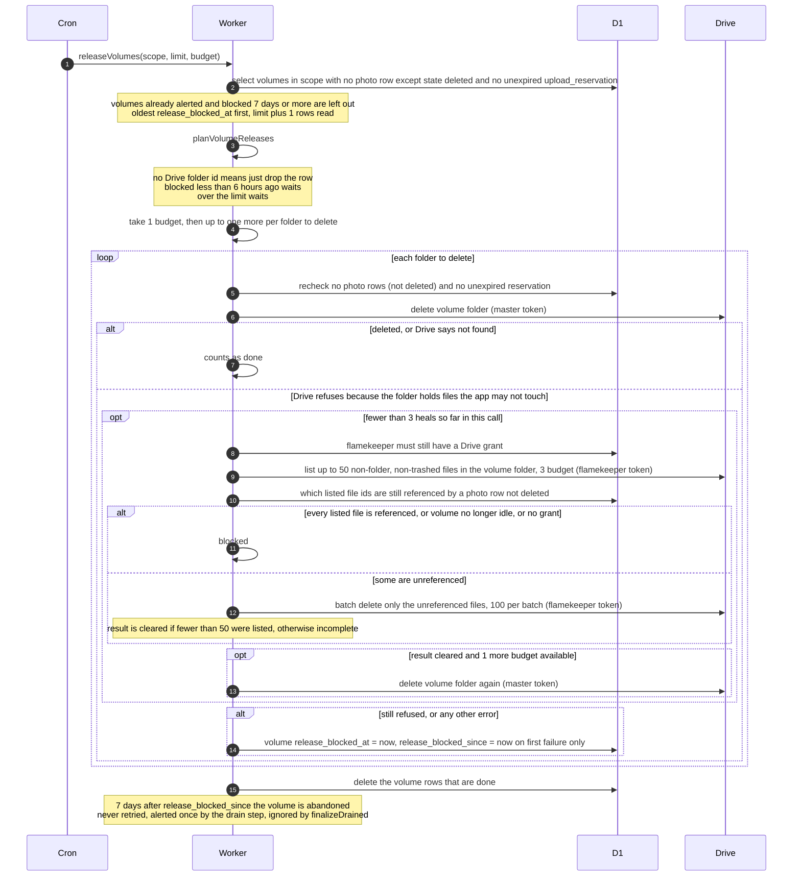
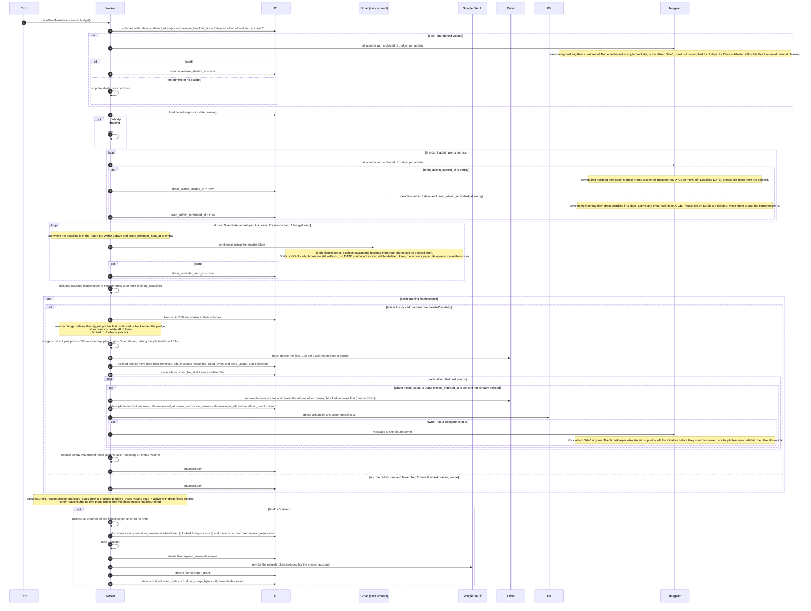
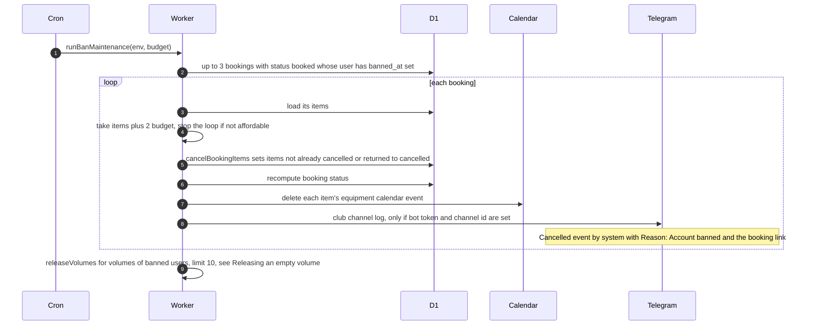
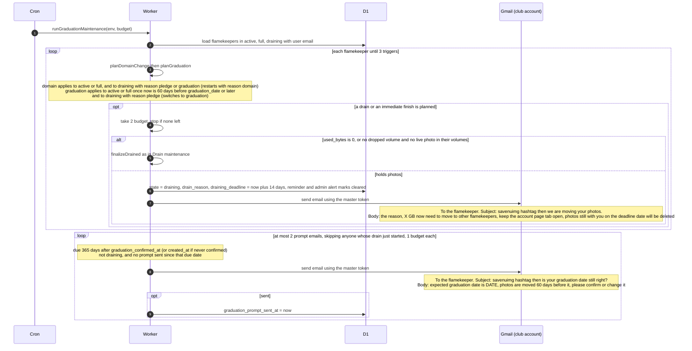

# Cron: Flamekeeper Storage Upkeep

Five steps of the 5-minute cron look after flamekeepers (members who lend their Google Drive for album photos): checkFlamekeeperHealth, maintainPool, drainFlamekeepers, finishBans and graduateFlamekeepers. They run in that order after the booking steps and before the album steps, all sharing one run budget of 40 outgoing requests, see 08-cron-overview-and-bookings.md for the full run order. Every step is wrapped so an error is only logged and the next step still runs.

## Data
Two KV keys are touched when album photo lists change: `album:list:<album Drive folder id>` (TTL 300 seconds) and `album:detail:<album id>` (TTL 3600 seconds). These steps only delete them, never write them.

## Health check: grants, usage and missing photos
Step checkFlamekeeperHealth (runFlamekeeperHealth). It runs on every tick, but a flamekeeper in state active, full or draining is only checked once 24 hours have passed since health_checked_at (never-checked first, then oldest first). This part may spend at most 24 of the 40 requests. A flamekeeper costs 2 when starting fresh (token refresh plus Drive about call) or 1 when resuming from a saved cursor. Every Drive call here uses the flamekeeper's own token, freshly refreshed for this check.

## Health check: lost flamekeepers and recovery
Same step, second half. A flamekeeper whose Drive grant was revoked is in state lost. They get one reconnect email, and 7 days after lost_since their photos are dropped from the app. If they reconnect later, dropped photos come back.

## Pool maintenance
Step maintainPool (runPoolMaintenance). Runs every tick. Makes no Drive calls, only database work and possibly one admin Telegram alert.

## Releasing an empty volume
Shared routine releaseVolumes used by drainFlamekeepers (up to 20 volumes per call) and finishBans (up to 10). A volume is the Drive subfolder a flamekeeper holds for one album. It is deleted only when the database shows nothing needs it. Folder deletion uses the club (master) token, clearing leftovers uses the flamekeeper's token.

## Drain maintenance
Step drainFlamekeepers (runDrainMaintenance). A flamekeeper in state draining has a 14 day deadline to move their photos to other flamekeepers (the move itself is done from their browser or by an admin, outside this step). This step sends alerts and reminders, finishes drains, and deletes what is left after the deadline. It returns early after the abandoned-volume alerts when nobody is draining.

## Ban follow-up
Step finishBans (runBanMaintenance). The ban itself is done by an admin (see 05-admin-console.md). This step finishes what a ban leaves behind for users with banned_at set.

## Graduation and domain check
Step graduateFlamekeepers (runGraduationMaintenance). Loads every flamekeeper in active, full or draining and decides, in database order, who must start draining. A drain starts when the account email is no longer on nu.edu.kz (reason domain) or when today is 60 days or less before graduation_date (reason graduation). At most 3 drains start per tick, 2 budget each.

