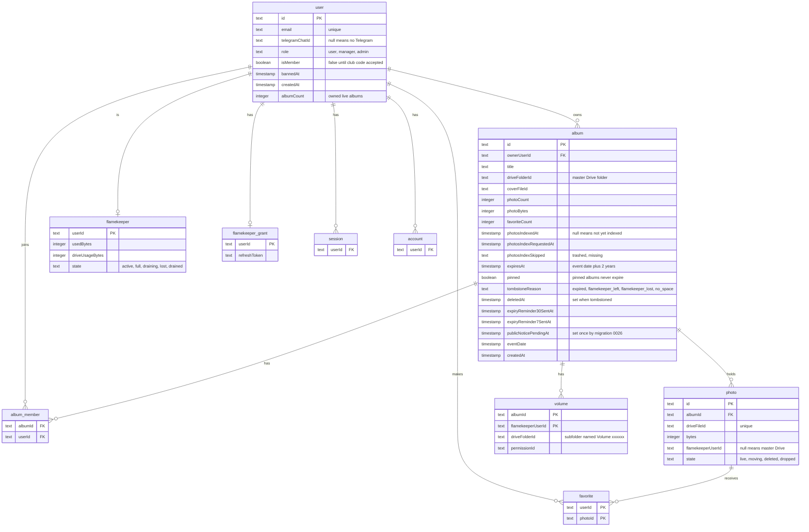
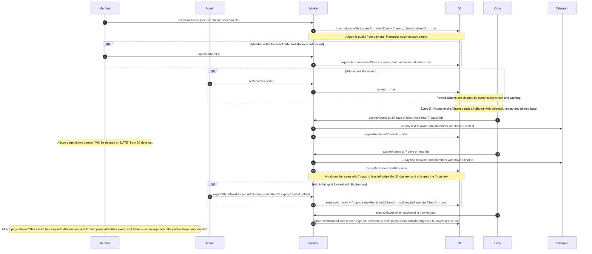
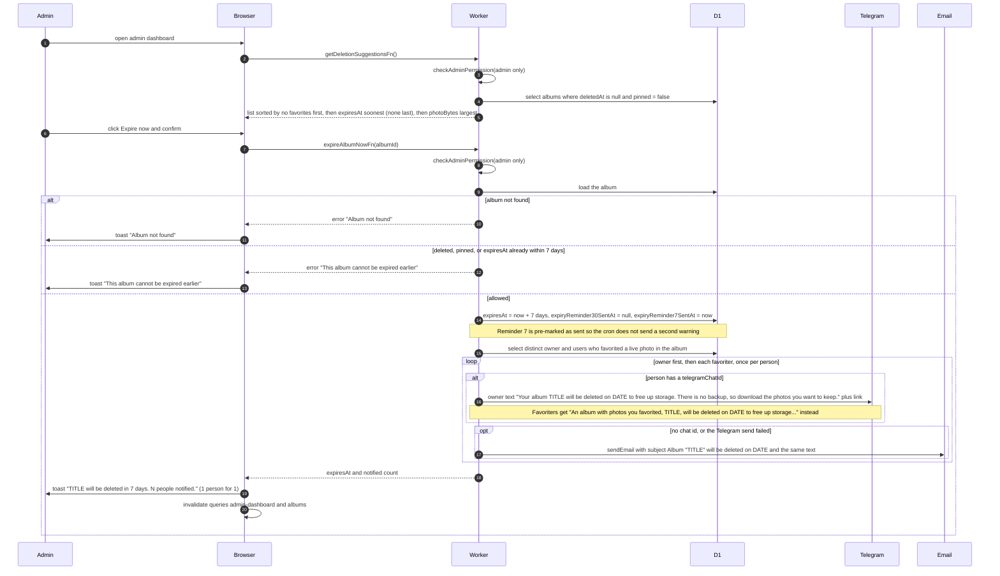
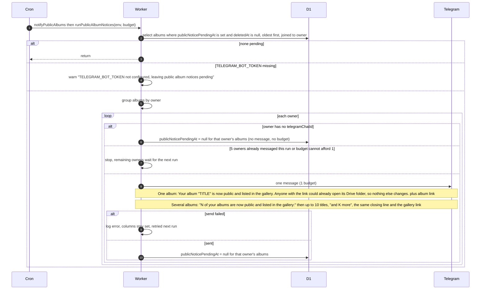
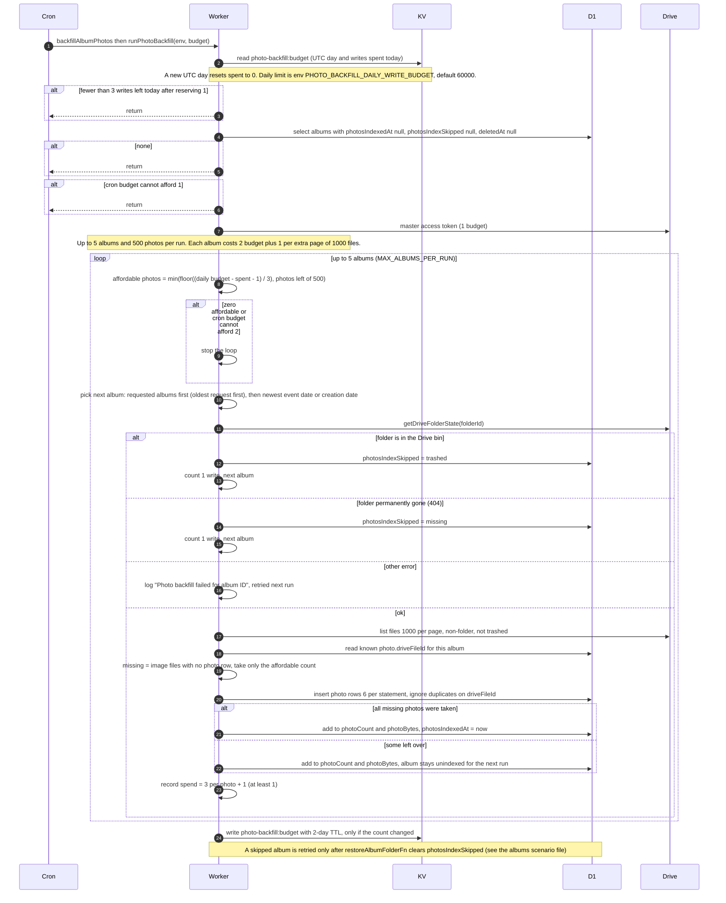
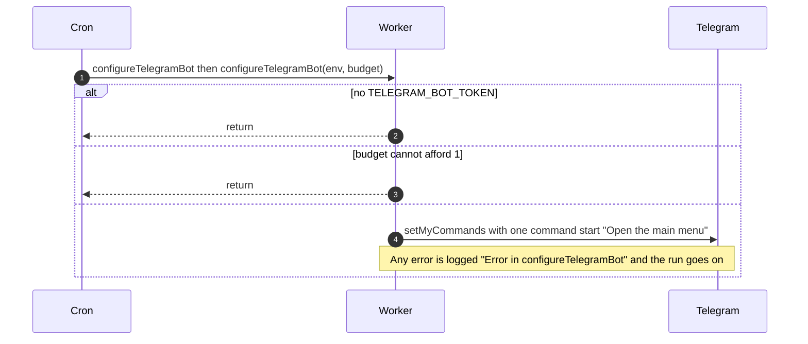
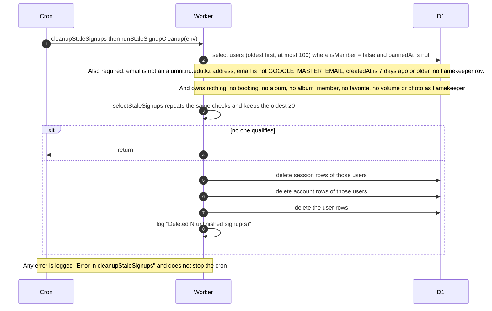
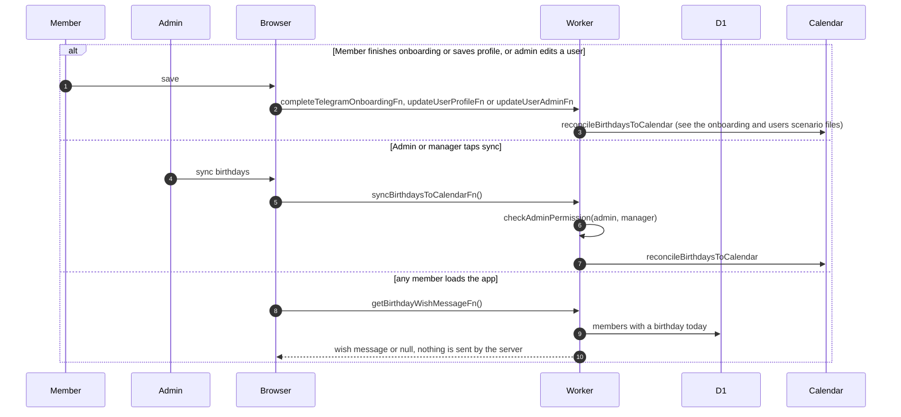

# Cron: Album Expiry, Public Notices, Photo Backfill, Bot Menu and Stale Signups

The last five steps of the 5-minute cron run: `expireAlbums`, `notifyPublicAlbums`, `backfillAlbumPhotos`, `configureTelegramBot` and `cleanupStaleSignups`. The clock triggers them. An admin can also bring an album's expiry forward with "Expire now". The full run order and the shared 40-request budget are in 08-cron-overview-and-bookings.md.

## Data

Cloudflare KV keys touched: `album:list:DRIVE_FOLDER_ID` (album file listing, TTL 300 seconds) and `album:detail:ALBUM_ID` (album page core, TTL 3600 seconds) are deleted when an album is removed. `photo-backfill:budget` (JSON with the UTC day and writes spent, TTL 2 days) is the backfill's daily write counter.

## An album from creation to expiry

Albums live two years after their event date. Only the cron warnings and the removal are covered in detail in the sections below. Creation, date edits and pinning belong to the albums scenario files.

## Expiring albums and sending warnings

Runs every 5 minutes. It reads every album with `deletedAt` empty and `pinned` false and does nothing, and spends no budget, if no album is overdue and no warning is due. An album with no `expiresAt` is never touched. Up to 3 albums are attempted per run, and each attempt counts toward the 3 even if it fails or is deferred. The overdue list is rotated by the current 5-minute turn (time divided by 5 minutes, modulo list length), so one stuck album cannot block the others. Drive calls use the master Google account token for the album folder and each flamekeeper's own token for photos they stored.

```mermaid
sequenceDiagram
  autonumber
  participant Cron
  participant Worker
  participant D1
  participant KV
  participant Drive
  participant Telegram

  Cron->>Worker: expireAlbums then runAlbumExpiry(env, budget)
  Worker->>D1: select albums where deletedAt is null and pinned = false
  Worker->>Worker: planExpiry splits into expire (expiresAt at or before now), remind7 (7 days or less left, reminder7 empty), remind30 (over 7 and up to 30 days left, reminder30 empty)
  alt nothing to expire and nothing to remind
    Worker-->>Cron: return without spending budget
  end

  opt at least one album is overdue
    Worker->>Worker: rotateIds(expire, turn) where turn = floor(now / 5 minutes)
    loop each overdue album until 3 attempted (EXPIRES_PER_RUN)
      Worker->>D1: removalCost counts photos per flamekeeper owner
      Note over Worker: Cost estimate = 1 + for each flamekeeper owner with photos (1 + ceil(photos / 100)) + 1 for the first master token in this run
      alt budget cannot afford the cost
        Worker->>Worker: skip this album and try the next one
      else affordable
        Worker->>Worker: removeAlbum(tombstone expired, strictDrive true)
        Worker->>D1: loadOwnedPhotos (photo rows with a flamekeeper owner, at most 2001 read)
        opt album has flamekeeper photos
          Worker->>Worker: take first 2000 as one batch (MAX_PHOTO_DELETES_PER_CALL)
          loop each flamekeeper owner in the batch
            Worker->>Drive: batch delete files with the flamekeeper token, 100 files per request
            Note over Worker,Drive: A 401 on a cached token forgets it, then retries once if budget affords 2
            alt owner's Drive grant is missing or revoked and flamekeeper is lost, drained or has no row
              Worker->>Worker: photos marked lost, nothing deleted in Drive
            else a file failed with anything other than success or 404
              Worker->>Worker: remember error and keep those photo rows
            else all files deleted or already 404
              Worker->>D1: flamekeeper usedBytes and driveUsageBytes reduced by the bytes (not below 0)
            end
          end
          Worker->>D1: delete photo rows for deleted and lost files only, recount album photoCount photoBytes favoriteCount
          alt a Drive error was remembered
            Worker->>Worker: throw so album stays unexpired, logged "Failed to expire album ID", retried next run
          else more than 2000 owned photos existed
            Worker->>Worker: throw error "This album is too large to delete in one go. Some photos were deleted" plus "try again to continue", retried next run
          end
        end

        alt some photos were lost (flamekeeper unreachable)
          Worker->>Worker: warn and keep the Drive folder, skip folder delete
        else all owned photos gone or none existed
          Worker->>Drive: delete album folder with the master token (1 request)
          alt Drive 404
            Worker->>Worker: treated as already deleted
          else Drive 403 appNotAuthorizedToChild (folder holds files the app cannot touch)
            Worker->>D1: healAlbumVolumes reads volume rows that have a driveFolderId
            Note over Worker,D1: At most 4 volumes are worked per attempt. Further ones count as incomplete.
            loop each volume
              alt flamekeeper has no flamekeeper_grant row
                Worker->>Worker: outcome blocked (no cost)
              else budget cannot afford 3
                Worker->>Worker: outcome incomplete
              else
                Worker->>Drive: list up to 50 non-folder files in the volume folder with the flamekeeper token
                alt folder listing is empty
                  Worker->>Worker: outcome cleared
                else files found
                  Worker->>D1: look up which listed files still have a photo row that is not deleted
                  Note over Worker: Safe to delete only files with no live photo row, and only when the flamekeeper has no non-deleted photo rows in the album and no unexpired upload reservation
                  alt nothing deletable or volume is not idle
                    Worker->>Worker: outcome blocked
                  else
                    Worker->>Drive: batch delete the stray files with the flamekeeper token
                    Worker->>Worker: outcome incomplete if 50 files were listed, else cleared
                  end
                end
              end
            end
            alt any volume incomplete
              Worker->>Worker: throw AlbumDeletionDeferredError, log "Expiry of album ID deferred to a later run"
            else no blocked volume, at least one cleared, first attempt
              Worker->>Drive: delete album folder again with the master token (1 budget)
              Note over Worker: If budget cannot afford 1, deferred. A second 403 then abandons the folder.
            else blocked volumes remain or nothing cleared
              Worker->>Worker: warn that the album keeps its Drive folder
              Worker->>D1: read admins who have a chat id
              alt no admin with a chat id
                Worker->>Worker: continue anyway, folder is left in Drive
              else budget cannot afford one message per admin
                Worker->>Worker: throw AlbumDeletionDeferredError, retried next run
              else
                Worker->>Telegram: to each admin "savenuimg: album ID was deleted but N of its volume subfolders could not be emptied, so its Drive folder may still hold public files that need manual cleanup."
                Note over Worker,Telegram: When N is 0 the text says its Drive folder could not be removed
              end
            end
          else any other Drive error
            Worker->>Worker: throw, album stays, logged "Failed to expire album ID", retried next run
          end
        end

        Worker->>KV: delete album:list:DRIVE_FOLDER_ID and album:detail:ALBUM_ID
        Worker->>D1: delete all photo rows and volume rows of the album (favorites go with the photos)
        Worker->>D1: album deletedAt = now, tombstoneReason = expired, photoCount 0, photoBytes 0, coverFileId null
        Worker->>D1: owner albumCount = albumCount - 1 (not below 0)
      end
    end
  end

  opt TELEGRAM_BOT_TOKEN is set and some albums need a warning
    Worker->>D1: load owner chat id and member chat ids for those albums (90 albums per query)
    loop 30-day albums first, then 7-day albums
      Worker->>Worker: reminderRecipients removes blanks and duplicates, owner first
      alt budget cannot afford one request per recipient
        Worker->>Worker: stop all remaining warnings until the next run
      else
        loop each recipient with a chat id
          Worker->>Telegram: Your album "TITLE" will be deleted in 30 days (or 7 days), on DATE. There is no backup, so download the photos you want to keep. plus link to the album page when BETTER_AUTH_URL is set
        end
        alt recipients exist and every send failed
          Worker->>Worker: leave the reminder column empty so the next run retries
        else at least one sent, or no recipient has a chat id
          Worker->>D1: expiryReminder30SentAt or expiryReminder7SentAt = now
        end
      end
    end
  end
  opt no bot token and warnings were due
    Worker->>Worker: warn "TELEGRAM_BOT_TOKEN not configured, skipping expiry reminders" and send nothing
  end
```

## Admin brings an album's expiry forward

An admin opens the dashboard card "Free up space", which lists unpinned live albums ranked by: albums with no favorites first, then earliest expiry, then biggest. Clicking "Expire now" on a row asks for confirmation. Nothing is deleted at that moment. The album's deadline becomes 7 days from now and the normal cron removal in the section above does the deletion.

## Telling owners their old albums are now public

Only albums that had `publicNoticePendingAt` set can be notified. The only code that sets it is migration 0026, once, for albums that were not shared at the time. New albums never get it. The step runs every 5 minutes and does nothing when no live album has the column set.

## Indexing old albums' photos into the database

Albums created now are marked indexed at creation. This step only handles older albums where `photosIndexedAt` is empty and no skip reason is set, including any album whose page was opened and asked for indexing (`photosIndexRequestedAt`). It runs every 5 minutes and does nothing when the daily write budget is gone or no such album exists. All Drive calls use the master account token.

## Clearing the Telegram command menu

Every run, 288 times a day, with no condition other than the bot token being set. It costs 1 of the 40 requests. Nothing is stored or sent to people.

## Deleting unfinished signups

Runs last, every 5 minutes, and does not use the request budget (database only). A person who signed in with Google but never entered the club code is removed 7 days after account creation. At most 20 accounts, oldest first, are removed per run. No message is sent to the person.

## What the 5-minute clock does not do

The only schedule in the project is `*/5 * * * *` in `wrangler.jsonc`, handled by `scheduled` in `server.ts` and its 13 steps. Birthdays have no timer. The birthday calendar is only reconciled when someone saves their data, and the birthday wish drawer is computed when a member loads it.

