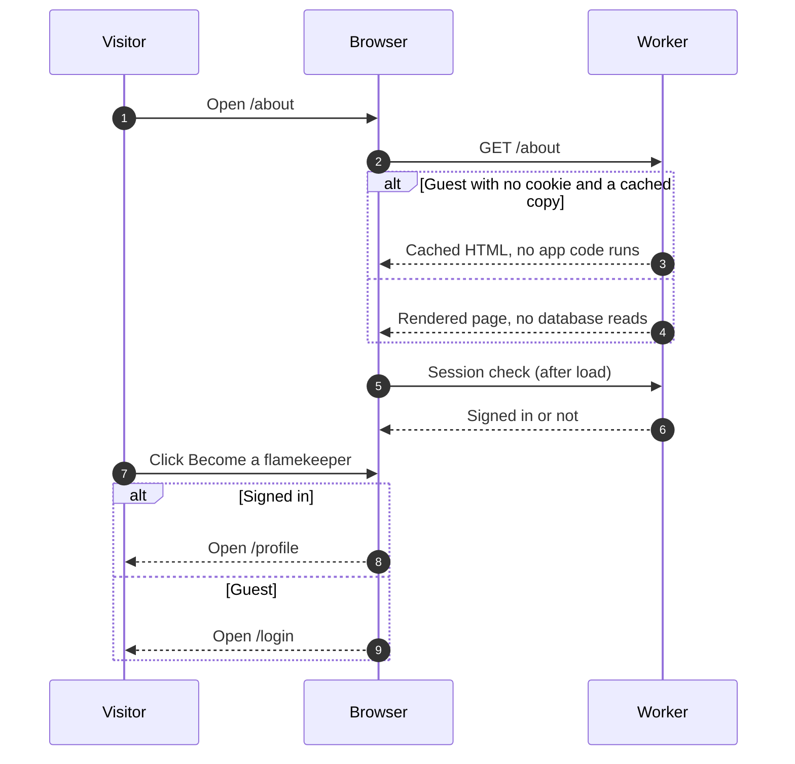

# The About page

> **Question:** What happens when someone opens `/about`, and where
> does the Become a flamekeeper button go?
>
> **Answer:** Anyone can open it, signed in or not. The Worker reads
> nothing from the database for it. The page explains the club,
> flamekeepers, how long albums last and how to help, and ends with
> FAQ, Terms and Privacy links. The Become a flamekeeper button goes
> to `/become-flamekeeper` for a signed-in person and to `/login` for a guest.
>
> **Notes:**
> - Links to the page: the sidebar "About" entry, the public gallery
>   header and the login page. `/` still redirects to `/albums`.
> - Guest loads are cached at the edge for an hour, signed-in loads
>   are not (they carry a cookie). The path-to-TTL rule is
>   `src/lib/cache/guest-html.ts`.
> - The HTML is the same for everyone. The browser only asks for the
>   session after the page loads, to pick the button's destination.
>   Until it answers, the button points at `/profile`, which sends a
>   guest to `/login`.
> - The minimum pledge, the two-year album lifetime and the 30 and 7
>   day reminders in the text come from the same constants the app
>   enforces, see `src/lib/about/content.ts`.
> - The button's destination is one constant,
>   `BECOME_FLAMEKEEPER_PATH`, see connect-drive.md.

