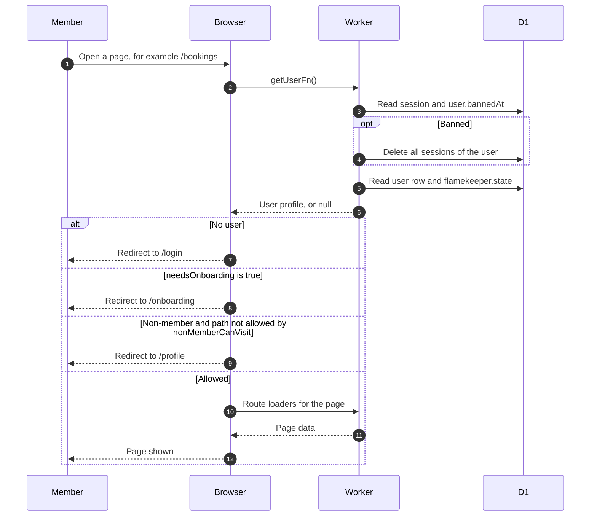

# Who can open which page

> **Question:** What decides whether a signed-in person can open
> a page, or is sent somewhere else?
>
> **Answer:** Every page in the signed-in area first asks the
> server who the person is. No session means `/login`. A member
> who has not finished onboarding goes to `/onboarding`. A
> non-member is never sent to onboarding. A non-member can only open `/profile` and `/favorites`, and is
> sent to `/profile` for anything else.
>
> **Notes:**
> - Member: the account has isMember set. Their onboarding is
>   unfinished until onboardingComplete is set.
> - Non-member: has no onboarding. Terms are accepted on the login
>   page when the account is created, so there is no signup step
>   left to finish, and an account is never removed for being
>   unfinished.
> - `/profile` and `/favorites` count along with any sub-path.
>   Trailing slashes are ignored.
> - The `/albums` pages are outside the signed-in area. Anyone
>   can open them, signed in or not. `/` redirects to `/albums`.
> - getUserFn also deletes the sessions of a banned user and then
>   reports no session. Inactive accounts are not checked here,
>   see sign-in.md.
> - These pages draw in the browser only. The server still runs
>   the check and the data loaders.

