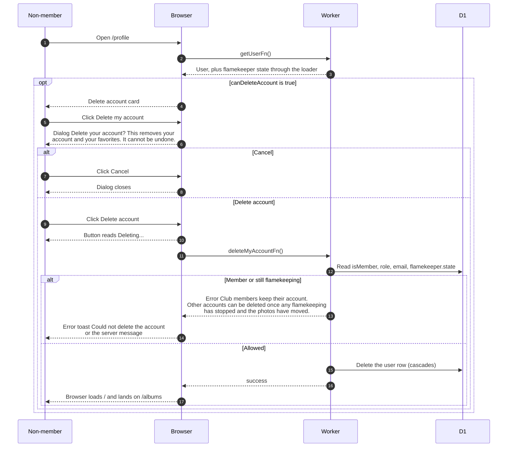

# Deleting your own account

> **Question:** Can a person delete their account, and what
> happens when they do?
>
> **Answer:** Only a non-member who is not currently flamekeeping
> can. They see a "Delete account" card on `/profile`, click
> "Delete my account" and confirm "Delete your account?". The
> account and its favorites are removed for good and the browser
> goes to `/`, which redirects to `/albums`. Club members cannot
> delete themselves.
>
> **Notes:**
> - A flamekeeper whose state is "drained" counts as no longer
>   flamekeeping and may delete. Any other state blocks it.
> - The card is hidden when the rule says no, and the server
>   checks the same rule again.
> - Deleting the user row also removes sessions, linked Google
>   accounts, Telegram tokens, favorites and the flamekeeper row
>   through database cascades.
> - Accounts left unfinished are removed by a scheduled cleanup
>   instead, see cron/albums-and-housekeeping/.
> - Abandoning signup is a different path, see leave-signup.md.

