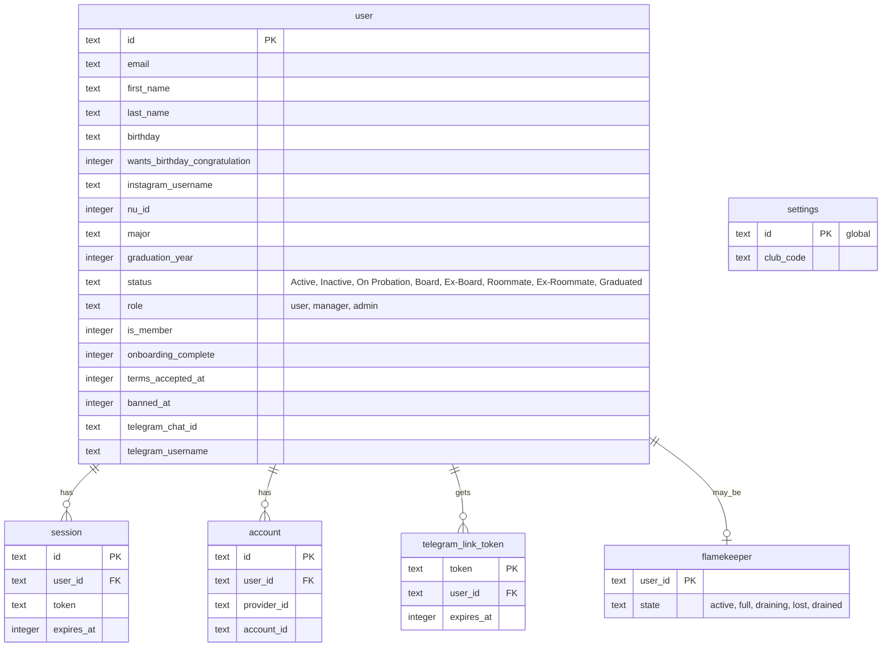

# Account tables

> **Question:** Which tables do the account scenarios read and
> write?
>
> **Answer:** Sign-in, onboarding, profile and deletion work on
> the user table and its sign-in helpers (session and account).
> Telegram linking uses telegram_link_token, joining the club
> reads settings.clubCode, and a flamekeeper row decides whether
> a non-member has finished signup or may delete the account.
>
> **Notes:**
> - Deleting a user cascades to session, account, favorite,
>   telegram_link_token and flamekeeper.
> - No KV or R2 data is used by these scenarios.
> - Telegram link tokens are random 32-character ids that last
>   10 minutes.

