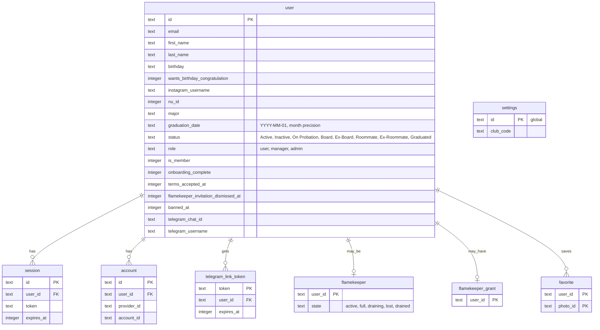

# Account tables

> **Question:** Which tables do the account scenarios read and
> write?
>
> **Answer:** Sign-in, onboarding, profile and deletion work on
> the user table and its sign-in helpers (session and account).
> Telegram linking uses telegram_link_token, joining the club
> reads settings.club_code, and a flamekeeper row decides whether
> a non-member may delete the account. The terms date is written
> to user.terms_accepted_at when the account is created.
>
> **Notes:**
> - Deleting a user cascades to session, account, favorite,
>   telegram_link_token, flamekeeper and flamekeeper_grant. It
>   also removes the user's albums, album memberships, upload
>   reservations and flamekeeper volumes, which these scenarios
>   do not use.
> - KV: the key `flamekeeper-oauth:{random id}` holds the pledge,
>   graduation month and terms time while a flamekeeper is at
>   Google. It lasts 10 minutes and is deleted when the person
>   returns. See flamekeepers/connect-drive.md.
> - No R2 data is used by these scenarios.
> - Telegram link tokens are random 32-character ids that last
>   10 minutes.

