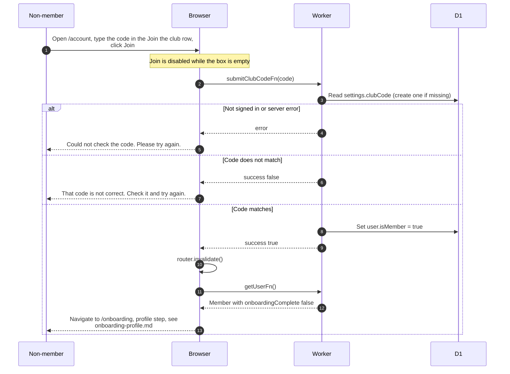

# Becoming a member with the club code

> **Question:** How does a non-member become a club member?
>
> **Answer:** On `/account` they type the current club code in the "Join the
> club" row of the Club section and click Join. If it matches, the account becomes a member
> and the app moves them to `/onboarding` to fill in their
> profile. A wrong code shows an error and nothing changes.
>
> **Notes:**
>
> - The code is compared ignoring capital letters and spaces at
>   the ends. It is stored in the global settings row. The server
>   accepts at most 64 characters.
> - If no code exists yet, the first check creates a random one
>   and saves it, so that first attempt fails.
> - The pledge and photos of a flamekeeper stay as they are.
> - The profile step and Telegram step that follow are in
>   onboarding-profile.md and onboarding-telegram.md.
> - Only non-members see this row. Deleting the account is
>   offered below it, see delete-account.md.

