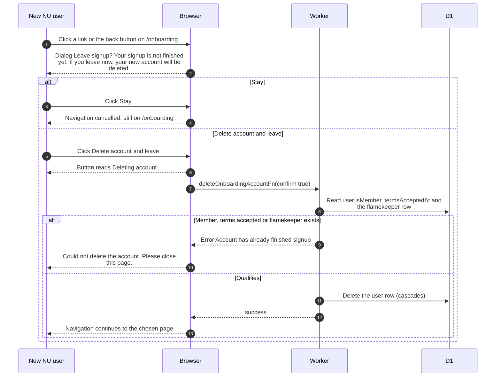

# Leaving signup before it is finished

> **Question:** What happens if a new NU user tries to leave the
> signup page without connecting Drive?
>
> **Answer:** The app blocks the move and asks "Leave signup?".
> If the person chooses "Stay" nothing changes. If they choose
> "Delete account and leave", the unfinished account is deleted
> and they continue to where they were going. They can sign in
> with Google again later and start over.
>
> **Notes:**
> - Only the first signup step is guarded, for both NU and
>   alumni users. Members finishing their profile are never
>   deleted this way.
> - The server refuses to delete an account that is a member, has
>   accepted the terms, or has a flamekeeper record.
> - Closing the tab shows the browser's own warning instead.
>   Moving to the Drive connection page and finishing with
>   "Create account" do not trigger the prompt.
> - Sessions, linked Google accounts and Telegram link tokens are
>   removed together with the user row.

