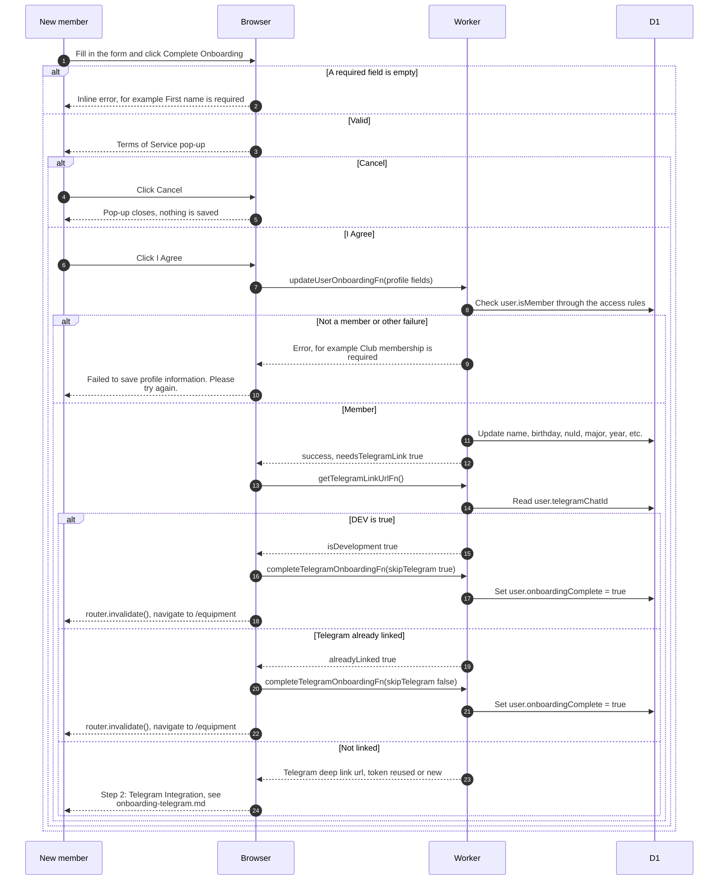

# Member profile step of onboarding

> **Question:** What happens when a new member fills in their
> profile on `/onboarding`?
>
> **Answer:** The member fills in name, birthday, NU ID, major
> and graduation year and clicks "Complete Onboarding". The
> details are saved and the app looks at Telegram. In local development with
> DEV=true, or if Telegram is already linked, onboarding finishes
> at once and the member goes to `/equipment`. Otherwise the
> Telegram step is shown.
>
> **Notes:**
> - Required in the form: first name, last name, birthday, NU ID,
>   major and graduation year. Instagram is optional. The
>   birthday greeting box starts ticked.
> - The server also requires a positive whole NU ID and a
>   graduation year from 2010 to 3000.
> - Saving the details does not mark onboarding complete. That
>   happens when Telegram is linked, or as drawn here when it is
>   already linked or skipped.
> - The terms were accepted on the login page and saved when the
>   account was created, see sign-in.md. Onboarding asks nothing
>   about terms.
> - Finishing also refreshes the birthdays calendar. A failure
>   there is only logged and does not stop the member.
> - Any failure on save shows the one message "Failed to
>   save profile information. Please try again." Examples are an
>   NU ID that another account already uses, a signed-out
>   session, or a refused membership check.
> - The Telegram step is in onboarding-telegram.md.

