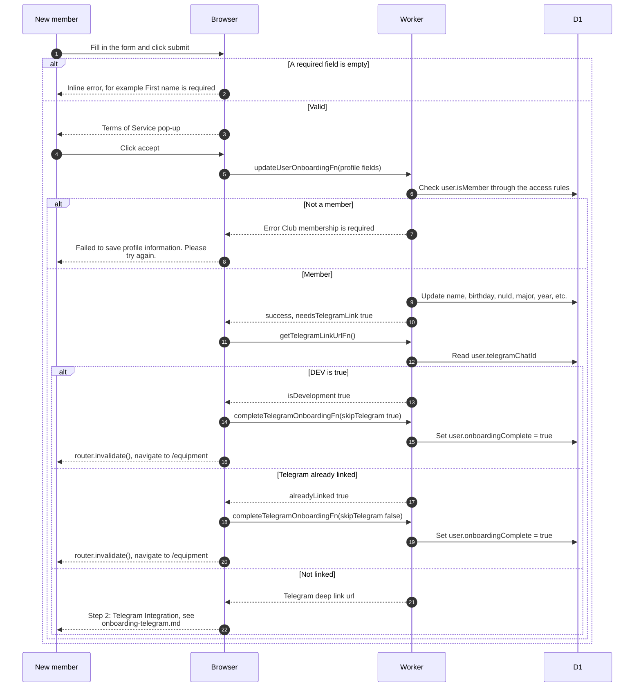

# Member profile step of onboarding

> **Question:** What happens when a new member fills in their
> profile on `/onboarding`?
>
> **Answer:** The member fills in name, birthday, NU ID, major
> and graduation year, then accepts the terms of service in a
> pop-up. The details are saved. The app then asks for a Telegram
> link. In local development with DEV=true, or if Telegram is
> already linked, onboarding finishes at once and the member goes
> to `/equipment`. Otherwise the Telegram step is shown.
>
> **Notes:**
> - Required in the form: first name, last name, birthday, NU ID,
>   major and graduation year. Instagram is optional. The
>   birthday greeting choice starts as yes.
> - The server also requires a positive whole NU ID and a
>   graduation year from 2010 to 3000.
> - Saving the details does not mark onboarding complete. That
>   happens in the Telegram step or, as drawn here, when it is
>   skipped.
> - Finishing also refreshes the birthdays calendar. A failure
>   there is only logged and does not stop the member.
> - The Telegram step is in onboarding-telegram.md.
> - Any failure while saving shows one generic message, for
>   example when the NU ID belongs to another account.

