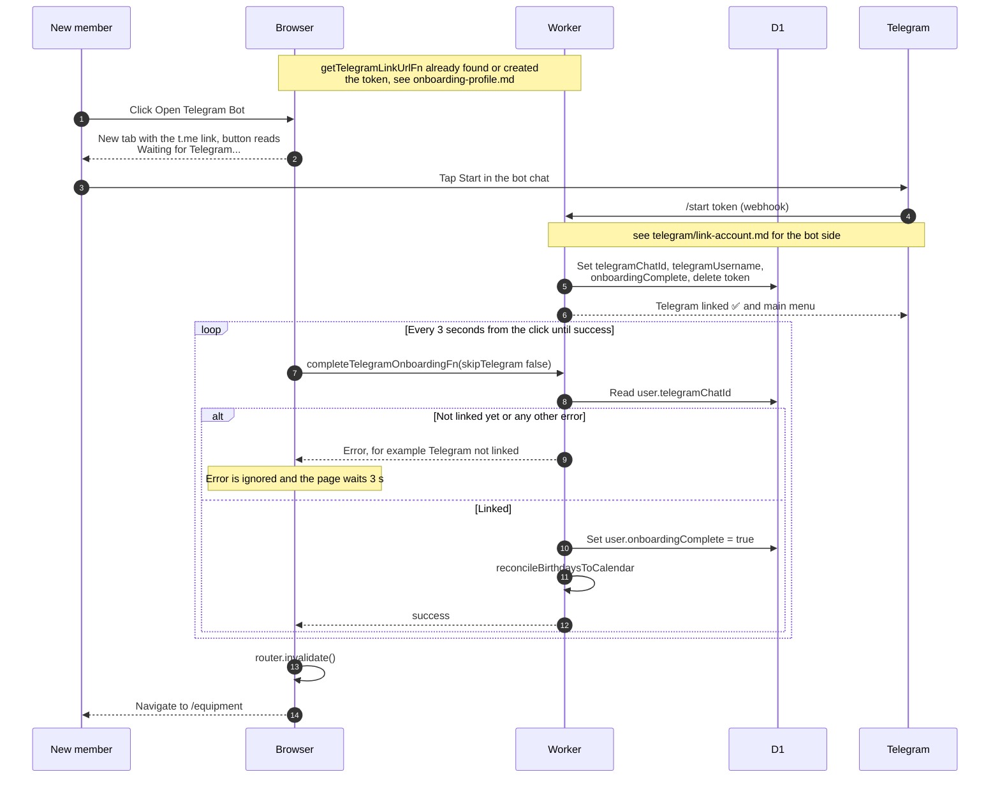

# Linking Telegram during onboarding

> **Question:** How does a new member finish onboarding by
> linking Telegram?
>
> **Answer:** The member clicks "Open Telegram Bot", which opens a
> chat with the bot using a one-time link. Tapping Start in
> Telegram links their chat to the account. After the click the
> web page asks the server every 3 seconds. Once the link exists
> it marks onboarding complete and moves the member to
> `/equipment`.
>
> **Notes:**
> - The link token lasts 10 minutes. If an unexpired token
>   already exists for the member it is reused, so reloads do
>   not create new ones. Tokens are stored in telegram_link_token.
> - The page only starts asking after the button is clicked. It
>   keeps asking until it succeeds. Any error is ignored, not
>   only "Telegram not linked". It never fetches a new token, so
>   once the first one expires the bot answers "Link expired or
>   invalid." unless the chat is already linked.
> - The bot also sets onboardingComplete when it links the chat.
> - The bot side, including the replies, is in
>   telegram/link-account.md. Where the link is created is in
>   telegram/link-token-create.md.
> - Failure to update the birthdays calendar is only logged.

