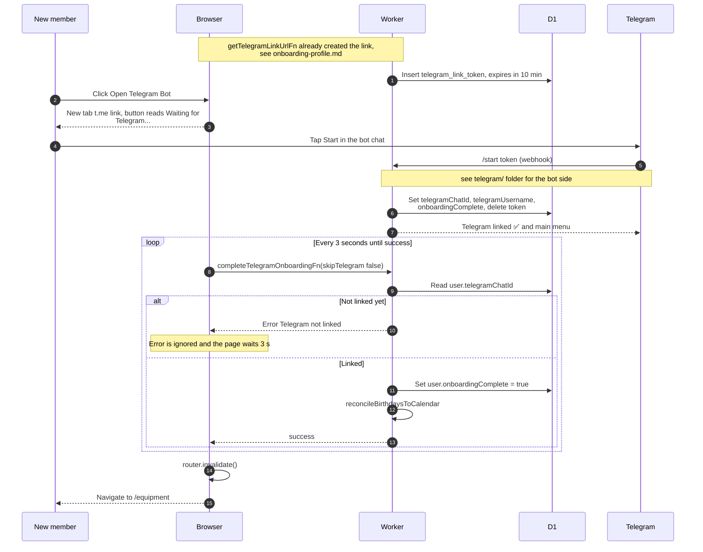

# Linking Telegram during onboarding

> **Question:** How does a new member finish onboarding by
> linking Telegram?
>
> **Answer:** The member clicks "Open Telegram Bot", which opens a
> chat with the bot using a one-time link. Pressing Start in
> Telegram links their chat to the account. The web page checks
> every 3 seconds and, once the link exists, marks onboarding
> complete and moves the member to `/equipment`.
>
> **Notes:**
> - The link token lasts 10 minutes. If an unexpired token
>   already exists for the member it is reused, so reloads do
>   not create new ones. Tokens are stored in telegram_link_token.
> - The page keeps checking until it succeeds. It does not fetch
>   a new token if the first one expires, and the bot then
>   answers "Link expired or invalid." unless the chat is already
>   linked.
> - The bot also sets onboardingComplete when it links the chat.
> - The bot side, including the replies, is in the telegram/
>   folder, see src/lib/telegram/commands/start.ts.
> - Failure to update the birthdays calendar is only logged.

