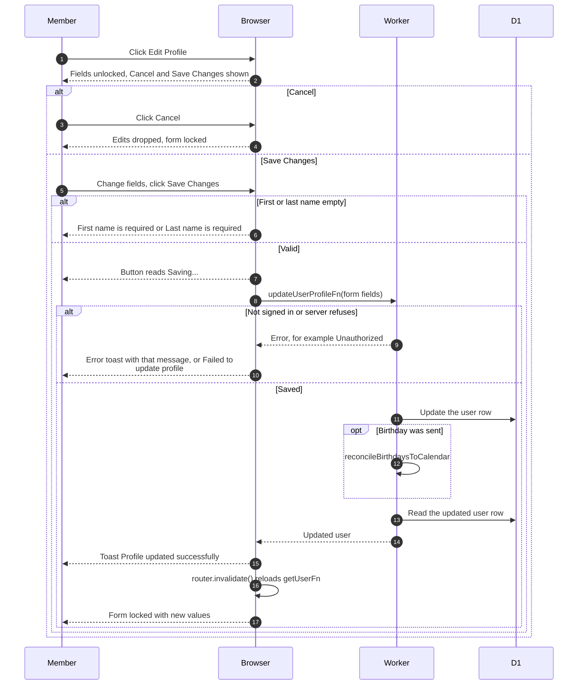

# Editing the profile

> **Question:** How does a member change their own details on
> the profile page?
>
> **Answer:** On `/profile` the member clicks "Edit Profile",
> changes fields and clicks "Save Changes". The changes are saved,
> the message "Profile updated successfully" appears, the form
> locks again and the page reloads its data. "Cancel" throws the
> edits away.
>
> **Notes:**
> - Editable: first name, last name, birthday, Instagram, major,
>   graduation month and NU ID. Email cannot be changed. Status,
>   role, clearance level and the other account facts sit on the
>   "Admin Managed" tab and cannot be changed here.
> - The Telegram username box is also locked. Its "Update
>   Telegram" button is in update-telegram.md.
> - Only members see this form. Non-members see the account page
>   described in join-club.md and delete-account.md.
> - When the form has a birthday, the birthdays calendar is
>   refreshed after saving. A failure there is only logged.
> - The server requires non-empty names and a graduation
>   month as a date. Anyone may enter a past month; a flamekeeper
>   must enter a future one, and a nearer date follows the 60-day
>   rule in change-pledge.md. A failure shows the server's message, or
>   "Failed to update profile".

