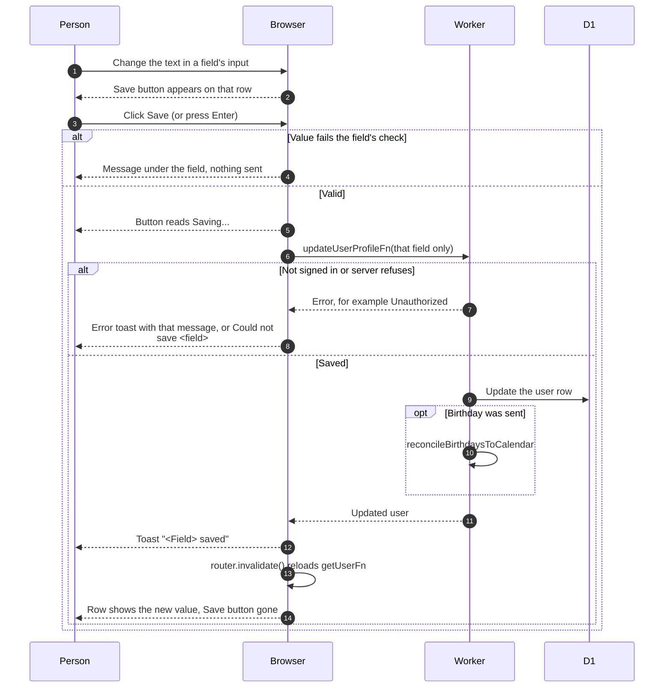

# Editing the profile

> **Question:** How does a person change their own details on
> the profile page?
>
> **Answer:** On `/profile` every editable field is its own row with
> its input always visible. Changing the text makes a Save button
> appear on that row. Saving sends just that field, shows the message
> "<Field> saved" and reloads the page data. There is no edit mode.
>
> **Notes:**
> - Members see About you (first name, last name, birthday, major,
>   Graduating, NU ID), Contact (email locked, Telegram with Relink,
>   Instagram) and a read-only Club section (status, role, clearance,
>   joined). Email cannot be changed.
> - Relink is in update-telegram.md.
> - Non-members never see About you or Contact. A flamekeeper who is
>   not a member sees Graduating in the Flamekeeper section, see
>   ../flamekeepers/profile-card.md. Who sees what is decided by
>   `getAccessRules`.
> - When a birthday is saved, the birthdays calendar is refreshed.
>   A failure there is only logged.
> - The browser checks each value with the same schema the server
>   uses (`src/lib/user/profile-fields.ts`): names cannot be empty,
>   the NU ID is digits, and birthday and Graduating cannot be
>   cleared. Major and Instagram can be cleared. A leading @ on
>   Instagram is dropped. A failure shows under the row or as the
>   server's message, or "Could not save <field>".
> - Anyone may enter a past graduation month; a flamekeeper must
>   enter a future one, and a nearer date follows the 60-day rule
>   in ../flamekeepers/change-pledge.md.

