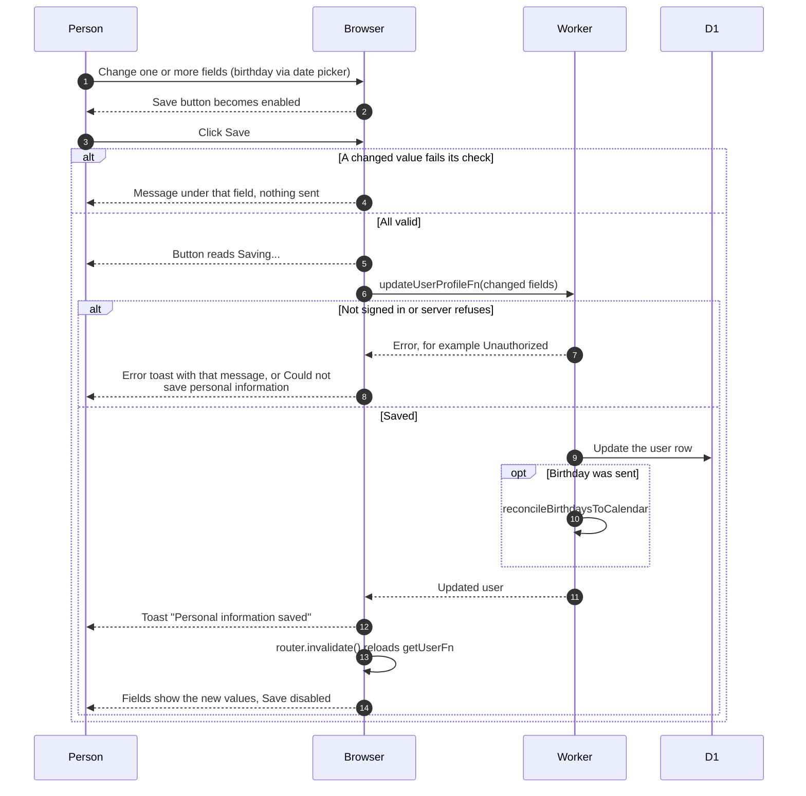

# Editing the profile

> **Question:** How does a person change their own details on
> the My Account page?
>
> **Answer:** On `/account` ("My Account") the Personal Information
> section shows every editable field with its input always visible.
> Changing any value enables one Save button at the bottom of the
> section. Saving sends only the changed fields together, shows the
> message "Personal information saved" and reloads the page data.
> There is no edit mode.
>
> **Notes:**
>
> - Members see Personal Information (first name, last name, birthday
>   picked from a date picker, major, Graduating, NU ID, email locked,
>   Telegram read-only, Instagram) and a read-only Club section
>   headed "Managed by admins" (status, role, clearance, joined).
>   Email cannot be changed.
> - Telegram shows the linked @username or "Not linked" and cannot be
>   typed into. A Link button appears only when nothing is linked, see
>   update-telegram.md.
> - Non-members never see Personal Information. A flamekeeper who is
>   not a member sees Graduating in the Flamekeeper section, see
>   ../flamekeepers/profile-card.md. Who sees what is decided by
>   `getAccessRules`.
> - When a birthday is saved, the birthdays calendar is refreshed.
>   A failure there is only logged.
> - The browser checks each changed value with the same schema the
>   server uses (`src/lib/user/profile-fields.ts`): names cannot be
>   empty, the NU ID is digits, and birthday and Graduating cannot be
>   cleared. Major and Instagram can be cleared. A leading @ on
>   Instagram is dropped. A failed check shows under its row and
>   nothing is sent. A server failure shows the server's message, or
>   "Could not save personal information".
> - Anyone may enter a past graduation month; a flamekeeper must
>   enter a future one, and a nearer date follows the 60-day rule
>   in ../flamekeepers/change-pledge.md.

