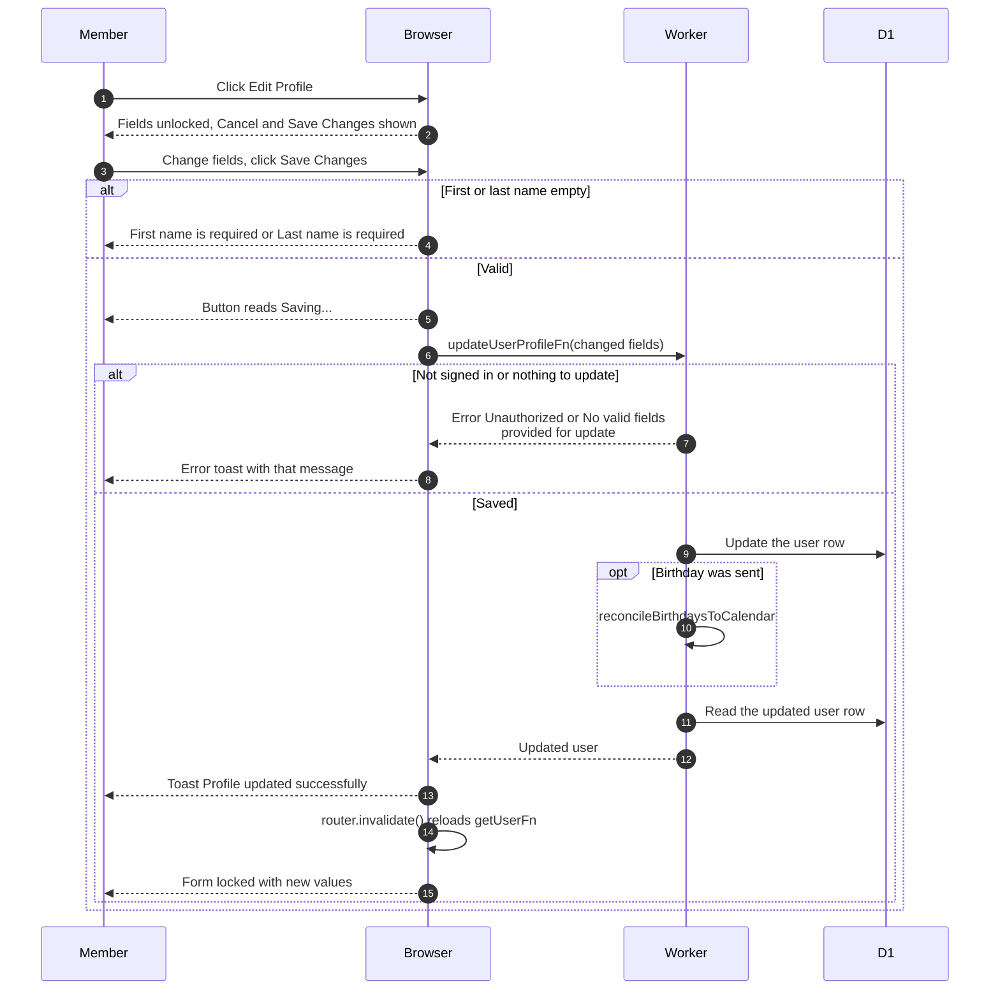

# Editing the profile

> **Question:** How does a member change their own details on
> the profile page?
>
> **Answer:** On `/profile` the member clicks "Edit Profile",
> changes fields and clicks "Save Changes". The changes are saved,
> the message "Profile updated successfully" appears, the form
> locks again and the page reloads its data. "Cancel" throws the
> edits away.
>
> **Notes:**
> - Editable: first name, last name, birthday, Instagram, major,
>   graduation year and NU ID. Email cannot be changed.
>   Status, role, clearance and Telegram are read-only here.
> - Only members see this form. Non-members see the account page
>   described in join-club.md and delete-account.md.
> - A changed birthday also refreshes the birthdays calendar. A
>   failure there is only logged.
> - Server rules: names must not be empty and graduation year
>   must be from 1900 to 2100. A failure shows the server's
>   message, or "Failed to update profile".
> - Changing the linked Telegram username is in
>   update-telegram.md.

