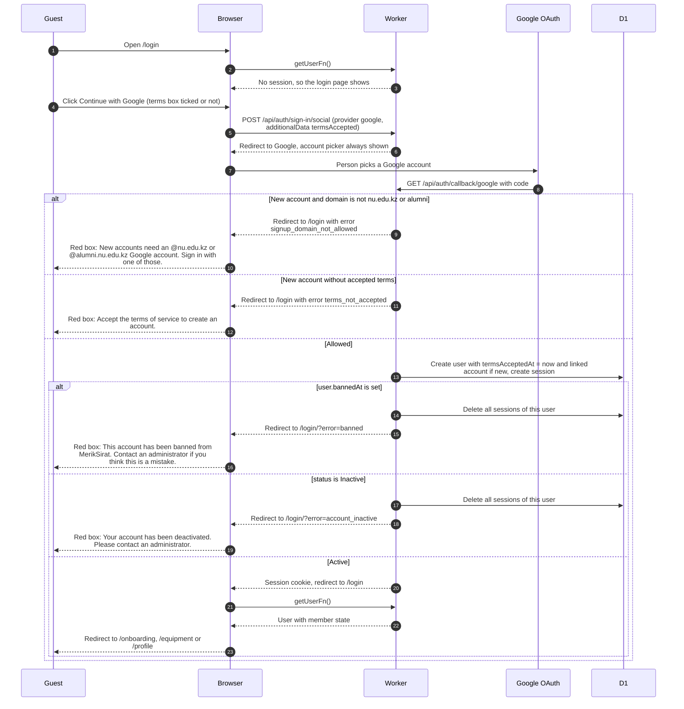

# Signing in with Google

> **Question:** What happens when someone clicks "Continue with
> Google" on the login page, and how does a new account get made?
>
> **Answer:** The terms of service box is for new accounts only,
> and the button is always enabled, so returning users sign in
> without ticking it. Google confirms who they are and they come back to
> `/login`, which sends them on to their home page. A brand-new
> account is only created for an @nu.edu.kz or @alumni.nu.edu.kz
> address, and only when the terms were accepted. The terms date is
> saved on the new user row as the account is created, and the
> account is finished at once: no Drive step, no other signup
> step. Any other new address, or a new account without accepted
> terms, is refused and sees a red message on the login page.
> Banned and inactive people are signed out again at once and see
> a red message too.
>
> **Notes:**
> - Only creating an account checks the email domain. Existing
>   accounts with any other domain can still sign in.
> - The home page is `/onboarding` for a member who has not
>   finished onboarding, else `/equipment` for members and
>   `/profile` for non-members. See access-gate.md for the rules.
> - The login page cannot tell new users from existing ones, so it
>   never blocks the button. Only account creation runs the check.
> - The box value (ticked or not) travels to the server as extra data on the
>   sign-in call, and comes back on the Google callback. A
>   better-auth hook reads it while creating the user. The browser
>   data is untrusted, so the hook accepts only an explicit true.
>   Existing accounts are never asked again and never removed, and
>   nothing deletes an account for being unfinished.
> - A club member enters the club code later on `/profile`, see
>   join-club.md. An @nu.edu.kz user can become a flamekeeper from
>   the profile too, see flamekeepers/connect-drive.md.
> - Someone who is already signed in and opens `/login` is sent
>   straight to their home page.
> - If the Google sign-in call throws in the browser, the error
>   is only written to the browser console.
> - A refused new address is turned back by better-auth, and its
>   code in node_modules shows the redirect to
>   `/login?error=signup_domain_not_allowed`. A new account without
>   accepted terms goes to `/login?error=terms_not_accepted`. No
>   account row is written in either case.
> - The Inactive check happens only at sign-in. When an admin sets
>   an account to Inactive, that person's sessions are deleted at
>   that moment. A ban is also checked on every page request, see
>   access-gate.md.
> - better-auth limits each client address to 3 requests per 10
>   seconds on its sign-in routes and 100 per 60 seconds on the
>   others. The sign-in page shows no message when that stops
>   a click.
> - The login page links to the About page, see about-page.md.
> - Sign-out is in sign-out.md.

