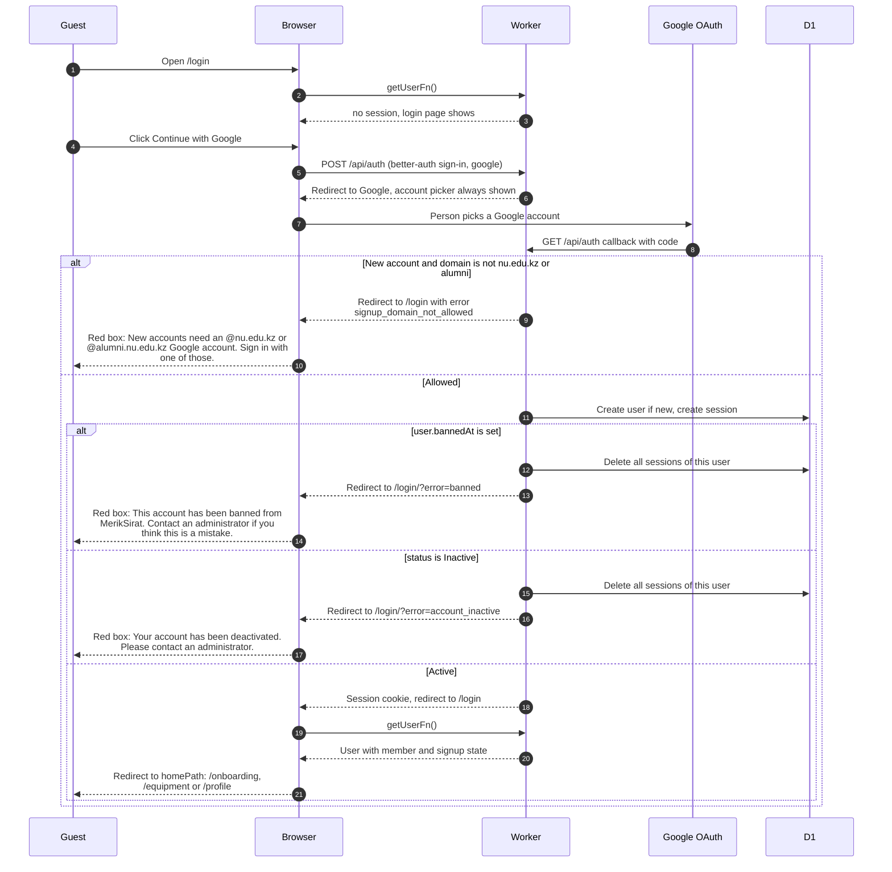

# Signing in with Google

> **Question:** What happens when someone clicks "Continue with
> Google" on the login page?
>
> **Answer:** Google confirms who they are and they come back to
> `/login`, which then sends them to their home page. A brand-new
> account is only created for an @nu.edu.kz or @alumni.nu.edu.kz
> address. Banned and inactive users are signed out again at once
> and see a red message on the login page.
>
> **Notes:**
> - Only account creation checks the email domain. Existing
>   accounts with any other domain can still sign in.
> - The home page is `/onboarding` if signup is unfinished, else
>   `/equipment` for members and `/profile` for non-members.
>   See access-gate.md for the rules.
> - If Google sign-in fails in the browser, only the console
>   logs it. The person sees nothing new.
> - Sign-out is in sign-out.md.

