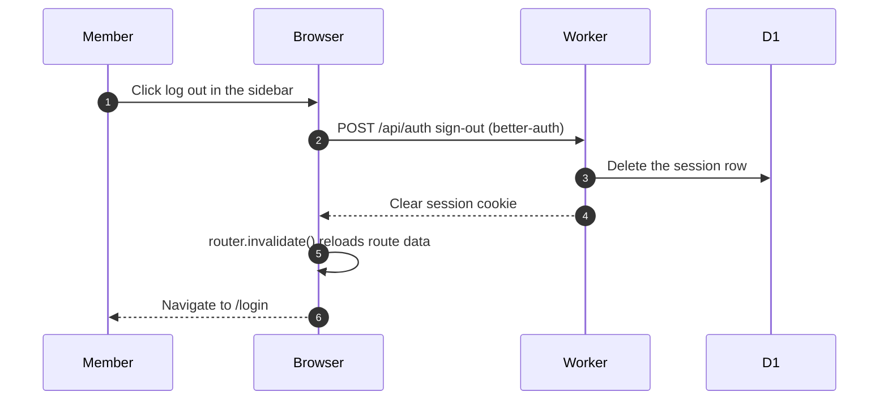

# Signing out

> **Question:** What happens when a signed-in person clicks log
> out in the sidebar?
>
> **Answer:** The session is ended through the better-auth route
> `/api/auth`, the app's cached route data is refreshed, and the
> person lands on `/login`.
>
> **Notes:**
> - A banned user does not choose this. Their sessions are
>   deleted on the server, see sign-in.md and access-gate.md.

