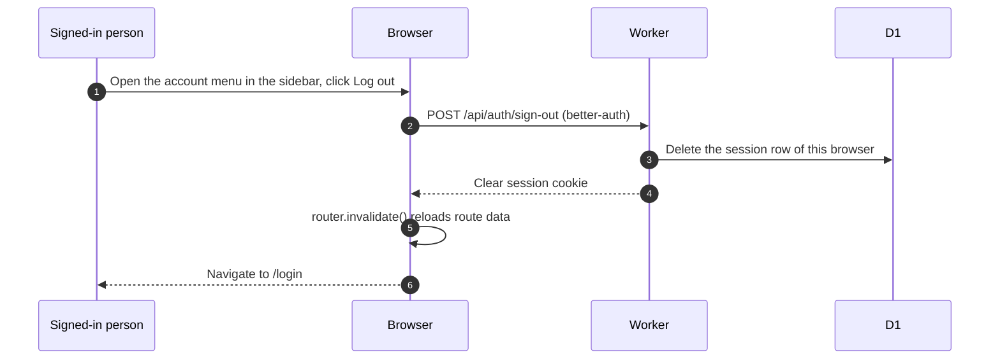

# Signing out

> **Question:** What happens when a signed-in person chooses
> "Log out" in the sidebar?
>
> **Answer:** The session is ended through the better-auth route
> under `/api/auth`, the app's saved page data is refreshed, and
> the person lands on `/login`.
>
> **Notes:**
> - "Log out" is in the account menu at the bottom of the sidebar.
>   Members and non-members both have it.
> - Only the session of this browser is deleted. Sessions on other
>   devices stay valid.
> - A banned person does not choose this. Their sessions are
>   deleted by the server, see sign-in.md and access-gate.md.

