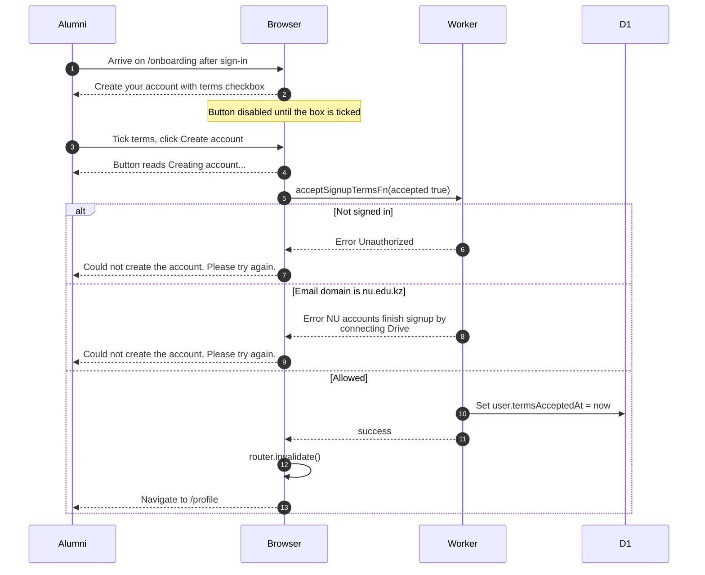

# Creating an alumni or other non-NU account

> **Question:** What does someone with an @alumni.nu.edu.kz
> address (or any non-@nu.edu.kz address) do to finish signup?
>
> **Answer:** They land on `/onboarding` and see "Create your
> account". They tick that they accept the terms of service and
> press "Create account". The terms date is saved and they go to
> `/profile` as a non-member. They can browse albums and favorite
> photos, and can enter the club code there to become a member.
>
> **Notes:**
> - There is no Drive step for these accounts. The page says
>   the account has too little Drive storage to keep club photos.
> - The server refuses this call for @nu.edu.kz addresses, with
>   the error "NU accounts finish signup by connecting Drive".
> - Only an @alumni.nu.edu.kz or @nu.edu.kz address can create a
>   new account, see sign-in.md. Other domains reach this page
>   only if their account already existed.
> - Alumni accounts are skipped by the scheduled cleanup of
>   unfinished signups.
> - Leaving this page before pressing the button shows the same
>   leave prompt as for NU users, see leave-signup.md.

