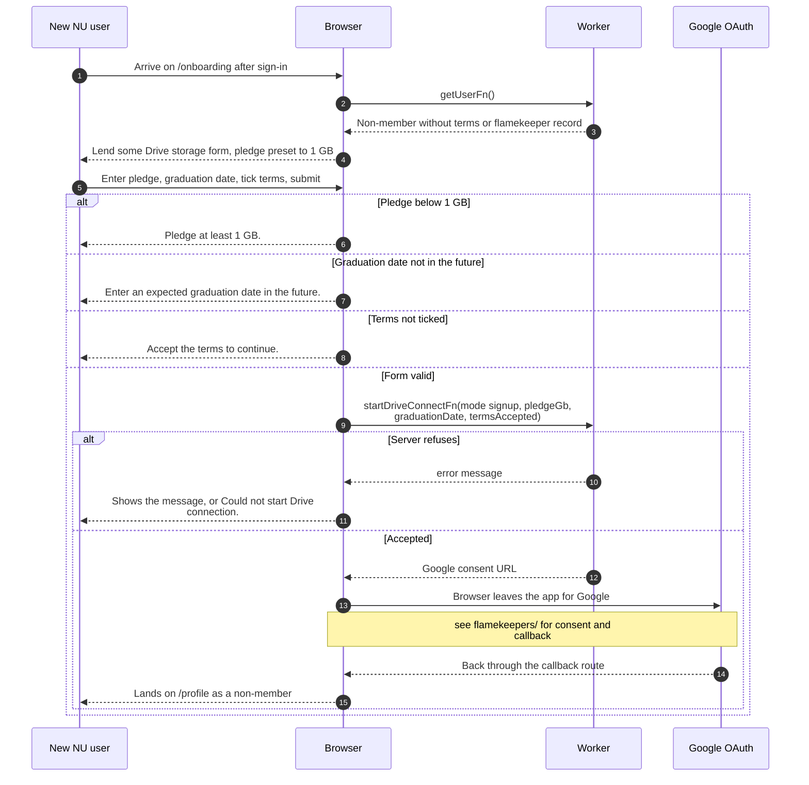

# Finishing signup with an NU Google account

> **Question:** What does a new @nu.edu.kz user have to do before
> they can use the app?
>
> **Answer:** They land on `/onboarding` and see "Lend some Drive
> storage". They must pledge at least 1 GB, give an expected
> graduation date in the future, accept the terms and then connect
> their Google Drive. Connecting Drive is what finishes the signup.
> They then arrive on `/profile` as a non-member and can browse
> albums and favorite photos.
>
> **Notes:**
> - The Drive connection itself, the Google consent screen and
>   the return trip are in the flamekeepers folder, see
>   flamekeepers/ and src/routes/api/flamekeeper.callback.ts.
> - On failure the return trip lands on `/onboarding` with an
>   error code in the URL, shown above the form. Messages are for
>   denied, state, session, account, scope, token and master.
> - Until Drive is connected, the account has no terms date and no
>   flamekeeper record, so the access gate keeps sending them back
>   here. Leaving the page asks to delete the account, see
>   leave-signup.md.
> - Accounts that never finish are also deleted by a scheduled
>   cleanup, see cron/albums-and-housekeeping/.
> - Members who already have a club code skip this page's first
>   step, see join-club.md.

