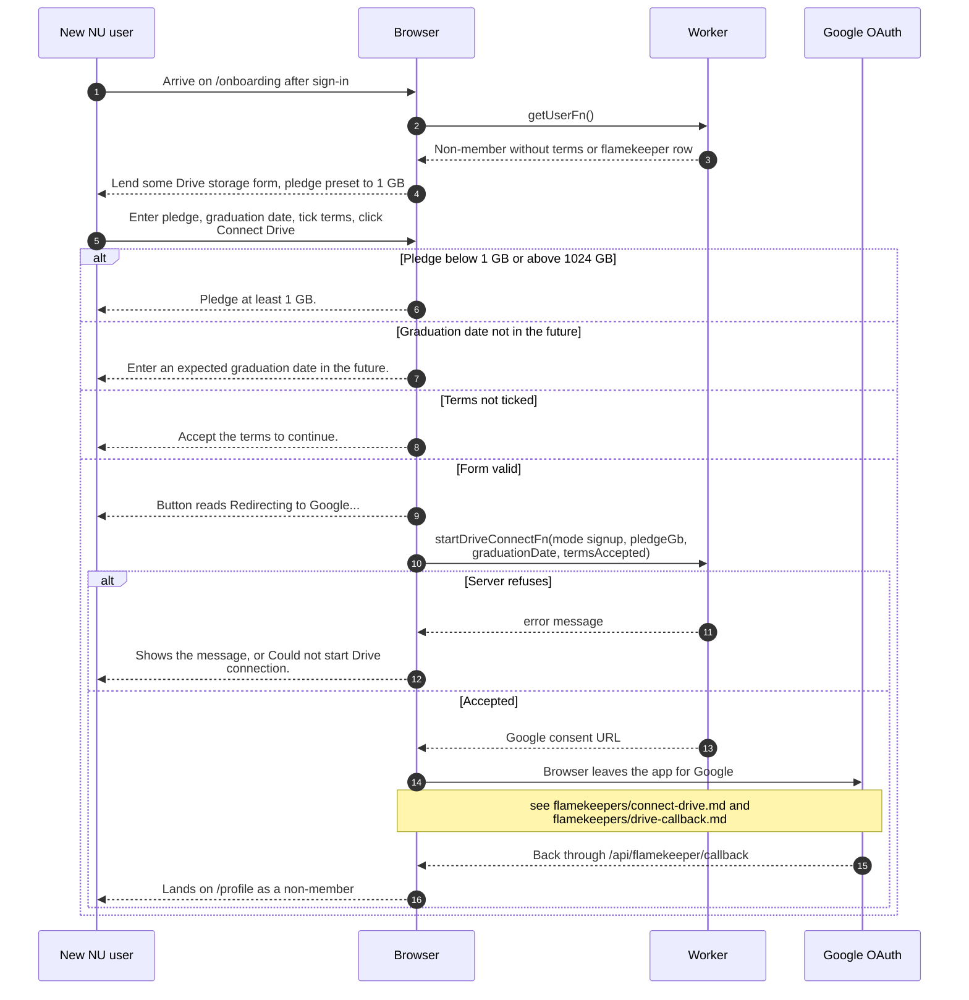

# Finishing signup with an NU Google account

> **Question:** What does a new @nu.edu.kz user have to do before
> they can use the app?
>
> **Answer:** They land on `/onboarding` and see "Lend some Drive
> storage". They must pledge between 1 and 1024 GB, give an
> expected graduation date in the future, accept the terms and
> then connect their Google Drive. Connecting Drive finishes the
> signup. They then arrive on `/profile` as a non-member and can
> browse albums and favorite photos.
>
> **Notes:**
> - The Google consent screen and the return trip are in
>   flamekeepers/connect-drive.md and flamekeepers/drive-callback.md.
> - The pledge box starts at 1 GB. A pledge above 1024 GB gets
>   the same message as one below 1 GB.
> - If the return trip fails, the person lands on `/onboarding`
>   with an error code in the address. A red message shows on the
>   form for these codes: denied, state, session, account, scope,
>   token and master.
> - Until Drive is connected, the account has no flamekeeper row,
>   so the access gate keeps sending them back here. Leaving the
>   page asks to delete the account, see leave-signup.md.
> - Accounts that never finish are also deleted by a scheduled
>   cleanup after 7 days, see
>   cron/albums-and-housekeeping/stale-signups.md.
> - Members who already have a club code skip this first step,
>   see join-club.md.

