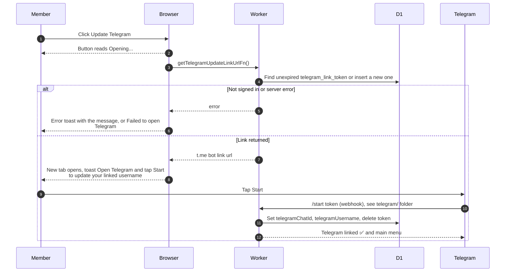

# Updating the linked Telegram username

> **Question:** What happens when a member clicks "Update
> Telegram" on their profile?
>
> **Answer:** The app prepares a one-time bot link and opens it
> in a new tab, with the message "Open Telegram and tap Start to
> update your linked username". When the member taps Start, the
> bot saves their current Telegram chat and username on the
> account.
>
> **Notes:**
> - The token helper reuses an unexpired token if one exists.
>   Otherwise it creates one that lasts 10 minutes.
> - Unlike the onboarding call, this one does not check whether
>   Telegram is already linked.
> - The profile page does not refresh by itself after the bot
>   finishes. The new username shows after the next reload.
> - The bot side is in the telegram/ folder, see
>   src/lib/telegram/commands/start.ts.
> - Onboarding uses a different function for the first link, see
>   onboarding-telegram.md.

