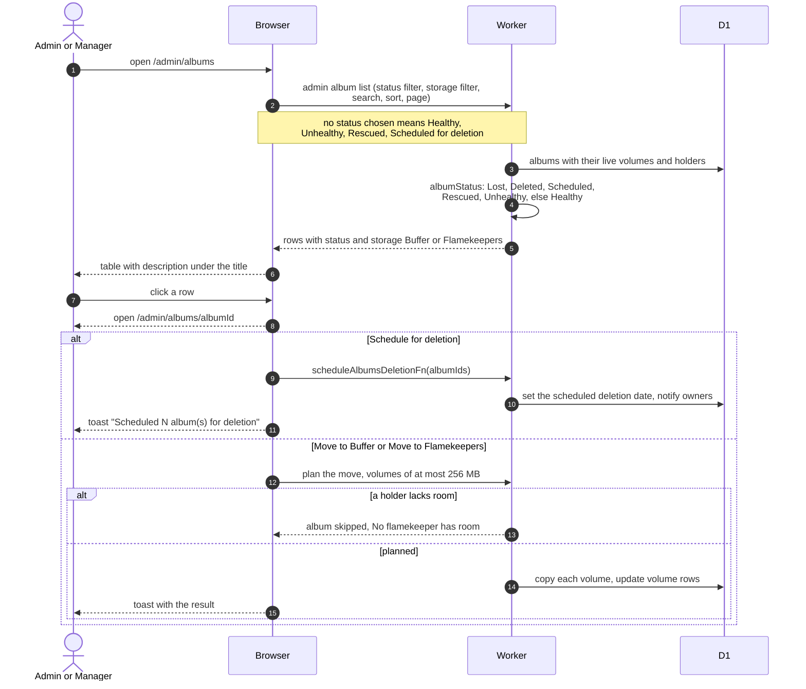

# Album Management And Album Statuses

> **Question:** How do admins and managers browse albums, what do the album statuses mean, and what can they do from the album page?
>
> **Answer:** Manage Albums (/admin/albums) is a table with a one-line description under the title, search, filters and bulk actions. Each album has one of six statuses derived from its data, never stored: Healthy, Unhealthy, Rescued, Scheduled for deletion, Deleted and Lost. The table opens with the status filter set to Healthy, Unhealthy, Rescued and Scheduled for deletion, so Deleted and Lost albums are hidden until chosen. The Storage column says Buffer or Flamekeepers. A row opens /admin/albums/albumId, which shows the same action buttons as the public album page plus Schedule for deletion (or Cancel deletion), Move to Buffer and Move to Flamekeepers, and an Overview tab with a table of the event, dates, owner and storage and an "Album statuses" explanation of all six.
>
> **Notes:**
> - Precedence when more than one applies: Lost, then Deleted, then Scheduled for deletion, then Rescued, then Unhealthy, then Healthy (`albumStatus` in `src/lib/albums/status.ts`). A deleted album is Lost when its tombstone reason is flamekeeper_lost, flamekeeper_left or folder_deleted, otherwise Deleted.
> - Unhealthy means a live volume sits on a flamekeeper that is lost or has a lost-since date. Rescued means an admin moved the album out of danger (it has a rescued date). Scheduled for deletion means it has a scheduled deletion date.
> - The Storage column is Flamekeepers when any live volume has a flamekeeper, Buffer when only buffer volumes are live, and empty when none is.
> - A volume holds at most 256 MB. Uploads, Move to Buffer and Move to Flamekeepers (offload) all split an album into as many volumes as needed, so one holder (the buffer or one flamekeeper) can hold several volumes of the same album. An offload is planned only if the chosen flamekeepers have room for every volume, otherwise the album is skipped with "No flamekeeper has room".
> - Schedule for deletion tells the owners the date and uses the period set in Settings, Albums. Cancel deletion clears it. Deleting is in [../albums/delete-album.md](../albums/delete-album.md) and the cron side in [../cron/albums-and-housekeeping/expiry-delete.md](../cron/albums-and-housekeeping/expiry-delete.md).
> - Export Albums sits in the page header, see [export-csv.md](export-csv.md). Co-authors are in the Authors tab.
> - Data tables and the detail page show dates as "8 Nov 2026" and "8 Nov 2026, 16:05" in the club's time zone (Asia/Almaty).

