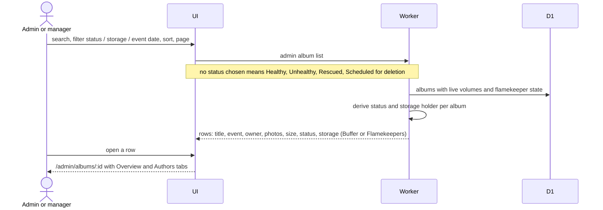
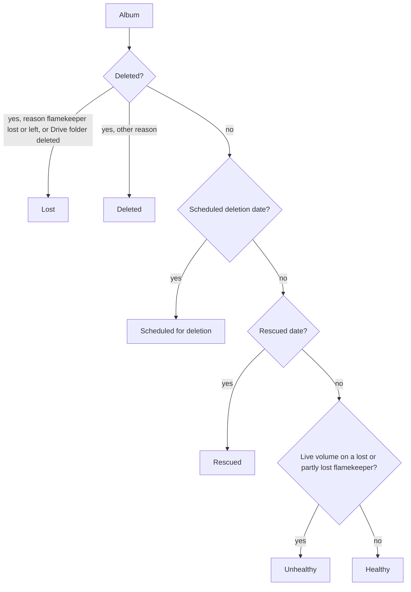

# Albums: list, detail and statuses

Manage Albums (`/admin/albums`) is for admins and managers. Terms: [Album status, Storage holder, Volume](../../../../GLOSSARY.md), [ADR-0018](../../../adr/0018-album-status-is-derived-with-six-statuses.md).

## How do admins browse albums?

- Deleted and Lost albums are hidden until chosen in the status filter, and their detail page shows "Album not found".
- The detail page has the public album actions plus the admin actions in [storage.md](storage.md).

## What do the six statuses mean?

- Never stored; recomputed from the album and its volumes on every read.
- Storage is Flamekeepers if any live volume has a flamekeeper, Buffer if only buffer volumes are live, empty if none.
