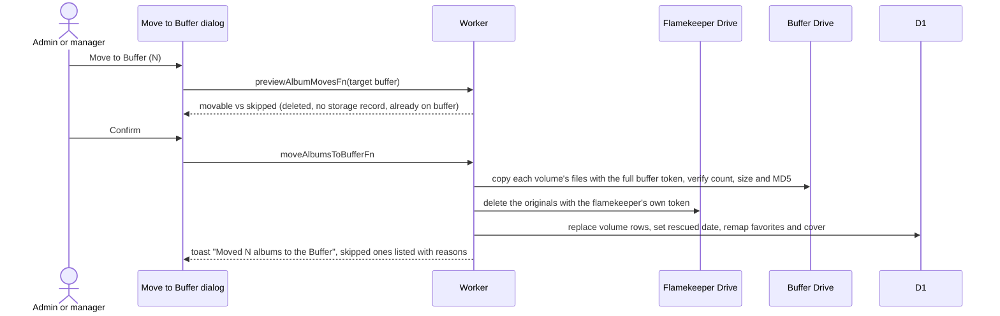
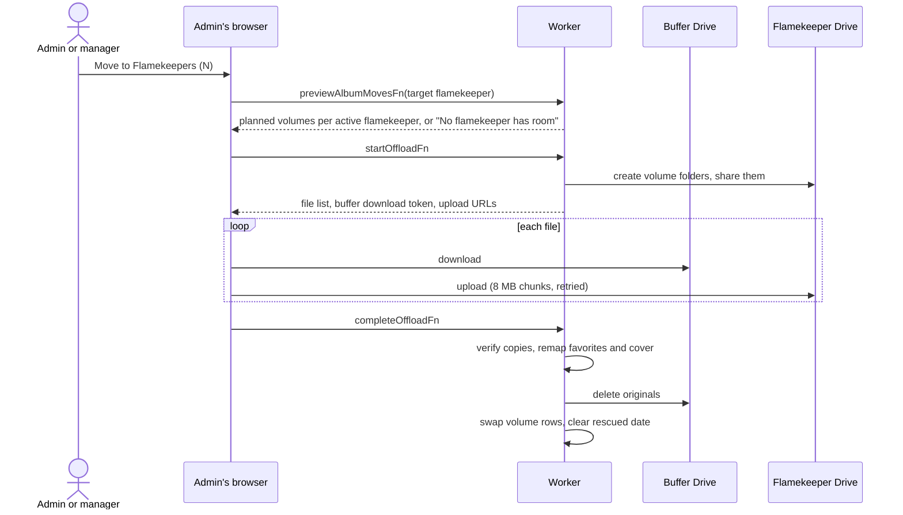
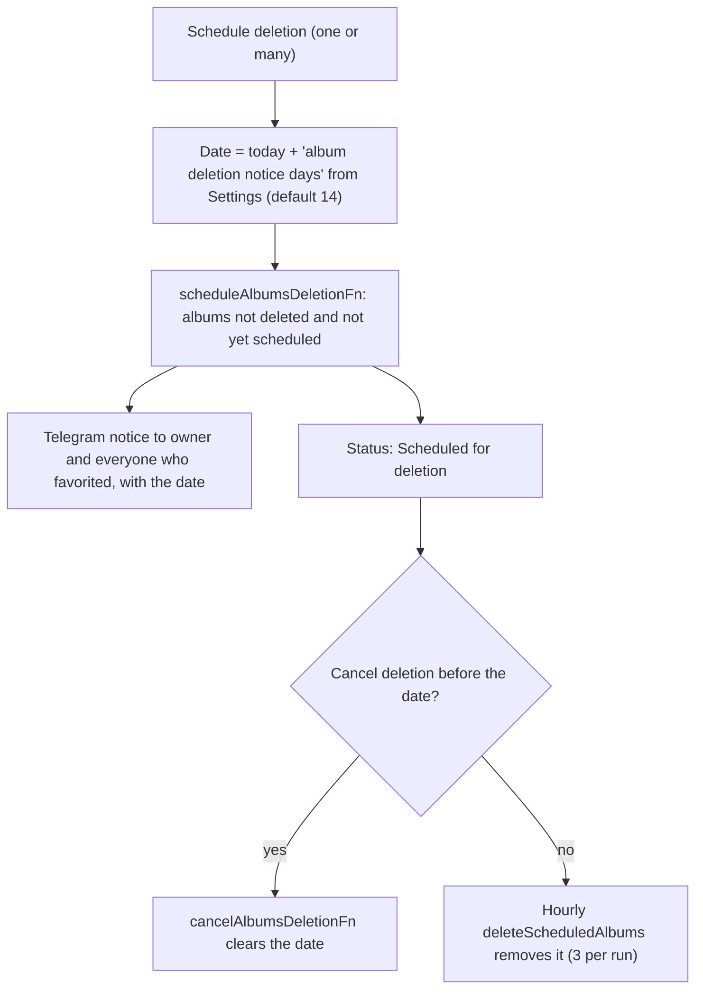

# Albums: move storage and schedule deletion

Actions on one album (detail page) or on ticked rows (table, up to 200). They run through `previewAlbumMovesFn`, which sets what can move before anything is touched. A volume holds at most 256 MB, so an album can span several volumes ([ADR-0019](../../../adr/0019-256mb-volumes-several-per-holder.md)).

## How does Move to Buffer work?

- Runs on the server within a request budget; an album that does not finish is reported and can be retried.
- Fails with "The buffer is full" when the buffer lacks room.

## How does Move to Flamekeepers work?

- Only albums held by the buffer move. The button shows only when `VITE_ENABLE_ALBUM_OFFLOAD=true`.
- The admin keeps the browser open. Progress is kept for 6 hours in KV (`album:offload:{id}`), so a stopped move can be restarted and skips files already uploaded. Photos get new Drive file IDs ([Relay](../../../../GLOSSARY.md)).
- Destinations are Active flamekeepers with a Drive grant, within their pledge and the pool cap ([flamekeepers](../flamekeepers/)).

## How do admins schedule an album for deletion?

- Already scheduled albums are skipped. Users without a linked Telegram chat get no notice.
- Deleting itself follows the normal album removal, see [cron](../../cron/). There is no automatic expiry any more; every deletion starts here.
