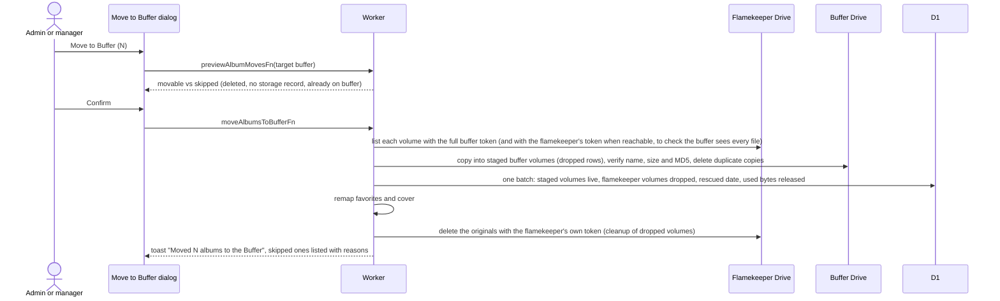
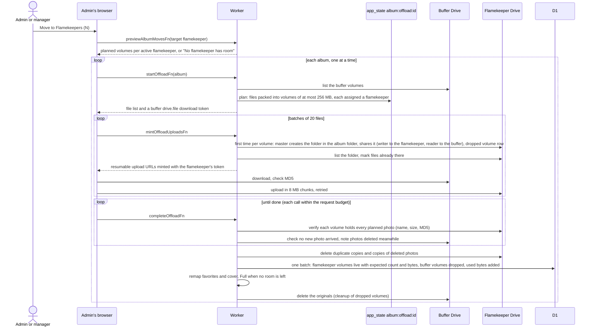
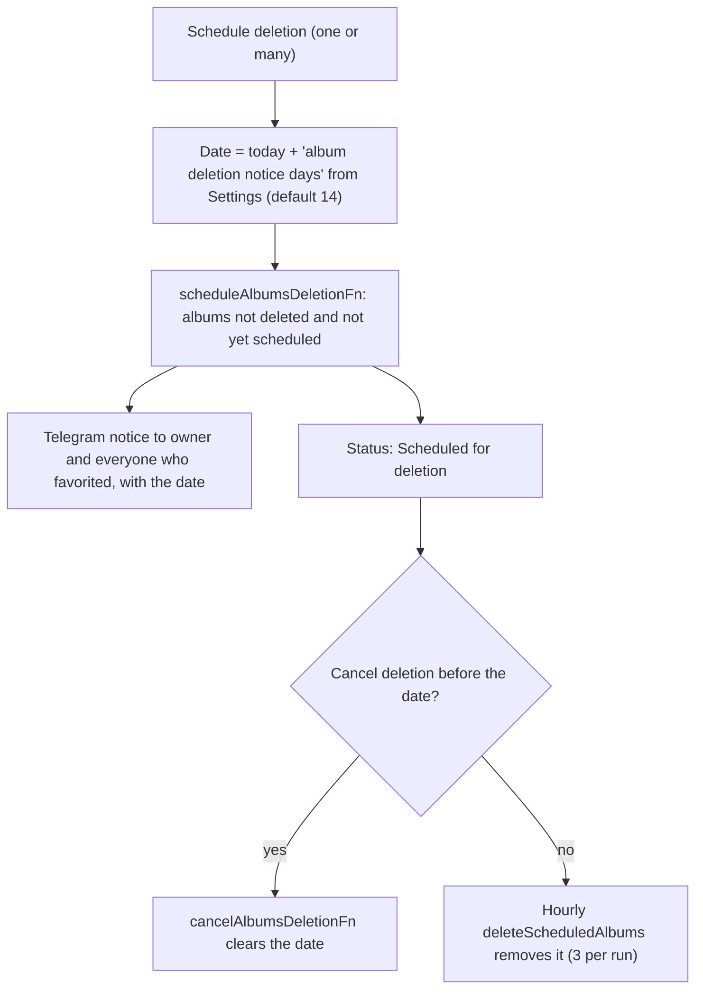

# Albums: move storage and schedule deletion

Actions on one album (detail page) or on ticked rows (table, up to 200). They run through `previewAlbumMovesFn`, which sets what can move before anything is touched. A volume holds at most 256 MB, so an album can span several volumes ([ADR-0019](../../../adr/0019-256mb-volumes-several-per-holder.md)).

## How does Move to Buffer work?

- Shown on one album only when flamekeepers hold it; the bulk button is always there and the preview skips what does not apply.
- Runs on the server within a request budget. An album that does not finish says so; running it again continues from the copies already made (an `app_state` marker `album:rescue:{id}` keeps them from being cleaned up meanwhile, [album-offload](../../state/album-offload.md)).
- A lost flamekeeper's photos can still be copied, since the volume folder is shared with the buffer. Their originals stay in their Drive until they reconnect, then the cleanup deletes them.
- Fails with "The buffer is full" when the buffer lacks room, and refuses when the buffer cannot read a volume folder.

## How does Move to Flamekeepers work?

- Shown on one album only when the buffer holds it. Destinations are Active flamekeepers with a Drive grant, within their pledge and the per-account cap ([flamekeepers](../flamekeepers/)).
- The admin keeps the browser open; closing the tab is warned. Cancel stops after the current file. Retry unfinished, within 6 hours, reuses the plan and skips files already uploaded; photos deleted meanwhile are dropped from the plan. A plan that no longer fits (new photos, a flamekeeper gone or full) is replaced, and the old partial copies are removed by the hourly cleanup.
- Uploads to the album are refused while the move runs and after it, as an album is held by the buffer or by flamekeepers, never both ([ADR-0019](../../../adr/0019-256mb-volumes-several-per-holder.md)). Move it back to the buffer to add photos.
- Photos get new Drive file IDs ([Relay](../../../../GLOSSARY.md)). They stay public: the volume folders sit in the album folder, which anyone can read ([ADR-0005](../../../adr/0005-album-drive-folders-are-always-public.md)).
- The buffer download token is the buffer's `drive.file` access token and is refreshed when it expires mid-move.

## How do admins schedule an album for deletion?

- Already scheduled albums are skipped. Users without a linked Telegram chat get no notice.
- Deleting itself follows the normal album removal, see [cron](../../cron/). There is no automatic expiry any more; every deletion starts here.
