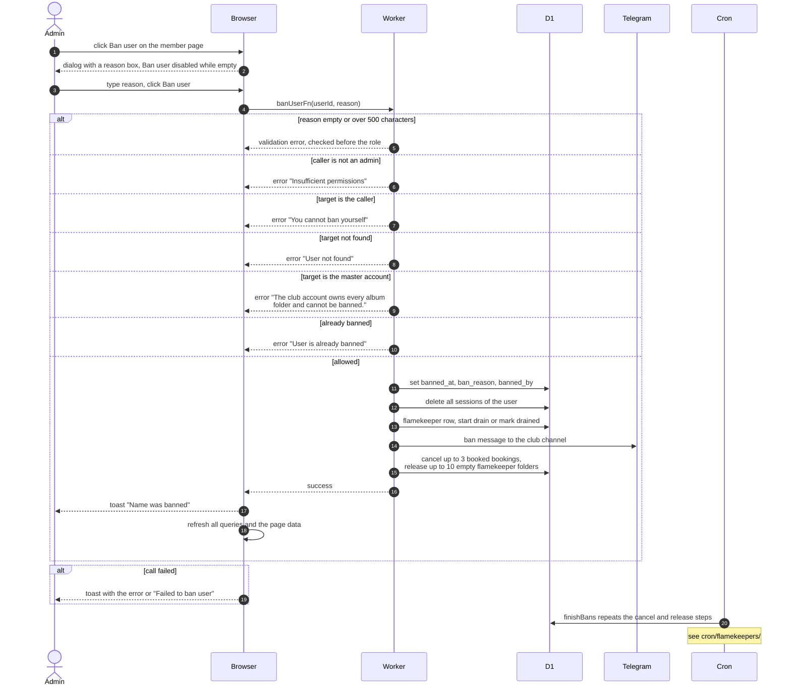

# Ban A Member

> **Question:** What happens when an admin bans a member?
>
> **Answer:** The admin opens the member's page, presses Ban user, types a reason of up to 500 characters and confirms. The person is signed out at once and cannot sign in again. Their upcoming (booked) bookings are cancelled, their empty album folders are released and any photos they keep as a flamekeeper start moving to others. The club channel gets a ban message. The admin sees the toast "Name was banned". Bookings that are already active, overdue or partly returned stay, so the return is still tracked.
>
> **Notes:**
> - Admin only. A manager does not see the Ban section. An admin does not see the Ban button on their own page, and the club's master account cannot be banned.
> - The Ban user button is disabled while the reason is blank and the box stops at 500 characters. The server checks the reason before it checks the caller's role, so a blank or too long reason is refused first with a validation error.
> - The follow-up work runs right away but only in small amounts: 3 booked bookings and 10 flamekeeper album folders per run, counted across all banned people. If it fails or there is more, the hourly cron continues, see [../cron/flamekeepers/ban-cleanup.md](../cron/flamekeepers/ban-cleanup.md).
> - Releasing a folder means deleting the person's flamekeeper folder inside the album with the master Drive token. Only folders that hold no photos and no pending upload are released.
> - Each cancelled booking also gets a line in the club channel with the reason "Account banned".
> - A flamekeeper with photos is put into a 14-day drain with reason ban, and one without photos is marked drained at once. A drain already running for another reason keeps its earlier deadline. Moving the photos is described in [../cron/flamekeepers/drain-deadline.md](../cron/flamekeepers/drain-deadline.md) and [../flamekeepers/relay-move-photo.md](../flamekeepers/relay-move-photo.md).
> - Banned people who try to sign in are sent to /login with an error "banned". That side is in [../account/sign-in.md](../account/sign-in.md).
> - The channel message is skipped quietly if channel logging is off.
> - Lifting a ban is in [unban-member.md](unban-member.md).

