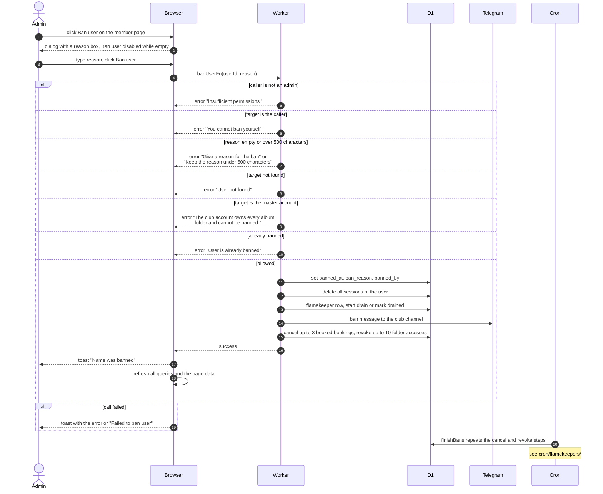

# Ban A Member

> **Question:** What happens when an admin bans a member?
>
> **Answer:** The admin opens the member's page, presses Ban user, types a reason of up to 500 characters and confirms. The person is signed out at once and cannot sign in again. Their upcoming bookings are cancelled, their access to album folders is removed and any photos they keep as a flamekeeper start moving to others. The club channel gets a ban message. The admin sees the toast "Name was banned". Bookings that are already active or overdue stay so the return is still tracked.
>
> **Notes:**
> - Admin only. A manager does not see the Ban section. An admin cannot ban themselves, and the club's master account cannot be banned.
> - The follow-up work (cancelling bookings and removing folder access) is run right away, but only a small amount per run: 3 upcoming bookings and 10 folder accesses. If it fails or there is more, the 5-minute cron picks it up, see [../cron/flamekeepers/](../cron/flamekeepers/).
> - A flamekeeper with photos is put into a 14-day drain with reason ban, and one without photos is marked drained at once. A drain already running for another reason keeps its earlier deadline. Moving the photos is described in [../flamekeepers/](../flamekeepers/).
> - Banned people who try to sign in are sent to /login with an error "banned". That side is in [../account/](../account/).
> - The channel message is skipped quietly if channel logging is off.
> - Lifting a ban is in [unban-member.md](unban-member.md).

