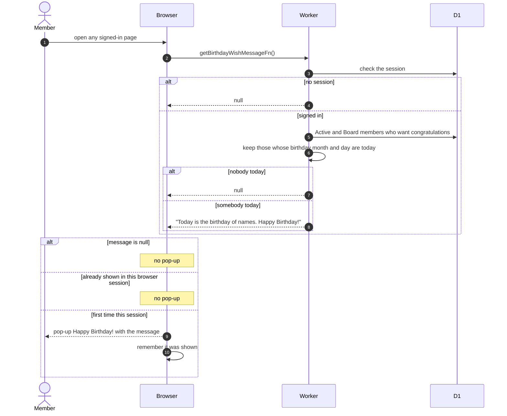

# Birthday Wish Pop-up

> **Question:** When do members see a Happy Birthday pop-up, and who is named in it?
>
> **Answer:** Every signed-in member sees a Happy Birthday pop-up once per browser session when at least one Active or Board member has a birthday today and has agreed to be congratulated. It names all of today's birthday people: "Today is the birthday of A, B. Happy Birthday!". If nobody qualifies, nothing appears.
>
> **Notes:**
> - This is the one function in this folder that is not limited to admins and managers. Every signed-in member needs it, so it only requires a session. Without a session it returns nothing.
> - The result is kept for the whole visit and not asked again, and is stored per user so two people sharing a browser do not see each other's result.
> - The once-per-session flag is kept in the browser's session storage. If that is unavailable the pop-up can show again.
> - The pop-up is a dialog on desktop and a drawer on mobile.
> - Today means the server's date, not the member's local date.

