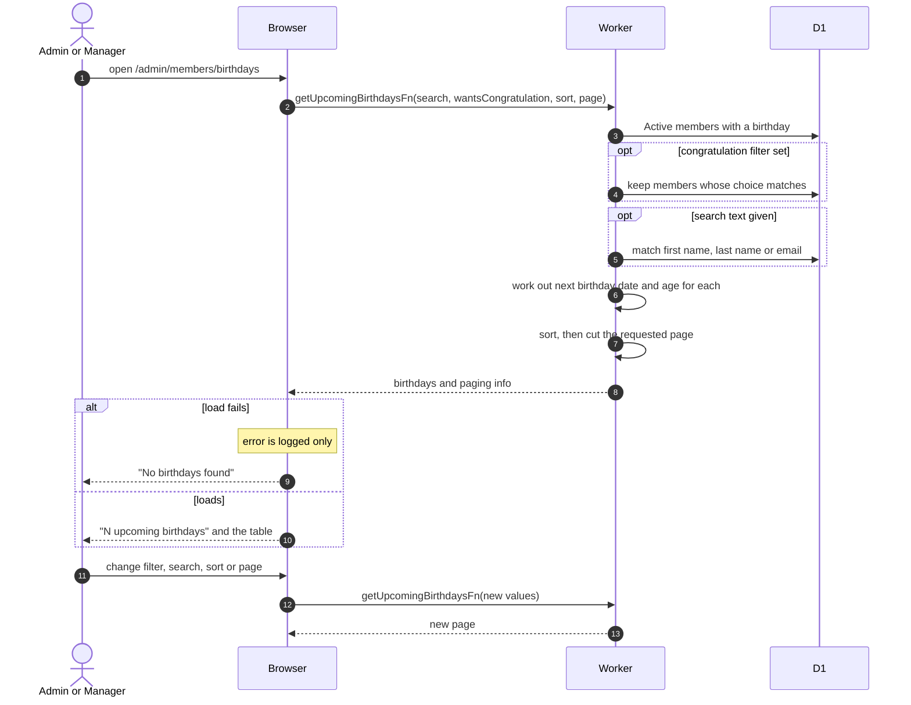

# Upcoming Birthdays List

> **Question:** How does an admin or manager see whose birthday is coming up?
>
> **Answer:** The Birthdays tab (/admin/members/birthdays) lists every Active member with a birthday on file, with the date of their next birthday and the age they turn. It can be searched by name or email, filtered by the Congratulate column (yes or no), sorted and paged, 50 rows per page. By default the nearest birthday comes first, and dates wrap around the end of the year.
>
> **Notes:**
> - Only the Active status counts, so Inactive and Alumni members are left out. A member whose stored birthday does not contain a full year-month-day date is left out.
> - Today's birthday counts as upcoming and shows today's date.
> - The age is the year of the next birthday minus the birth year.
> - Sorting and paging happen after the dates are worked out, because the next-birthday date is not stored.
> - Copying the list to the shared calendar is in [sync-birthdays.md](sync-birthdays.md). The message members see on the day is in [birthday-wish.md](birthday-wish.md).

