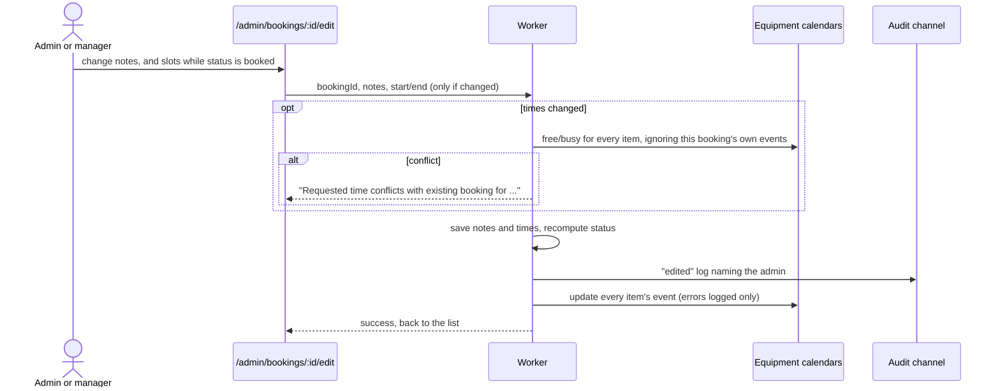
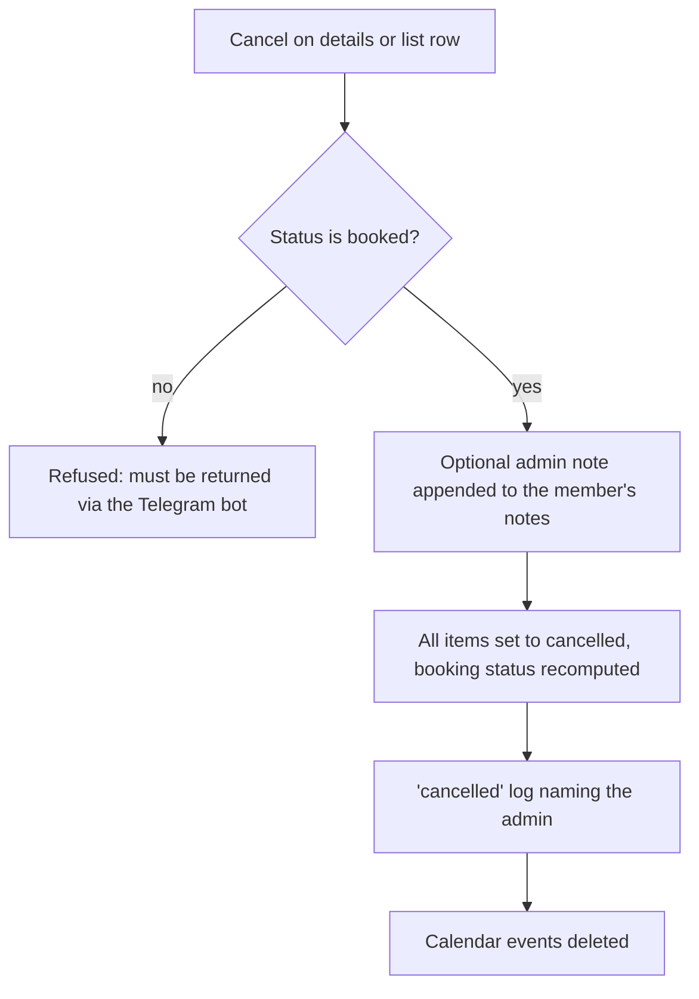

# Edit and cancel a booking (admin)

Both go through `updateBookingStatusAdminFn`. Unlike members, admins have no advance-notice, 48-hour, 60-day or operating-hours limits.

## How does an admin edit a booking?

- On the same page the admin can add equipment or cancel a single item, only while the booking is `booked`.
- Notes replace the old notes; blank clears them.

## How does an admin cancel a booking?

- Calendar and log failures are logged and do not undo the cancellation.
- Any other target status is rejected.
