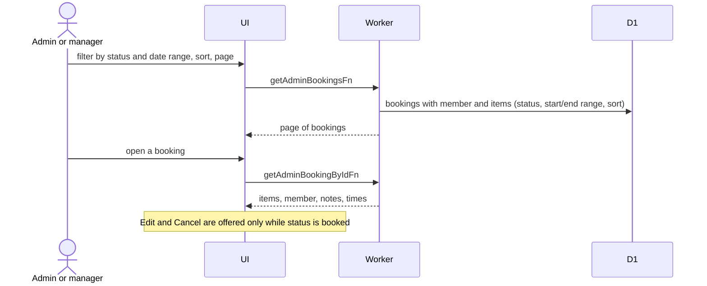

# Bookings: list and details

Manage Bookings (`/admin/bookings`) lists every member's bookings. Statuses are derived ([Derived status](../../../../GLOSSARY.md)), so admins never set them directly.

## How do admins browse and open bookings?

- Status filter uses booking statuses; date filters compare the booking's start and end.
- The details page is the shared booking view plus "booked by". Members' own view is in [member bookings](../../member/bookings/).
- Only `booked` bookings can change. Active, overdue and partly returned ones are returned through the Telegram bot ([ADR-0004](../../../adr/0004-returns-are-telegram-only.md)).
