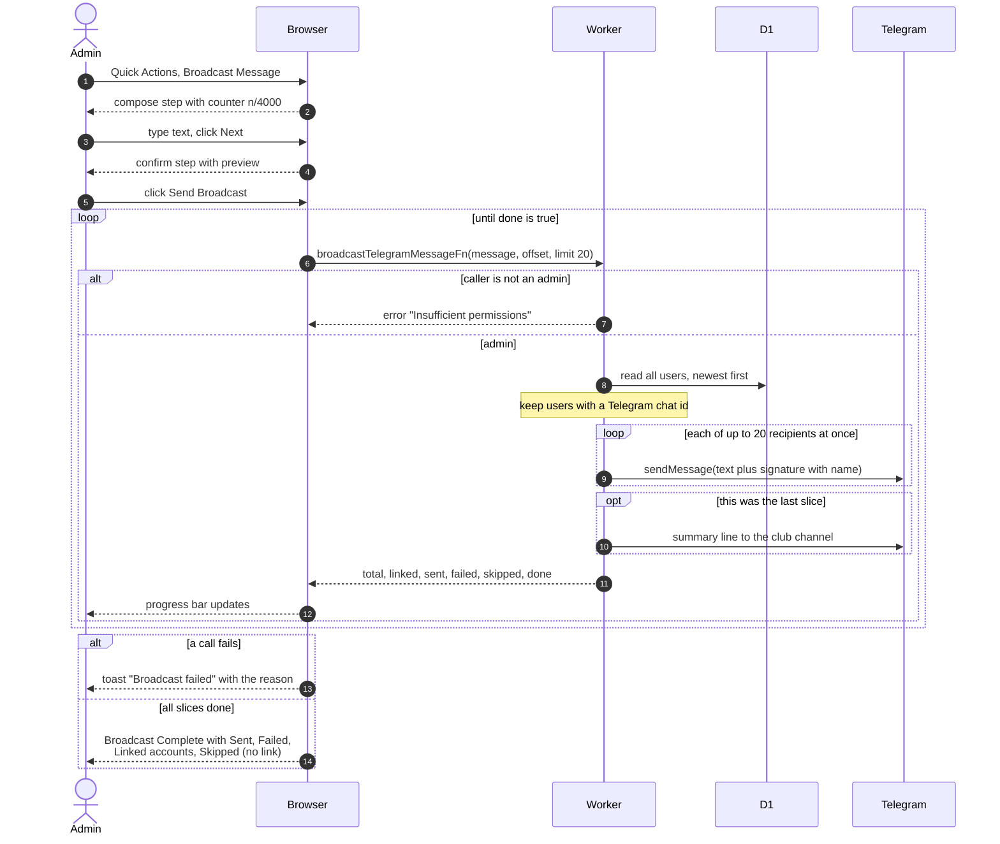

# Broadcast A Telegram Message

> **Question:** How does an admin send one announcement to every member on Telegram?
>
> **Answer:** The admin opens Broadcast Message from the dashboard Quick Actions menu, writes up to 4000 characters, reviews a preview and presses Send Broadcast. The browser sends the message in slices of 20 recipients, one server call per slice, and shows a progress bar. Each person gets the text with a signature line carrying their own name. At the end a summary shows how many were sent, failed, linked and skipped. People without a linked Telegram chat are skipped.
>
> **Notes:**
> - Admin only. The menu item is hidden for managers and the server refuses them.
> - The slicing keeps each call within Telegram's rate limits and the Worker's request limit. The browser, not the server, drives the loop.
> - A failed send to one person does not stop the slice. It is counted as failed and not retried.
> - If a whole call fails, the progress stops, a toast "Broadcast failed" appears and the dialog returns to the confirm step. Pressing Send again starts from the first person again, so people reached earlier are messaged twice.
> - When the last slice is done, one line "Broadcast sent to N user(s), M failed." goes to the club channel if a channel is configured. A failure to post it is only logged.
> - If nobody has a linked chat, the first call returns at once with zero sent and the summary shows all as skipped.
> - The recipient order is newest account first, and stays stable between calls.

