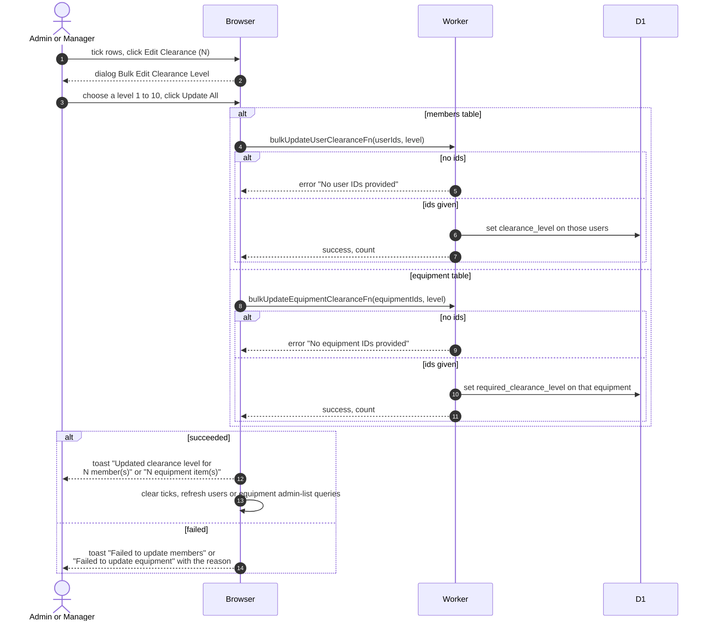

# Bulk Edit Clearance Level

> **Question:** How does an admin or manager set the clearance level for many members, or many pieces of equipment, in one go?
>
> **Answer:** The person ticks rows in the Members table or the Equipment table, presses Edit Clearance with the count, picks a level from 1 to 10 and presses Update All. The server sets that level on every ticked row. A toast says how many rows were updated, the ticks are cleared and the list reloads. For members the level is the clearance they hold. For equipment it is the clearance a member needs to book it.
>
> **Notes:**
>
> - Both tables share one dialog, titled Bulk Edit Clearance Level.
> - Ids that do not exist are silently ignored, and the count in the toast is the number of ticked rows.
> - The level starts unset, and the form blocks the submit until one from 1 to 10 is chosen.
> - An empty list of ids is refused with "No user IDs provided" or "No equipment IDs provided". The Edit Clearance button appears only once at least one row is ticked.
> - Only rows on the current page can be ticked. The ticks are remembered by row position, not by person, so after changing page the same positions can still be ticked and would then name different people. Look at the count on the Edit Clearance button before confirming.
> - Clearance gates which equipment a member sees and can book, see [../equipment/load-equipment-page.md](../equipment/load-equipment-page.md).

