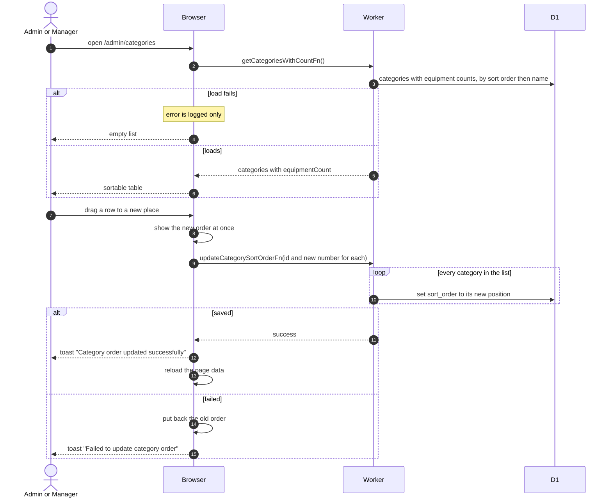

# Equipment Categories List And Order

> **Question:** How do admins and managers see the equipment categories and change their order?
>
> **Answer:** Category Management lists every category with its description and how many pieces of equipment it holds, ordered by its sort number and then its name. Dragging a row to a new place renumbers all categories from 0 in the new order and saves them in one call. A toast says "Category order updated successfully". If saving fails the list jumps back to the old order and a toast says "Failed to update category order".
>
> **Notes:**
> - If the list cannot be loaded the page shows an empty list. The error is only logged.
> - The renumbering writes one row at a time, so a failure part way can leave some categories renumbered and the screen reverts to the old order until the page is reloaded.
> - Creating, editing and deleting a category are in [create-edit-category.md](create-edit-category.md) and [delete-category.md](delete-category.md).
> - The order set here is the order shown in the equipment filters and forms, see [../equipment/](../equipment/).

