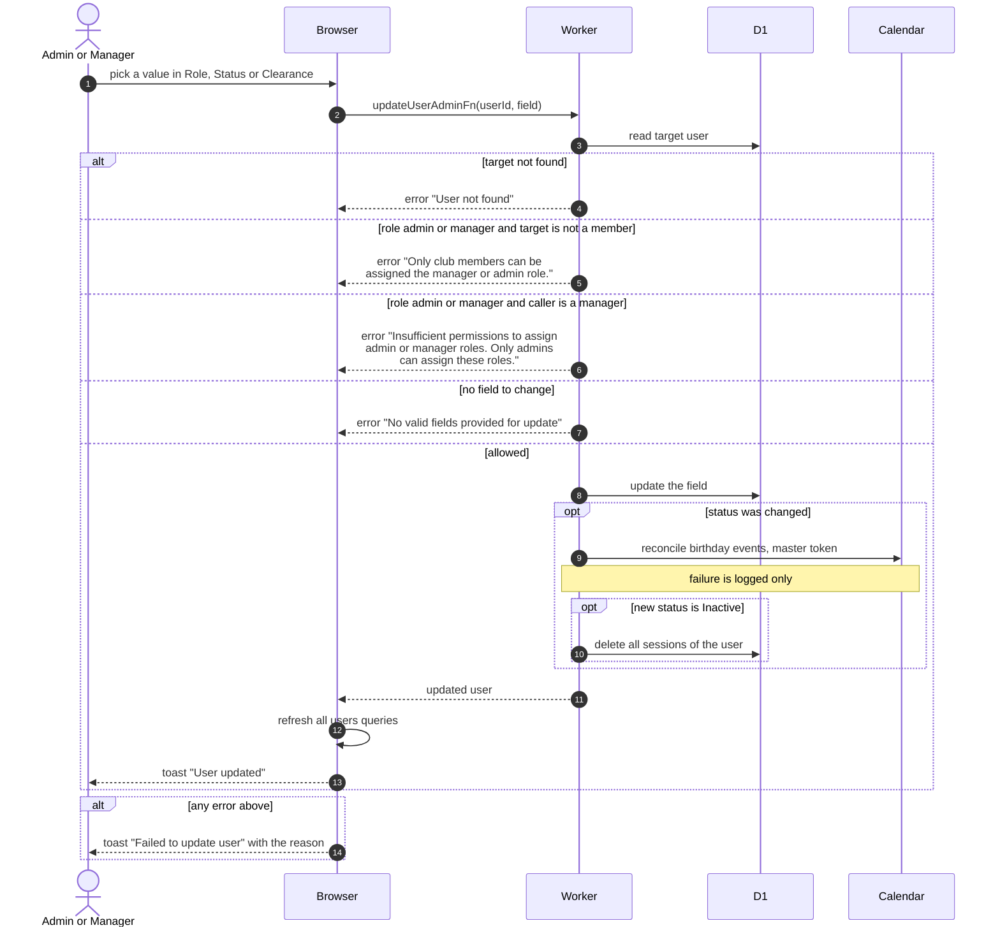

# Change A Member's Role, Status Or Clearance

> **Question:** What happens when an admin or manager changes a member's role, status or clearance level in the Members table?
>
> **Answer:** Each dropdown saves as soon as a value is picked. The server updates that one field and the table reloads with a toast "User updated". Making someone a manager or admin is allowed only for an admin, and only for a club member. Setting the status to Inactive also signs the person out everywhere. Any status change also refreshes the birthdays calendar.
>
> **Notes:**
> - The Manager and Admin options are greyed out for managers. The server refuses the same change if it is sent by hand, see [who-can-do-what.md](who-can-do-what.md).
> - Only the fields sent are changed. A call with nothing to change is refused with "No valid fields provided for update".
> - Birthdays use only the Active and Board statuses, so a status change can add or remove the member's birthday event. A failure of that sync is logged and does not undo the change, see [sync-birthdays.md](sync-birthdays.md).
> - A person set to Inactive is also refused at the next sign-in. The sign-in side is in [../account/sign-in.md](../account/sign-in.md).
> - First name and last name can also be changed by this function, but this table does not offer them.
> - The clearance dropdown offers levels 1 to 10. A manager can also set a role back to User, even for an admin.

