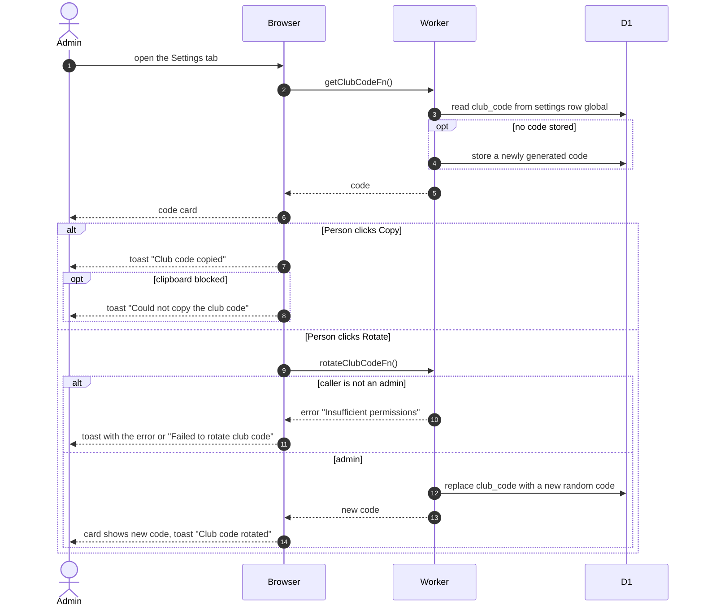

# Club Code

> **Question:** How does an admin see, copy and replace the club code that new members enter at signup?
>
> **Answer:** Admins see the current code on the dashboard Settings tab, can copy it, and can rotate it. Rotating makes a new random code of two groups of four letters and digits, such as ABCD-2345, and the old code stops working for new signups at once. Existing members are not affected. If no code exists yet, simply opening the tab creates one.
>
> **Notes:**
> - Managers do not see the club code card, and the server refuses them.
> - The alphabet leaves out look-alike characters (0, 1, I, O). The code is compared without regard to capital letters or surrounding spaces when a new member types it, see [../account/](../account/).
> - There is one code for the whole club, kept in the shared settings row. Rotating does not tell anyone.

