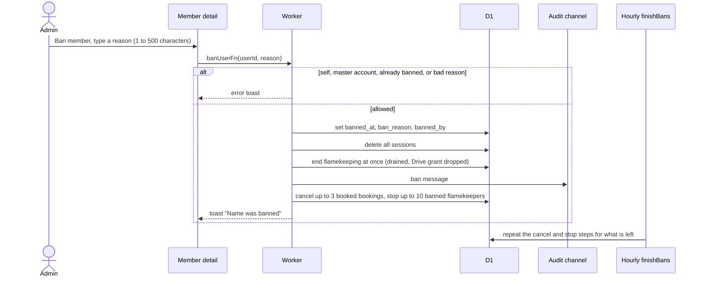
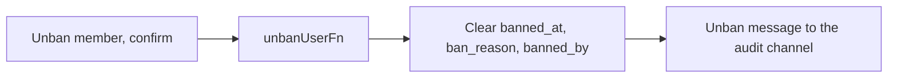

# Ban and unban

Admin only. Managers never see the Ban button; admins do not see it on their own page. The club master account cannot be banned. Terms: [Banned user](../../../../GLOSSARY.md).

## What happens when an admin bans a member?

- Only `booked` bookings are cancelled (each logged as "Account banned"). Active, overdue and partly returned bookings stay so the return is tracked.
- A banned person is sent back to `/login` with a "banned" error and cannot sign up again with that Google account.
- Nothing is held on flamekeepers, so there is no drain or photo move.

## What does unbanning do?

- Cancelled bookings stay cancelled, sessions are not restored and flamekeeping is not restarted; the person reconnects Drive themselves.
- Banning many flamekeepers at once is on the [flamekeepers page](../flamekeepers/).
